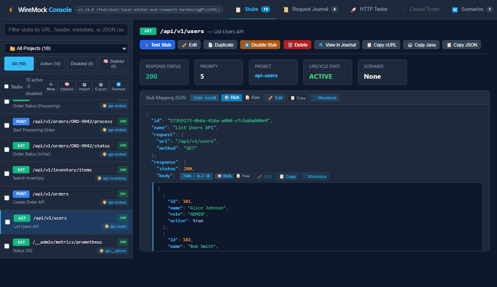
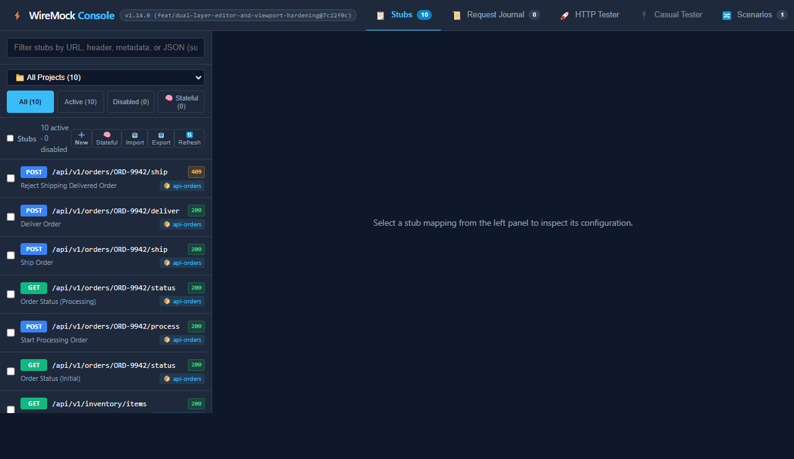

# WireMock Extensions Suite

> ### 🎯 Core Mission & Progressive Simulation Value Proposition
>
> **Empower teams testing complex distributed systems** (combining modern HTTP REST, legacy Casual/Tuxedo RPCs, raw TCP, and async messaging) to run the **exact same integration suite** across three progressive fidelity stages: **fully live**, **hybrid**, and **100% offline simulation**—with zero test code changes.
>
> ```mermaid
> flowchart LR
>     A["Stage 1: Live WireMock Proxy<br/>(HTTP REST + Casual XATMI / 2PC)"] -->|"1-Click Session Snapshot"| B["Stage 2: Hybrid & Offline Simulation<br/>(Zero Upstream Dependencies, Native Stubs + Scenarios)"]
>     B -->|"Deterministic Codegen + AI Synthesis"| C["Stage 3: Domain Simulation SDK<br/>(Type-Safe Java 21 Records, Builders & Replayable Scenarios)"]
> ```

A collection of lightweight, production-grade extensions for [WireMock](https://wiremock.org/) and WireMock Standalone.

> 🌐 **Documentation & Interactive Demo**: Visit [https://mattiasgreen.github.io/wiremock-extensions/](https://mattiasgreen.github.io/wiremock-extensions/) for our product landing page, interactive live console sandbox, and technical docs.
>
> 📹 **Video Tour**: Watch the [Progressive Simulation Walkthrough](https://github.com/mattiasgreen/wiremock-extensions/releases/latest/download/banking-progressive-simulation-tour.webm) (HTTP REST + Casual 2PC offline transition).

Each extension is **modular and standalone**: you can pick and choose only the extensions you need, or use the all-in-one bundle to include everything.

## Modules

| Module | Description | Documentation |
| :--- | :--- | :--- |
| **`wiremock-extension-json-logging`** | Single-line structured JSON logging for standard/verbose mode with automatic MDC header extraction (`x_correlation_id`, `x_tenant_id`) and runtime Logback log level Admin API (`/__admin/logging/levels`, `LOG_LEVEL`). | [Module README](wiremock-extension-json-logging/README.md) |
| **`wiremock-extension-otel`** | In-process OpenTelemetry metrics recording (`wiremock_requests_total`, latency histogram) with a Prometheus scrape route (`/__admin/metrics/prometheus`). | [Module README](wiremock-extension-otel/README.md) |
| **`wiremock-extension-common`** | Shared traffic verdict classification, boolean query parsing, indexed journal lookup, and telemetry SPI contracts shared across WireMock extensions. | Root rules (`AGENTS.md`) |
| **`wiremock-extension-openapi`** | OpenAPI 3.0 / 3.1 specification parser and stub synthesizer with `POST /__admin/openapi/import` route and format-aware mock data generation. | [Module README](wiremock-extension-openapi/README.md) |
| **`wiremock-extension-tcp-netem`** | In-process Layer 4 TCP network emulator & fault injector (Toxiproxy re-implementation in Java 21 Virtual Threads) with dual-ingress architecture and zero blast-radius correlation-id scoping. | [Module README](wiremock-extension-tcp-netem/README.md) |
| **`wiremock-extension-casual`** | In-process Casual (XATMI / Tuxedo) Domain Gateway for simulating distributed transaction and legacy RPC architectures with transparent proxying and failure injection. | [Module README](wiremock-extension-casual/README.md) |
| **`wiremock-extension-async`** *(Beta)* | In-process Kafka Netty wire sink, AMQP/IBM MQ queue bridge, synthetic journal mediation, and HTTP async triggers. | [Module README](wiremock-extension-async/README.md) |
| **`wiremock-extension-journal`** *(Beta)* | High-density memory-bounded request journal powered by adaptive Zstandard dictionary compression, dynamic structural clustering, and JVM headroom anti-OOM guard. | [Module README](wiremock-extension-journal/README.md) |
| **`wiremock-extension-ui`** | Embedded WireMock Console web UI at `/__admin/ui/` with stub explorer, Unified Document Workspace, OpenAPI importer, scenario DAG visualizer, request journal with caller source resolution, async queue explorer, Multi-Protocol Tester, and headless `WireMockConsoleProxy` (zero external dependencies). | [Module README](wiremock-extension-ui/README.md) |
| **`wiremock-extension-bundle`** | Umbrella module aggregating all extensions into a single JAR with unified SPI auto-discovery, standalone fat-JARs (`fatJar` / `fatJarIbmMq`), and a local dev runner. | [Module README](wiremock-extension-bundle/README.md) |
| **`wiremock-cli`** | Zero-compile JDK 21 JEP 330 terminal CLI (`wm`) for capability probing, boolean stub search, live journal tailing (`src:`/`ip:`/`host:`), NetEm toxic inspection, and launching `WireMockConsoleProxy`. | [Module README](wiremock-cli/README.md) |
| **`wiremock-examples`** | Complete Case Management System reference implementation demonstrating isolated native scenario modeling (`CaseLifecycle-<caseId>`), parallel case collision pitfalls, and Playwright verification. | [Examples Subproject](wiremock-examples/README.md) |

## Quick Preview

| Overview Tour | OpenAPI Spec Import & Testing |
| :--- | :--- |
|  |  |

### 🎥 End-to-End Progressive Simulation Tour (WebM)

Watch how a multi-protocol enterprise system (combining HTTP REST and binary Casual XATMI 2PC distributed transactions) transitions from live upstream proxy recording to 100% offline stub playback in seconds:

> 📹 **[Watch / Download Progressive Simulation Tour Video (WebM)](https://github.com/mattiasgreen/wiremock-extensions/releases/latest/download/banking-progressive-simulation-tour.webm)** *(Hosted on GitHub Releases, zero git bloat)*
>
> 1. **Live Proxy Recording**: SUT interacts with live Case Management, CRM, and Casual 2PC billing services while WireMock records every call into the unified journal.
> 2. **1-Click Harvest & Park**: Harvest captured sessions into deterministic stubs (`#btn-journal-snapshot-filtered`), enable recorded stubs, and park proxy routes via priority tiers.
> 3. **100% Offline Replay**: Terminate upstream backend services completely; the exact same customer journey replays with 100% fidelity and local 2PC transaction synthesis.

## Building

Prerequisites: Java 21+ and Gradle (wrapper included).

```bash
# Build all modules and run all tests
./gradlew build

# Build a specific extension module
./gradlew :wiremock-extension-json-logging:build
./gradlew :wiremock-extension-otel:build
./gradlew :wiremock-extension-openapi:build
./gradlew :wiremock-extension-ui:build
./gradlew :wiremock-extension-bundle:build

# Build the all-in-one standalone executable fat-jar
./gradlew fatJar

# Run all tests across the suite
./gradlew test
```

### Java 21 Toolchain Configuration

The build enforces a JDK 21 toolchain. If Gradle fails to locate a matching Java 21 installation on your machine:

- **Option 1 — Inspect Detected Toolchains**: Check which JDKs Gradle currently sees on your system:
  ```bash
  ./gradlew -q javaToolchains
  ```
- **Option 2 — Specify Existing JDK 21 Path**: If Java 21 is installed in a custom location, tell Gradle where to find it without changing global environment variables by adding `org.gradle.java.installations.paths` to your user-level `~/.gradle/gradle.properties`:
  ```properties
  org.gradle.java.installations.paths=C:/path/to/your/jdk-21,D:/another/jdk-21
  ```
  *(Use forward slashes `/`)*.

---

### Building Behind Corporate Firewalls / Private Mirrors

If your corporate environment restricts outbound traffic to `services.gradle.org` or public Maven Central:

#### 1. Initial Setup: Cache the Gradle Wrapper
> [!NOTE]
> Gradle Wrapper does not yet support dynamic runtime environment variables for `distributionUrl` ([gradle/gradle#27295](https://github.com/gradle/gradle/issues/27295)). This is scheduled for **Gradle 10.0**. Until then, use this one-time cache workflow:

1. **Temporarily point to your internal mirror**: In `gradle/wrapper/gradle-wrapper.properties`, set `distributionUrl` to your internal mirror:
   ```properties
   distributionUrl=https\://nexus.corp.internal/repository/gradle-distributions/gradle-9.4.1-bin.zip
   ```
2. **Download & cache the wrapper**:
   ```bash
   ./gradlew --version
   ```
3. **Revert back to clean Git state**:
   ```bash
   git restore gradle/wrapper/gradle-wrapper.properties
   ```
   Gradle is now cached locally in `~/.gradle/wrapper/dists/`. Subsequent `./gradlew` runs will use the cache without reaching out to external networks.

#### 2. Configure Internal Dependency Mirrors
To route dependency and plugin downloads to your internal mirror without modifying Git-tracked files, place an initialization script in your user home at `~/.gradle/init.d/corporate-mirror.gradle`:

```groovy
// ~/.gradle/init.d/corporate-mirror.gradle
def mavenURL  = "https://nexus.corp.internal/repository/maven-public/"
def pluginURL = "https://nexus.corp.internal/repository/gradle-plugins/"

def mirror = { repos, targetUrl ->
    repos.mavenLocal()
    repos.maven { url targetUrl }
    repos.all { repo ->
        if (repo instanceof MavenArtifactRepository) {
            if (repo.url.toString().contains("plugins.gradle.org")) repo.url = uri(pluginURL)
            if (repo.url.toString().contains("repo.maven.apache.org")) repo.url = uri(mavenURL)
        }
    }
}

beforeSettings { mirror(it.pluginManagement.repositories, pluginURL) }
allprojects {
    mirror(buildscript.repositories, pluginURL)
    mirror(repositories, mavenURL)
}
```

Now build normally:
```bash
./gradlew build
```


## Usage Options

### 1. All-in-One Bundle, Standalone Fat-JAR & Docker

For all extensions together with Java SPI auto-discovery:

**Gradle**:
```groovy
implementation 'io.github.mattiasgreen:wiremock-extension-bundle:1.14.0'
```

**Standalone Executable Fat-JAR**:
```bash
./gradlew fatJar # Lean standalone JAR (or ./gradlew fatJarIbmMq to bundle IBM MQ SVRCONN client)
java -jar wiremock-extension-bundle/build/libs/wiremock-extension-bundle-*-standalone.jar --port 8080
```

See [wiremock-extension-bundle/README.md](wiremock-extension-bundle/README.md) for full Maven/Gradle coordinates, WireMock CLI classpath launch, Docker image build/run commands, and zero-build consumer runner instructions.

All extensions auto-register via Java Service Provider Interface (SPI):
- Web UI: `http://localhost:8080/__admin/ui/`
- Prometheus Metrics: `http://localhost:8080/__admin/metrics/prometheus`
- OpenAPI Spec Importer: `http://localhost:8080/__admin/openapi/import`
- Casual Config API & TCP Gateway: `http://localhost:8080/__admin/casual/config` / `casual://127.0.0.1:7772`
- Async Status & Destinations: `http://localhost:8080/__admin/async/status`
- Compressed Journal Stats: `http://localhost:8080/__admin/journal/stats`
- Admin API: `http://localhost:8080/__admin/mappings`

### 2. Individual Extensions

Each extension can be used independently without pulling in the others:

- **JSON Logging Only**: `implementation 'io.github.mattiasgreen:wiremock-extension-json-logging:1.14.0'` — [README](wiremock-extension-json-logging/README.md)
- **OpenTelemetry & Prometheus Only**: `implementation 'io.github.mattiasgreen:wiremock-extension-otel:1.14.0'` — [README](wiremock-extension-otel/README.md)
- **OpenAPI Importer Only**: `implementation 'io.github.mattiasgreen:wiremock-extension-openapi:1.14.0'` — [README](wiremock-extension-openapi/README.md)
- **Web UI Only**: `implementation 'io.github.mattiasgreen:wiremock-extension-ui:1.14.0'` — [README](wiremock-extension-ui/README.md)
- **L4 TCP Network Emulation & Chaos Only**: `implementation 'io.github.mattiasgreen:wiremock-extension-tcp-netem:1.14.0'` — [README](wiremock-extension-tcp-netem/README.md)
- **Casual (XATMI / Tuxedo) Domain Gateway Only**: `implementation 'io.github.mattiasgreen:wiremock-extension-casual:1.14.0'` — [README](wiremock-extension-casual/README.md)
- **Async Messaging & Queue Bridge Only** *(Beta)*: `implementation 'io.github.mattiasgreen:wiremock-extension-async:1.14.0'` — [README](wiremock-extension-async/README.md)
- **Adaptive Zstandard Request Journal Only** *(Beta)*: `implementation 'io.github.mattiasgreen:wiremock-extension-journal:1.14.0'` — [README](wiremock-extension-journal/README.md)

  #### Dual-Ingress Architecture & Port Separation
  `tcp-netem` implements an in-process Dual-Ingress pattern using Java 21 Virtual Threads:
  * **WireMock Core (Port `8080`)**: Admin API (`/__admin/...`), Web UI, Prometheus metrics (`/__admin/metrics/prometheus`), and direct functional stubs.
  * **NetEm Ingress (Port `8081`)**: Transparent Layer 4 TCP proxy forwarding to `8080` while applying real-time network impairments (latency, bandwidth throttling, TCP resets, packet slicing, black holes).

  #### L4 NetEm vs. Built-in WireMock L7 Faults
  While WireMock provides HTTP-level delays (`withFixedDelay()`) and servlet faults (`Fault`), `tcp-netem` simulates true Layer 4 transport anomalies:
  * **True Bandwidth Throttling**: Streams packets at fixed byte rates (e.g. 64 KB/s) rather than holding the entire response in memory before sending.
  * **Hard TCP Reset (`ECONNRESET`)**: Abruptly resets the TCP connection via `setSoLinger(true, 0); socket.close();`, exercising client-side low-level socket reset handlers.
  * **TCP Frame Slicing**: Splits TCP segments into micro-chunks with inter-frame delays (`slicer`), triggering OS reassembly and MTU edge cases.
  * **Connection Black Hole**: Drops incoming/outgoing frames (`timeout`) to validate client connection and socket read timeouts.

  #### Zero Blast-Radius Parallel Testing
  Network impairments can be scoped to individual requests using header `X-Correlation-Id`:
  * A chaos test thread targeting `X-Correlation-Id: test-chaos-42` experiences latency or drops.
  * Concurrent functional tests running on the same WireMock instance without that header execute at line speed with 0% error cross-talk.
  * See the complete reference implementation in [`wiremock-examples`](wiremock-examples/src/test/java/com/github/mattiasgreen/wiremock/examples/NetEmResilienceParallelIntegrationTest.java) demonstrating parallel Resilience4j circuit breaker verification.

  #### Circular Event Journal & JVM Sizing
  NetEm tracks all transfers in a lock-free, circular event journal (`AtomicReferenceArray`):
  * **Memory Footprint**: Each compact event record is ~80–128 bytes. Sizing formula: $\text{Heap} = N_{\text{capacity}} \times 128 \text{ bytes}$.
  * **Default (50,000 entries)**: Consumes only ~6 MB of heap with zero allocation churn on wrap-around.
  * **Recommended JVM Options**: `-Xms512m -Xmx2g` for high-throughput enterprise mock clusters.

### 3. Deep Dive: In-Process Casual (XATMI / Tuxedo) Gateway & 2PC Simulation
`wiremock-extension-casual` embeds a Layer 7 Netty-based Casual domain gateway on raw TCP (Port `7772`), allowing enterprise integration suites to simulate distributed Tuxedo/XATMI RPCs and Two-Phase Commit (2PC) transactions without JEE containers or C++ domain brokers:

* **Stub-Driven Dynamic Proxying (`targetBaseUrl: casual://...`)**: Declare dynamic proxy routes in standard WireMock stubs (`metadata.mode = "proxy"`). Inbound Casual frames probe WireMock stubs in-memory with microsecond latency and zero HTTP loopback overhead, forwarding matching calls natively socket-to-socket over TCP.
* **Multi-Upstream 2PC / XA Stickiness**: Because 2PC frames (`PREPARE`, `COMMIT`, `ROLLBACK`) contain only an `Xid` without a `serviceName`, the gateway dynamically tracks client connections enlisted per `Xid` (`enlistedXidClients`), enabling coordinated distributed transactions across disparate remote domains under a single global XA coordinator.
* **Human-Readable Buffer Mediation**: Translates binary Fielded buffers (`.FIELDED` / `CFIELD/`) to and from structured JSON objects via `FieldedTypeBuffer`, automatically strips/restores `CSTRING/` null terminators, and records JSON text directly in the Request Journal for seamless observability.
* **Offline Replay & Synthetic XA Voting**: When upstream servers are severed, the gateway acts as a Synthetic XA Resource Manager (`XA_OK` voter) for recorded stubs, enabling complete offline test replay.

### 4. Local Development Runner & Port Configuration

To launch WireMock with all extensions and active Web UI for local testing (starts clean with no pre-populated stubs):

```bash
./gradlew :wiremock-extension-bundle:runStandalone
# Or specify a custom main WireMock port via standard program arguments:
./gradlew :wiremock-extension-bundle:runStandalone -Pargs="--port 9090"
```

The server starts on port `8080` (or the configured `--port`) with filesystem hot-reloading for UI development. Baseline sample stubs (including HTTP endpoints and Casual dynamic proxying) can be imported from [`wiremock-examples/example-stubs.json`](wiremock-examples/example-stubs.json), or import the standalone Casual proxy stub from [`wiremock-examples/casual-proxy-stub.json`](wiremock-examples/casual-proxy-stub.json).

#### Simplified Port Configuration Model
Extending WireMock Standalone, port configuration follows a clean separation of concerns:
* **Main WireMock HTTP Port**: Configured via standard CLI program arguments (`--port <port>`, e.g. `--port 8080`).
* **Extension Listener Ports**: Configured strictly via environment properties:
  * `WIREMOCK_NETEM_PORT`: Layer 4 TCP NetEm ingress port (default: `8081`).
  * `WIREMOCK_CASUAL_PORT`: Netty Casual (XATMI) domain gateway TCP port (default: `7772`).

### 5. Live Proxy, Traffic Recording & Console UI Walkthrough (Dual-Server Setup)

To test the complete OpenAPI Live Proxying, Traffic Snapshot Recording, Unified Document Workspace, and Multi-Protocol workflows:

1. **Start the simulated Upstream Mock Service** (Port `8089`):
   ```bash
   ./gradlew :wiremock-extension-bundle:runUpstream
   ```
2. **Start the Primary WireMock Server with Extensions & UI** (Port `8080`):
   ```bash
   ./gradlew :wiremock-extension-bundle:runStandalone
   ```
3. **Open the WireMock Console UI**:
   Navigate to [http://localhost:8080/__admin/ui/](http://localhost:8080/__admin/ui/).
4. **Import OpenAPI Specification in Live Proxy Mode**:
   - In the **Stubs** sidebar, click **📥 Import** and open the OpenAPI import flow.
   - Select **Live Proxy & Recording** mode, paste an OpenAPI spec containing an upstream path (e.g. `/api/v1/live-catalog`), set the Upstream Base URL to `http://localhost:8089`, and import.
5. **Live Test via Multi-Protocol Tester**:
   - Select the newly imported proxy stub (`[GET] /api/v1/live-catalog`) and click **⚡ Test** to load it into the **Multi-Protocol Tester** (supports HTTP, Kafka, AMQP, and Casual XATMI).
   - Click **Send Request**. The request is proxied through WireMock to the upstream service (`8089`) returning live upstream data.
6. **Inspect Caller Source & Snapshot Traffic in Request Journal**:
   - Switch to the **Request Journal** tab to view the `🌐 PROXIED` entry alongside its resolved **Source** column (short hostname + IP, filterable via `src:`, `ip:`, `host:` or by clicking a source chip).
   - Click **📸 Snapshot Filtered Proxied** (`#btn-journal-snapshot-filtered`) or **📸 Snapshot Stub** on an individual row to save captured responses as parked (`priority >= 100`) replay stubs.
7. **Inspect/Edit in Document Workspace & Go Offline**:
   - Return to the **Stubs** tab and filter by **Disabled** (parked `priority >= 100`) to inspect the captured stub. Click **✏️ Edit** to open it in the fullscreen **Unified Document Workspace** (`#modal-document-workspace`) for polyglot tree inspection and span-exact section editing.
   - Enable the recorded stub and park the proxy route via the Stubs sidebar (`#btn-toggle-stub` or bulk actions).
   - Terminate the upstream service (Ctrl+C on port `8089`) and re-send the request in the Multi-Protocol Tester: it is now served 100% offline (`📌 STUB`).
8. **Explore Async Queues & Topics**:
   - Open the **📬 Queues & Topics** tab to browse live Kafka/AMQP/Casual/In-Memory destinations, inspect polyglot message payloads in `#modal-document-workspace`, publish compensating messages, or purge queues.

## Shipped Simulator Stack Capabilities

All simulator stack extensions run in-process inside WireMock Standalone (sub-second startup, zero external sidecar containers):

* **🌪️ L4 TCP Network Chaos & Fault Injection (`wiremock-extension-tcp-netem`)**:
  * Native Java 21 Virtual Threads re-implementation of Toxiproxy with Dual-Ingress (`8081` → `8080`), all 7 toxics (`latency`, `bandwidth`, `slow_close`, `timeout`, `reset_peer`, `slicer`, `limit_data`), `X-Correlation-Id` / stream-pattern / IP-CIDR scoping, circular event journal, and Web UI presets. See [wiremock-extension-tcp-netem/README.md](wiremock-extension-tcp-netem/README.md).
* **🏛️ Casual (XATMI / Tuxedo) Domain Gateway & 2PC Simulation (`wiremock-extension-casual`)**:
  * In-process Netty TCP gateway (Port `7772`) with stub-driven dynamic proxying (`targetBaseUrl: casual://host:port`), multi-upstream 2PC XA transaction stickiness, schema-less Fielded (`.FIELDED`/`CFIELD/`) ↔ JSON buffer mediation, Casual Queue (`ENQUEUE`/`DEQUEUE`) mediation, and synthetic XA voting for offline replay. See [wiremock-extension-casual/README.md](wiremock-extension-casual/README.md).
* **📬 Asynchronous Messaging & Queue Mocking (`wiremock-extension-async`, Beta)**:
  * Unified single-module async engine supporting in-process Netty Kafka wire sink, AMQP 1.0 (`protonj2`), optional `compileOnly` IBM MQ (`SVRCONN` via `fatJarIbmMq`), HTTP-to-async triggers (`metadata.async.produce`), regex priority queue bridging (`"mode": "PROXY"`, `channelPattern`/`proxyChannel`/`proxyBroker`), synthetic `ServeEvent` journaling (`CONSUME /__async/<protocol>/<channel>`), and the Web Console **Queues & Topics** explorer. See [wiremock-extension-async/README.md](wiremock-extension-async/README.md).
* **🗜️ Adaptive Zstandard Request Journal (`wiremock-extension-journal`, Beta)**:
  * Memory-bounded `RequestJournalStore` (`CompressedStores`) with per-cluster Zstandard dictionary training, retroactive compaction, transient on-demand decompression, indexed search (`/__admin/journal/search`), and real-time JVM headroom anti-OOM FIFO pruning. See [wiremock-extension-journal/README.md](wiremock-extension-journal/README.md).
* **💻 Zero-Compile Terminal CLI & Console Proxy (`wiremock-cli`)**:
  * JDK 21 JEP 330 CLI (`./wiremock-cli/bin/wm`) for `wm info`, boolean `wm stubs`, live `wm tail` with caller `src:`/`ip:`/`host:` filtering, `wm toxics`, and `wm proxy` (launching `WireMockConsoleProxy` from `wiremock-extension-ui`). See [wiremock-cli/README.md](wiremock-cli/README.md).

## License

Apache License 2.0
