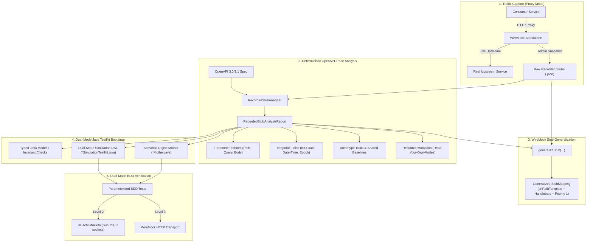

# Recorded Stubs to Dual-Mode TestKit Bootstrapping Guide

A comprehensive architectural and procedural guide on transforming brittle, raw recorded WireMock stubs into a type-safe, time-invariant, dual-mode Java TestKit powered by OpenAPI schema analysis and Object Mother factories.

---

## 1. Executive Summary & Core Motivation

In modern microservice architectures, consumers of upstream services (e.g., Billing, CRM, Payment Gateways) frequently face a painful dilemma when developing and testing client integrations:

```
┌────────────────────────────────────────────────────────┐
│           Top-Down (Producer-Provided SDK)             │
│  • High fidelity, typed builders & invariant checks     │
│  • Requires producer investment; rarely exists early   │
└───────────────────────────┬────────────────────────────┘
                            │
              VS            │ THE BRIDGE:
                            │ Deterministic OpenAPI Analysis +
                            │ Trace Correlation to Bootstrap
┌───────────────────────────┴────────────────────────────┐
│         Bottom-Up (Recorded Stubs from E2E Runs)       │
│  • Instant capture from real test environment traffic  │
│  • Brittle, identity-pinned, time-locked, rotting      │
└────────────────────────────────────────────────────────┘
```

### The Pitfalls of Raw Recorded Stubs
When developers record traffic during an end-to-end integration test run (e.g., proxied through WireMock), the resulting stub mappings suffer from four fatal failure modes:

1. **Identity Pinning**: URL matchers pin concrete IDs (`/api/crm/customers/CUST-42/kyc`). Testing any other customer ID (e.g., `CUST-777` or a dynamically generated ID) results in a `404 Not Found`.
2. **Temporal Brittle-Lock**: Query parameters and response payloads pin concrete calendar dates (e.g., `?asOf=2026-10-25` or `"onboardedDate": "2024-01-15"`). When business logic evaluates relative rules (e.g. *customer tenure > 2 years*), the test passes today but breaks permanently on future runs.
3. **Stateful Collision & Overwrite**: When multiple tests execute in parallel or mutate a resource (`POST` $\to$ `GET` $\to$ `PATCH` $\to$ `GET`), static JSON stubs either conflict or fail to model state progression (Read-Your-Own-Writes).
4. **Schema Rot & Invariant Blindness**: Hardcoded JSON fixtures cannot enforce domain invariants (e.g. *a Premier customer must have verified KYC status*). Invalid states slip into tests undetected, creating "echo chamber" mocks that drift away from upstream production behavior.

### The Solution: The Bootstrapping Bridge
Instead of treating recorded stubs as static test fixtures, we treat them as **seed data**. By correlating recorded HTTP traces against an **OpenAPI 3.0 / 3.1 specification**, deterministic algorithms synthesize:
1. **Generalized WireMock Stubs**: Parameterized with path templates, relaxed matchers, and Handlebars response templates (`{{request.path.x}}`, `{{jsonPath request.body '$.y'}}`).
2. **Typed Java Domain Models**: Enforcing provider invariants and nullability upon construction.
3. **Semantic Object Mother Factories**: Producing archetypes (e.g. `premierVipCustomer()`, `highRiskNewCustomer()`) with relative time offsets.
4. **Dual-Mode Simulation DSL**: Seamlessly executing both in-memory (Level 2 Mockito, sub-millisecond, zero sockets) and wire-boundary (Level 3 WireMock HTTP).

---

## 2. Architectural Pipeline & Data Flow



---

## 3. Step-by-Step Implementation Mechanics

### Step 1: Capture Traffic via Proxy Snapshot
1. Start WireMock Standalone as a reverse proxy targeting the upstream test environment:
   ```bash
   java -jar wiremock-standalone.jar --proxy-all="https://crm-test.corp.internal" --record-mappings
   ```
2. Execute 1 or 2 high-level end-to-end integration scenarios through the proxy.
3. Take a filtered snapshot via the Admin API route:
   ```http
   POST /__admin/stubs/snapshot-filtered
   Content-Type: application/json

   {
     "project": "crm-service",
     "onlyProxied": true,
     "activate": true
   }
   ```
4. This produces raw recorded stubs pinned to specific IDs and calendar dates.

---

### Step 2: Deterministic Trace Correlation (`RecordedStubAnalyzer`)
The analyzer matches each recorded stub to an OpenAPI operation by comparing concrete HTTP paths and methods against OpenAPI path templates:

```java
RecordedStubAnalyzer analyzer = new RecordedStubAnalyzer();
RecordedStubAnalysisReport report = analyzer.analyze(openApiSpecYaml, rawRecordedStubs);
```

#### A. Recursive Nested JSON Traversal (`walkJsonLeaves`)
Real-world enterprise APIs contain deeply nested structures, arrays, and sub-resources. Rather than inspecting only top-level fields, the analyzer traverses the payload recursively, generating standard RFC 6901 JSON Pointers:
- `/customerId`
- `/contactInfo/address/city`
- `/events/0/timestamp`
- `/paymentMethods/0/cardDetails/expiryDate`

#### B. Parameter Echo Detection (Path, Query, and Request Body)
When client input is reflected back into the response payload:
- **Path Parameter Echoes**: The path parameter `{customerId}` matches the response field `/customerId`.
- **Query Parameter Echoes**: `?asOf=2026-10-25` or `?page=1` matches response fields `/asOfDate` or `/page`.
- **Request Body Echoes**: A `POST` or `PUT` request payload leaf (e.g. `{"requestedBy": "officer-alice"}`) matches response field `/requestedBy`. The analyzer synthesizes JSONPath identifiers: `$.requestedBy`.

#### C. Deep Schema-Informed Temporal Resolution (`getSchemaForPointer`)
Detecting temporal fields via raw regex string matching fails on integer Unix timestamps or non-standard formats. The analyzer navigates the OpenAPI schema hierarchy following the JSON pointer tokens:
1. Traverses through `$ref` references, nested object properties, and `ArraySchema.getItems()`.
2. Inspects `DateSchema`, `DateTimeSchema`, and format declarations (`format: date`, `format: date-time`).
3. Recognizes 64-bit integer Unix epoch timestamps (`int64` / `integer` with names containing `epoch`, `timestamp`, or ending in `at`) as `epoch-seconds` (e.g. `expiresEpochSeconds: 1761553800`).

#### D. Archetype Trait Diffing
By grouping multiple recorded stubs under the same OpenAPI operation:
- **`sharedBaselineFields`**: Properties whose values remain identical across all recordings (e.g. `processedBy = "upstream-server-B"`). These form the default seed values for Object Mothers.
- **`distinguishingTraitFields`**: Properties that vary across recordings (e.g. `riskTier: [LOW, HIGH]`, `kycStatus: [VERIFIED, PENDING]`, `segment: [PREMIER, STANDARD]`). These form the parameter signatures and named factory variants.

#### E. Timeline Mutation & Read-Your-Own-Writes Detection (`detectResourceMutations`)
The analyzer inspects sequential requests to the same resource URL. If a `GET /api/crm/customers/CUST-42/kyc` returns `kycStatus: PENDING`, followed by a `PATCH /api/crm/customers/CUST-42/kyc`, followed by a subsequent `GET` returning `kycStatus: VERIFIED`:
- Flags `readYourOwnWritesDetected = true`.
- Identifies the mutating method (`PATCH`).
- Discovers the exact list of modified properties (`["/kycStatus", "/riskTier", "/segment"]`).

---

### Step 3: WireMock Stub Generalization (`generalizeStub`)
To prevent identity pinning and date locking, the analyzer transforms brittle stubs into portable mappings:

```java
StubMapping generalized = analyzer.generalizeStub(rawStub, opAnalysis);
generalized.setPriority(1); // Takes precedence over catch-all stubs
wireMock.addStubMapping(generalized);
```

- **Path Template**: Replaces `/api/crm/customers/CUST-42/kyc` with `WireMock.urlPathTemplate("/api/crm/customers/{customerId}/kyc")`.
- **Query Relaxation**: Relaxes query matchers to regex wildcards (`.*`) so dynamic dates or pagination params do not fail routing.
- **Handlebars Response Templating**:
  - Path echoes become: `"customerId": "{{request.path.customerId}}"`
  - Query echoes become: `"asOfDate": "{{request.query.asOf.[0]}}"`
  - Request body echoes become: `"requestedBy": "{{jsonPath request.body '$.requestedBy'}}"`
- **Response Transformer**: Enables `"response-template"`.
- **Header Preservation**: Preserves corporate multi-tenant headers (`X-Tenant-Id`, `X-Correlation-Id`, `Content-Type`) while stripping ephemeral session cookies.

---

### Step 4: Synthesizing the Typed Domain Model
Create an immutable Java class or record enforcing provider invariants upon build:

```java
@JsonDeserialize(builder = CustomerKycProfile.Builder.class)
@JsonIgnoreProperties(ignoreUnknown = true)
public final class CustomerKycProfile {
    private final String customerId;
    private final String fullName;
    private final KycStatus kycStatus;
    private final RiskTier riskTier;
    private final CustomerSegment segment;
    private final LocalDate onboardedDate;

    // Builder enforces invariants:
    public static final class Builder {
        public CustomerKycProfile build() {
            Objects.requireNonNull(customerId, "customerId is required");
            Objects.requireNonNull(kycStatus, "kycStatus is required");

            // Domain Invariant: Premier customers MUST have VERIFIED KYC status
            if (segment == CustomerSegment.PREMIER && kycStatus != KycStatus.VERIFIED) {
                throw new IllegalStateException(
                    "Provider invariant violation: PREMIER segment requires VERIFIED KYC");
            }
            return new CustomerKycProfile(this);
        }
    }
}
```

---

### Step 5: Synthesizing the Semantic Object Mother (`*Mother.java`)
Object Mothers encapsulate common archetypes using relative dates, completely eliminating temporal lock:

```java
public final class CrmCustomerMother {

    // Archetype 1: Premier VIP Customer
    public static CustomerKycProfile.Builder premierVipCustomer() {
        return CustomerKycProfile.builder()
                .customerId("CUST-VIP-" + UUID.randomUUID())
                .fullName("Eleanor Vance")
                .segment(CustomerSegment.PREMIER)
                .riskTier(RiskTier.LOW)
                .kycStatus(KycStatus.VERIFIED)
                // Relative time offset defeats temporal brittle-lock!
                .onboardedDate(LocalDate.now().minusYears(4))
                .processedBy("upstream-server-B"); // Seeded from sharedBaselineFields
    }

    // Archetype 2: High-Risk Pending Customer
    public static CustomerKycProfile.Builder highRiskNewCustomer() {
        return CustomerKycProfile.builder()
                .customerId("CUST-RISK-" + UUID.randomUUID())
                .fullName("Marcus Thorne")
                .segment(CustomerSegment.STANDARD)
                .riskTier(RiskTier.HIGH)
                .kycStatus(KycStatus.PENDING)
                .onboardedDate(LocalDate.now().minusDays(14))
                .processedBy("upstream-server-B");
    }
}
```

---

### Step 6: Synthesizing the Dual-Mode Simulation TestKit (`*SimulationTestKit.java`)
The simulation kit exposes identical fluent DSL methods that work across both Level 2 (Mockito) and Level 3 (WireMock HTTP):

```java
public abstract class CrmSimulationTestKit {

    public abstract void stubCustomerKyc(CustomerKycProfile profile);

    // Factory for Level 2 (In-JVM Mockito)
    public static CrmSimulationTestKit forMockito(CrmClient mockClient) {
        return new CrmSimulationTestKit() {
            @Override
            public void stubCustomerKyc(CustomerKycProfile profile) {
                Mockito.when(mockClient.getCustomerKyc(eq(profile.customerId()), any()))
                       .thenReturn(profile);
            }
        };
    }

    // Factory for Level 3 (WireMock HTTP Transport)
    public static CrmSimulationTestKit forWireMock(WireMockServer server) {
        return new CrmSimulationTestKit() {
            @Override
            public void stubCustomerKyc(CustomerKycProfile profile) {
                server.stubFor(
                    WireMock.get(WireMock.urlPathTemplate("/api/crm/customers/{customerId}/kyc"))
                        .withPathParam("customerId", WireMock.equalTo(profile.customerId()))
                        .willReturn(WireMock.okJson(toJson(profile)))
                );
            }
        };
    }
}
```

---

## 4. Architectural Considerations & Design Choices

| Dimension | Decision Made | Rationale & Alternatives Considered |
| :--- | :--- | :--- |
| **Deterministic Code vs LLM Deduction** | **100% Deterministic Java AST / Parser** | Path template matching, regex parameter extraction, JSON pointer recursion, and schema lookups must be deterministic, reproducible, sub-millisecond, and zero-cost. LLMs can assist optionally with archetype naming, but the core engine relies on pure code. |
| **JSON Representation** | **RFC 6901 JSON Pointers (`/a/b/0/c`)** | Deep navigation through nested objects and arrays avoids property key collisions (e.g. `/reporter/id` vs `/case/id`). Stripped leading slashes (`riskTier`, `contact/email`) are used when surfacing builder traits to Java. |
| **Temporal Detection** | **Schema Navigation + String Regex** | ISO-8601 regex alone cannot detect Unix epoch timestamps (`1730000000`). By navigating the OpenAPI schema tree to leaf types, `int64` / `integer` formats with epoch naming heuristics are accurately flagged as `epoch-seconds`. |
| **Read-Your-Own-Writes** | **Timeline Diffing across Identical GET URLs** | Detecting sequential GET requests returning differing payloads after a mutating method (`POST`, `PUT`, `PATCH`, `DELETE`) reveals stateful scenarios without requiring manual scenario wiring. |
| **Stub Registration Safety** | **Generate Fresh UUID on Generalization** | WireMock rejects stubs with duplicate mapping IDs. The generalization engine generates `UUID.randomUUID()` before registration into the active stub store. |
| **Jackson POJO Invariants** | **Fast-Fail Invariant Validation in `.build()`** | Enforcing provider rules (e.g. *PREMIER requires VERIFIED KYC*) inside the builder prevents invalid fixtures from being tested, catching contract drift at compile/build time. |

---

## 5. Verification Matrix & Test Strategy

All behaviors are verified across a rigorous 5-Act test suite in [`RecordedStubsToTestKitEndToEndTest.java`](file:///C:/Users/mag/.gemini/antigravity/worktrees/wiremock-extensions/explore_recorded_stub_pitfalls/wiremock-examples/src/test/java/com/github/mattiasgreen/wiremock/examples/banking/RecordedStubsToTestKitEndToEndTest.java):

```
Act 1: Capture 2 E2E Scenarios via Live Proxy & Snapshot Stubs
  │
  ├──► Act 2: Prove Failures (Identity Pinning & Temporal Brittle-Lock)
  │
  ├──► Act 3: Deterministic OpenAPI Analysis & Generalized Stub Re-Registration
  │
  ├──► Act 4: Dual-Mode BDD Verification (Parameterized over Mockito & WireMock)
  │      ├── Scenario 1: Premier VIP Customer (Tenure > 2 yrs, 0 fees)
  │      ├── Scenario 2: High-Risk Customer (KycStatus.PENDING, rejection)
  │      └── Scenario 3: Provider Invariant Violation (Fails fast in Java)
  │
  └──► Act 5: Enterprise Multi-Operation Evaluation
         ├── PATCH Mutation & Read-Your-Own-Writes
         ├── POST Request Body Echoes ($.requestedBy)
         ├── Unix Epoch Timestamps (expiresEpochSeconds: 1761553800)
         └── Nested Collections & Pagination Query Echoes
```

This verification ensures that any developer or agent adopting this protocol achieves:
- **Instant Local Feedback**: Sub-second inner loops using In-JVM Mockito.
- **Contract Fidelity**: High-confidence wire testing using WireMock HTTP.
- **Zero Fixture Rot**: Clean, typed Object Mothers that adapt to schema evolution.
