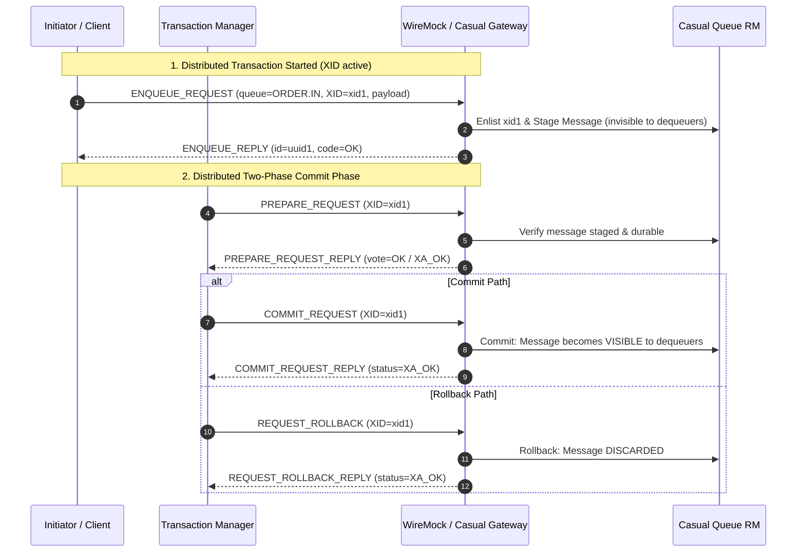

# Research Report: Casual Queue Integration via `casual-java`

- **Issue**: [#86 - Research: Casual Queue integration via casual-java](https://github.com/mattiasgreen/wiremock-extensions/issues/86)
- **Parent Map**: [#85 - Map: Async Messaging & Queue Mocking Architecture](https://github.com/mattiasgreen/wiremock-extensions/issues/85)
- **Status**: Completed Research & Architectural Specification
- **Date**: 2026-11-08
- **Authors**: WireMock Extensions Architecture Team / Research Subagent
- **Primary Upstream Source**: `casualcore/casual-java` (version 3.4.0) and `casualcore/casual` C++ runtime

---

## 1. Executive Summary & Core Architectural Insights

As part of the **Async Messaging & Queue Mocking Architecture** ([#85](https://github.com/mattiasgreen/wiremock-extensions/issues/85)), WireMock must support asynchronous message mocking across enterprise messaging topologies. In addition to industry-standard broker protocols (AMQP 1.0, Apache Kafka, IBM MQ), enterprise mainframe and distributed financial transaction systems frequently rely on **Casual** (an open-source XATMI application server and distributed transaction middleware, functionally analogous to Oracle Tuxedo).

In Casual architectures, **Casual Queue** (`casual-queue` / Tuxedo `/Q`) provides transaction-safe, persistent asynchronous message queues. Messages are enqueued and dequeued using standard XATMI buffer types (`JSON`, `.FIELDED`, `CSTRING`, `X_OCTET`) and can participate in distributed Two-Phase Commit (2PC / XA) transactions alongside synchronous XATMI services (`tpcall`).

### Key Findings from Codebase & Upstream Investigation

1. **Protocol-Level First-Class Support in `casual-java`**:
   The upstream `casual-network-protocol` (version `3.4.0`, already included as an `api` dependency in `wiremock-extension-casual`) already provides complete binary encoders, decoders, and message models for queue operations:
   - `ENQUEUE_REQUEST (6100)` & `ENQUEUE_REPLY (6101)` / `ENQUEUE_REPLY_V_1_3 (6102)`
   - `DEQUEUE_REQUEST (6200)` & `DEQUEUE_REPLY (6201)` / `DEQUEUE_REPLY_V_1_3 (6202)`
   - `DOMAIN_DISCOVERY_REQUEST (7300)` & `DOMAIN_DISCOVERY_REPLY (7301)` / `DOMAIN_DISCOVERY_REPLY_V_1_4 (7311)` (which carry queue advertisements in addition to services).
2. **Dual-Topology Opportunity for WireMock**:
   Unlike message brokers (Kafka, RabbitMQ, IBM MQ) where WireMock acts strictly as an external peer client, Casual Queue supports **two complementary integration topologies**:
   - **Topology A — Inbound Gateway Server (WireMock as Casual Queue Mock)**: Downstream Java EE / Quarkus clients connect directly to WireMock's existing Netty `CasualServer` TCP port. WireMock intercepts `ENQUEUE_REQUEST` and `DEQUEUE_REQUEST` frames directly, serving offline canned queue stubs or emulating in-memory queues with zero external broker infrastructure.
   - **Topology B — Outbound Peer Client (WireMock interacting with External Casual Queues)**: WireMock acts as an asynchronous consumer/producer connected to a remote Casual domain via `CasualClient` (wrapping `NettyNetworkConnection`). WireMock long-polls queues using blocking dequeue requests, evaluates `metadata.async` pattern matchers, generates synthetic `ServeEvent` journal records, and produces correlated reply messages.
3. **Transactional Enlistment (XA / 2PC)**:
   Every enqueue and dequeue wire frame carries an `Xid`. Queue operations can be enlisted into active distributed transactions. Enqueued messages are not committed until 2PC `COMMIT_REQUEST (5203)` is received; dequeued messages are locked and only deleted upon commit, or restored upon `REQUEST_ROLLBACK (5205)` with an incremented `redelivered` counter. WireMock's existing `CasualTransactionCoordinator` is uniquely positioned to coordinate or simulate this 2PC boundary.
4. **Buffer Parity with Synchronous Casual Mocking**:
   Queue message payloads are wrapped in standard `ServiceBuffer` instances. WireMock's existing `CasualHttpMediation` and schema-less `.FIELDED` buffer decoders ([ADR-0007](docs/adr/0007-schema-less-fielded-buffer-mediation.md)) can be directly reused to unnest binary payloads into structured JSON for request journal display, console search, and body matching.

---

## 2. Casual Network Protocol: Wire Framing & Message Types

All communication in Casual occurs over TCP using the Casual Network Protocol. Every frame begins with a fixed-length 28-byte header (`CasualNWMessageHeader`):

```
+------------------------------------+------------------+---------------------+
| Correlation ID (UUID, 16 bytes)    | Type (int, 4 B)  | Payload Size (long) |
+------------------------------------+------------------+---------------------+
| 0                               15 | 16            19 | 20               27 |
+------------------------------------+------------------+---------------------+
```

The `correlationId` allows multiplexing asynchronous requests, service calls, and queue operations across a single persistent TCP socket.

### 2.1 Queue Message Types (`CasualNWMessageType`)

The message types governing queue operations are defined in `se.laz.casual.api.network.protocol.messages.CasualNWMessageType`:

| Enum Constant | Type ID | Direction | Purpose | Protocol Version |
| :--- | :--- | :--- | :--- | :--- |
| `ENQUEUE_REQUEST` | `6100` | Inbound $\rightarrow$ Gateway / Outbound $\rightarrow$ Domain | Submit a message to a named queue with optional XID. | All ($\ge 1.0$) |
| `ENQUEUE_REPLY` | `6101` | Gateway $\rightarrow$ Inbound / Domain $\rightarrow$ Outbound | Acknowledge enqueue with assigned message UUID. | $< 1.3$ |
| `ENQUEUE_REPLY_V_1_3` | `6102` | Gateway $\rightarrow$ Inbound / Domain $\rightarrow$ Outbound | Acknowledge enqueue with message UUID + `QueueErrorCode`. | $\ge 1.3$ |
| `DEQUEUE_REQUEST` | `6200` | Inbound $\rightarrow$ Gateway / Outbound $\rightarrow$ Domain | Request message(s) from a queue with optional selector & block flag. | All ($\ge 1.0$) |
| `DEQUEUE_REPLY` | `6201` | Gateway $\rightarrow$ Inbound / Domain $\rightarrow$ Outbound | Return list of dequeued messages. | $< 1.3$ |
| `DEQUEUE_REPLY_V_1_3` | `6202` | Gateway $\rightarrow$ Inbound / Domain $\rightarrow$ Outbound | Return single message + `hasValue` flag + `QueueErrorCode`. | $\ge 1.3$ |
| `DOMAIN_DISCOVERY_REQUEST` | `7300` | Client $\rightarrow$ Server | Query available services and queues by name. | All ($\ge 1.0$) |
| `DOMAIN_DISCOVERY_REPLY` | `7301` | Server $\rightarrow$ Client | List available services and queues (`List<Queue>`). | $< 1.4$ |
| `DOMAIN_DISCOVERY_REPLY_V_1_4` | `7311` | Server $\rightarrow$ Client | Queues include `retryDelay`, `enqueueEnabled`, `dequeueEnabled`. | $\ge 1.4$ |

### 2.2 Wire Structure: `CasualEnqueueRequestMessage` (Type 6100)

Serialized by `CasualEnqueueRequestMessage.toNetworkBytes()` and deserialized by `CasualEnqueueRequestMessageDecoder`:

```
+-----------------------------------------------------------------------------+
| Execution ID (UUID, 16 bytes)                                               |
+-----------------------------------------------------------------------------+
| Queue Name Length (long, 8 bytes) + Queue Name (UTF-8 bytes)                |
+-----------------------------------------------------------------------------+
| XID (Variable: formatID [long] + gtrid_len [long] + bqual_len [long] + data)|
+-----------------------------------------------------------------------------+
| Message ID (UUID, 16 bytes)                                                 |
+-----------------------------------------------------------------------------+
| Properties/Correlation Length (long, 8 bytes) + Properties (UTF-8 bytes)     |
+-----------------------------------------------------------------------------+
| Reply Queue Length (long, 8 bytes) + Reply Queue Name (UTF-8 bytes)         |
+-----------------------------------------------------------------------------+
| Available Since (long, 8 bytes - Nanoseconds since Unix epoch)              |
+-----------------------------------------------------------------------------+
| ServiceBuffer: Buffer Type Length (long) + Buffer Type String (e.g. "JSON") |
|                + Payload Length (long) + Raw Payload Bytes                  |
+-----------------------------------------------------------------------------+
```

### 2.3 Wire Structure: `CasualEnqueueReplyMessage` (Types 6101 & 6102)

- **Protocol $< 1.3$ (`6101`)**:
  - `execution` (UUID, 16 bytes)
  - `id` (UUID, 16 bytes — the assigned message UUID)
- **Protocol $\ge 1.3$ (`6102`)**:
  - `execution` (UUID, 16 bytes)
  - `id` (UUID, 16 bytes)
  - `code` (int, 4 bytes — `QueueErrorCode`)

### 2.4 Wire Structure: `CasualDequeueRequestMessage` (Type 6200)

Serialized by `CasualDequeueRequestMessage.toNetworkBytes()`:

```
+-----------------------------------------------------------------------------+
| Execution ID (UUID, 16 bytes)                                               |
+-----------------------------------------------------------------------------+
| Queue Name Length (long, 8 bytes) + Queue Name (UTF-8 bytes)                |
+-----------------------------------------------------------------------------+
| XID (XID struct - formatID, gtrid_len, bqual_len, payload)                 |
+-----------------------------------------------------------------------------+
| Selector Properties Length (long, 8 bytes) + Selector Properties (UTF-8)    |
+-----------------------------------------------------------------------------+
| Selector ID (UUID, 16 bytes - 00000000-0000-0000-0000-000000000000 if none) |
+-----------------------------------------------------------------------------+
| Block Flag (byte, 1 byte - 1 = block/wait, 0 = non-blocking)                |
+-----------------------------------------------------------------------------+
```

### 2.5 Wire Structure: `CasualDequeueReplyMessage` (Types 6201 & 6202)

- **Protocol $< 1.3$ (`6201`)**:
  - `execution` (UUID, 16 bytes)
  - `numberOfMessages` (long, 8 bytes)
  - Array of `DequeueMessage` items. Each contains:
    - `id` (UUID, 16 bytes)
    - `properties` (length + UTF-8 string)
    - `replyQueue` (length + UTF-8 string)
    - `availableSince` (long, nanoseconds since epoch)
    - `serviceBuffer` (buffer type + payload bytes)
    - `redeliveredCount` (long, 8 bytes)
    - `timestamp` (long, 8 bytes, nanoseconds since epoch)
- **Protocol $\ge 1.3$ (`6202`)**:
  - `execution` (UUID, 16 bytes)
  - `hasValue` (byte, 1 byte: `1` if a message is returned, `0` if empty)
  - If `hasValue == 1`: Single `DequeueMessage` struct
  - `code` (int, 4 bytes — `QueueErrorCode`)

### 2.6 Queue Error Codes (`QueueErrorCode`)

Defined in `se.laz.casual.api.queue.QueueErrorCode`:

```java
public enum QueueErrorCode {
    OK(0),          // Success
    NO_MESSAGE(1),  // Non-blocking dequeue found no eligible message
    NO_QUEUE(10),   // The requested queue does not exist
    ARGUMENT(20),   // Invalid parameters (e.g. malformed selector)
    SYSTEM(30),     // Internal storage/queue failure
    SIGNALED(40);   // Blocking wait interrupted by signal or shutdown
}
```

---

## 3. Upstream `casual-java` APIs & Message Models

The `casual-api` subproject defines the high-level Java programming model for interacting with Casual queues.

### 3.1 The `CasualQueueApi` Interface

Source: `se.laz.casual.api.CasualQueueApi`:

```java
package se.laz.casual.api;

public interface CasualQueueApi {
    EnqueueReturn enqueue(QueueInfo qinfo, QueueMessage msg);
    DequeueReturn dequeue(QueueInfo qinfo, MessageSelector selector);
    boolean queueExists(QueueInfo qinfo);
}
```

### 3.2 Key Domain Objects

#### `QueueMessage` (`se.laz.casual.api.queue.QueueMessage`)
Encapsulates an enqueued or dequeued message:
- `id` (`UUID`): Unique message identifier. Generated on enqueue or preserved on dequeue.
- `correlationInformation` (`String`): User-defined routing/correlation token. Often used for Request-Reply matching or workflow correlation.
- `replyQueue` (`String`): The name of the queue where responses to this message should be enqueued.
- `payload` (`CasualBuffer`): The business payload, typically a `JsonBuffer`, `FieldedBuffer`, or `CStringBuffer`.
- `redelivered` (`long`): Number of times this message was previously rolled back or failed processing.
- `availableSince` (`Instant`): Scheduling timestamp; message is invisible to dequeuers until this instant.
- `timestamp` (`Instant`): Timestamp when the message was originally accepted into the queue.

#### `MessageSelector` (`se.laz.casual.api.queue.MessageSelector`)
Filtering criteria for dequeuing:
- `selector` (`String`): Correlation property string or SQL-92 Casual filter.
- `selectorId` (`UUID`): Exact message UUID to dequeue (or `new UUID(0, 0)` for any).

#### `QueueInfo` and `QueueOptions` (`se.laz.casual.api.queue.QueueInfo`)
- `queueName` (`String`): Target queue identifier.
- `options` (`QueueOptions`): Contains `blocking` (`boolean`). If true, a dequeue operation blocks until a matching message is present or timeout occurs.

#### `EnqueueReturn` and `DequeueReturn`
- `EnqueueReturn`: Returns `Optional<UUID> id`, `ErrorState errorState`, and `Optional<QueueErrorCode> errorCode`.
- `DequeueReturn`: Returns `Optional<QueueMessage> queueMessage`, `ErrorState errorState`, and `Optional<QueueErrorCode> errorCode`.

### 3.3 Network Invocation Pipeline in `casual-java`

In `casual-jca` (`se.laz.casual.jca.queue.CasualQueueCaller`), requests are sent through `NettyNetworkConnection.request()`:

```java
CasualEnqueueRequestMessage requestMessage = CasualEnqueueRequestMessage.createBuilder()
        .withExecution(UUID.randomUUID())
        .withXid(connection.getCurrentXid())
        .withQueueName(qinfo.getQueueName())
        .withMessage(EnqueueMessage.of(msg))
        .build();

CasualNWMessage<CasualEnqueueRequestMessage> networkRequestMessage = 
        CasualNWMessageImpl.of(corrid, requestMessage);

CompletableFuture<CasualNWMessage<CasualEnqueueReplyMessage>> replyFuture = 
        connection.getNetworkConnection().request(networkRequestMessage);

CasualEnqueueReplyMessage reply = replyFuture.join().getMessage();
```

`NettyNetworkConnection` handles frame framing, Netty pipeline encoding (`CasualNWMessageEncoder`), decoding (`CasualNWMessageDecoder`), and future resolution via `CorrelatorImpl`.

---

## 4. Transaction Boundaries & XA / 2PC Semantics

Casual queues are full **XA Resource Managers**. Enqueue and dequeue operations are enlisted into distributed transactions via their embedded `Xid`.



### 4.1 Dequeue Transaction Semantics

When dequeuing within an active transaction (`XID != NULL_XID`):
1. The message matching the selector is locked and returned in `DEQUEUE_REPLY`.
2. It is **not deleted** from storage while in-flight.
3. If `COMMIT_REQUEST` arrives: The message is permanently deleted from the queue.
4. If `REQUEST_ROLLBACK` arrives: The lock is released, the message is placed back at the head of the queue, and its `redelivered` count is incremented by 1.

### 4.2 Non-Transactional Fallback

When `XID == XID.NULL_XID`:
- Enqueue: Auto-commit. The message is immediately placed in the queue and made available to consumers.
- Dequeue: Auto-commit. The message is immediately popped and removed from storage.

---

## 5. WireMock Integration Architecture: Dual Topologies

WireMock can support Casual queues through two architectural approaches, tailored to different testing scenarios:

```mermaid
flowchart TD
    subgraph Topology A: Inbound Gateway Server [Topology A — Inbound Gateway Server]
        ClientApp["Casual Client / JavaEE App"] -- "casual://localhost:7772<br/>(ENQUEUE_REQUEST / DEQUEUE_REQUEST)" --> CasualServer["CasualServer (Netty)"]
        CasualServer --> GatewayRouter{"CasualWireMockGateway"}
        GatewayRouter -- "Mock Match" --> QueueStore[("In-Memory Queue Store<br/>& Offline Canned Stubs")]
        GatewayRouter -- "Proxy Match" --> UpstreamDomain["Upstream Casual Domain<br/>(casual://prod:7772)"]
        GatewayRouter --> JournalStore["WireMock Request Journal<br/>(Synthetic ServeEvents)"]
    end

    subgraph Topology B: Outbound Peer Client [Topology B — Outbound Peer Client (Map #85)]
        RemoteDomain[("Remote Casual Domain<br/>casual-queue")]
        WMClient["WireMock Async Worker<br/>(CasualAsyncBrokerDriver)"] -- "Long-Poll Dequeue<br/>(DEQUEUE_REQUEST block=true)" --> RemoteDomain
        WMClient -- "Match & Produce Reply<br/>(ENQUEUE_REQUEST)" --> RemoteDomain
        WMClient --> AsyncStubs["metadata.async Stub Mappings"]
        WMClient --> WMJournal["WireMock Journal & UI"]
    end
```

---

### Topology A: Inbound Gateway Server (WireMock as Casual Queue Mock)

In this mode, WireMock Standalone runs `CasualServer` on its TCP port (e.g. 7772). Downstream applications configure their Casual gateway to point directly to WireMock.

#### 1. Inbound Handler Extension (`CasualServer.java`)
Currently, `CasualServer.ServerInboundHandler` handles `DOMAIN_CONNECT_REQUEST`, `DOMAIN_DISCOVERY_REQUEST`, `SERVICE_CALL_REQUEST`, and 2PC frames, but closes the connection on queue types:

```java
// Inside CasualServer.ServerInboundHandler.channelRead0:
} else if (type == CasualNWMessageType.ENQUEUE_REQUEST) {
    handleEnqueue(ctx, (CasualNWMessage<CasualEnqueueRequestMessage>) msg);
} else if (type == CasualNWMessageType.DEQUEUE_REQUEST) {
    handleDequeue(ctx, (CasualNWMessage<CasualDequeueRequestMessage>) msg);
}
```

#### 2. Domain Discovery Advertisement
Clients send `DOMAIN_DISCOVERY_REQUEST` with `List<String> queueNames`. Currently, `CasualServer` returns `reply.setQueues(Collections.emptyList())`.
To satisfy downstream client existence checks (`CasualQueueApi.queueExists`), `CasualWireMockGateway` should discover registered queue stubs and return populated `Queue` descriptors:

```java
List<Queue> queues = stubbedQueueNames.stream()
        .map(qname -> Queue.createBuilder()
                .withName(qname)
                .withProtocolVersion(version)
                .withRetries(3)
                .withRetryDelay(1000)
                .withEnqueueEnabled(true)
                .withDequeueEnabled(true)
                .build())
        .toList();
reply.setQueues(queues);
```

#### 3. In-Memory Queue Store (`CasualQueueStore`)
For mock mode, an in-memory queue store manages:
- Concurrent FIFO queues keyed by queue name.
- Pending transactions: messages staged under active `Xid` (committed or aborted via `CasualTransactionCoordinator`).
- Selector matching: filter by correlation ID or message ID.
- Blocking dequeues: Virtual Threads / `CompletableFuture` park waiting for an enqueue event or timeout.

#### 4. Synthetic `ServeEvent` Journal Mediation
When an enqueue or dequeue request is handled:
- Synthesize an `ImmutableRequest`:
  - URL: `/casual/queue/{queueName}/enqueue` or `/casual/queue/{queueName}/dequeue`
  - Method: `POST` (enqueue) / `GET` (dequeue)
  - Headers:
    - `X-Casual-Queue`: `{queueName}`
    - `X-Casual-Op`: `ENQUEUE` / `DEQUEUE`
    - `X-Casual-Correlation-Info`: `{correlationInformation}`
    - `X-Casual-Reply-Queue`: `{replyQueue}`
    - `X-Casual-Message-Id`: `{messageId}`
    - `X-Casual-Xid`: `{xid}`
    - `X-Casual-Buffer-Type`: `JSON` | `.FIELDED` | `CSTRING`
  - Body: Unnested JSON payload (via `CasualHttpMediation`).
- Record into WireMock's journal (`storePort.recordServeEvent()`).

---

### Topology B: Outbound Peer Client (WireMock interacting with External Queues)

In this mode (aligned with Map [#85](https://github.com/mattiasgreen/wiremock-extensions/issues/85)), WireMock connects as a client to an external Casual domain (e.g. `casual://host:7772`).

#### 1. Peer Client Worker
- Uses `CasualClient` to establish a persistent connection via `NettyNetworkConnection`.
- Starts a background consumer loop on a Java 21 Virtual Thread.
- Continuously executes blocking dequeue:
  ```java
  QueueInfo qinfo = QueueInfo.of(queueName, QueueOptions.createBuilder().withBlock(true).build());
  DequeueReturn ret = casualClient.dequeue(qinfo, MessageSelector.of());
  ```
- When a `QueueMessage` arrives:
  1. Converts payload to JSON / structured form.
  2. Synthesizes an inbound `LoggedRequest`.
  3. Evaluates matching stubs defined with `metadata.async`.
  4. If a match is found:
     - Records a synthetic `ServeEvent` in the journal.
     - If MEP is `Request-Reply` and a reply definition or `replyQueue` is present:
       Constructs reply `QueueMessage` and executes `casualClient.enqueue(replyQueue, replyMsg)`.

---

## 6. Co-Located `metadata.async` Stub Schema for Casual

Co-locating async queue definitions within standard WireMock stub mappings avoids fragmented configuration files:

### 6.1 Request-Reply Interaction (MEP: Request-Reply)

```json
{
  "id": "7f8b9a10-2c3d-4e5f-a6b7-8c9d0e1f2a3b",
  "name": "Casual Queue: Payment Processing Request-Reply",
  "request": {
    "method": "POST",
    "urlPath": "/casual/queue/PAYMENT.REQUEST"
  },
  "response": {
    "status": 200,
    "headers": {
      "Content-Type": "application/json",
      "X-Casual-Buffer-Type": "JSON"
    },
    "jsonBody": {
      "paymentId": "{{jsonPath request.body '$.paymentId'}}",
      "status": "APPROVED",
      "authorizationCode": "AUTH-994821",
      "timestamp": "{{now format='yyyy-MM-ddTHH:mm:ssZ'}}"
    }
  },
  "metadata": {
    "async": {
      "protocol": "casual",
      "brokerUri": "casual://localhost:7772",
      "channel": "PAYMENT.REQUEST",
      "mep": "Request-Reply",
      "replyChannel": "PAYMENT.REPLY",
      "messageMatcher": {
        "correlationId": {
          "matches": "PAY-[0-9]+"
        },
        "payload": {
          "matchesJsonPath": "$.amount",
          "matchesJsonPath": "$[?(@.amount > 0)]"
        }
      },
      "reply": {
        "bufferType": "JSON",
        "correlationId": "{{async.correlationId}}",
        "replyTo": "PAYMENT.REPLY"
      }
    }
  }
}
```

### 6.2 Fire-and-Forget Ingestion (Event Sink)

```json
{
  "id": "1a2b3c4d-5e6f-7a8b-9c0d-1e2f3a4b5c6d",
  "name": "Casual Queue: Audit Log Ingestion (Fire-and-Forget)",
  "request": {
    "method": "POST",
    "urlPath": "/casual/queue/AUDIT.EVENTS"
  },
  "metadata": {
    "async": {
      "protocol": "casual",
      "brokerUri": "casual://mq-host.corp:7772",
      "channel": "AUDIT.EVENTS",
      "mep": "Fire-and-Forget",
      "messageMatcher": {
        "payload": {
          "matchesJsonPath": "$.eventType"
        }
      }
    }
  }
}
```

---

## 7. Implementation Roadmap & Recommendation

### Recommended 3-Phase Implementation

| Phase | Component | Key Deliverables | Effort |
| :--- | :--- | :--- | :--- |
| **Phase 1: Inbound Gateway Queue Mock (Topology A)** | `wiremock-extension-casual` | 1. Add `ENQUEUE_REQUEST` (6100) and `DEQUEUE_REQUEST` (6200) dispatching to `CasualServer`.<br/>2. Add in-memory `CasualQueueStore` supporting canned stubs and FIFO message holding.<br/>3. Advertise configured queues in `handleDiscovery` (`DOMAIN_DISCOVERY_REPLY`).<br/>4. Journal synthetic `ServeEvent`s with unnested JSON bodies. | **3–4 Days** |
| **Phase 2: Transparent Queue Proxying & 2PC** | `wiremock-extension-casual` | 1. Implement queue proxy forwarding in `CasualWireMockGateway` via `CasualClient.forwardEnqueue()` and `forwardDequeue()`.<br/>2. Enlist queue operations under active `Xid` into `CasualTransactionCoordinator` for 2PC commit/rollback handling. | **2–3 Days** |
| **Phase 3: Outbound Peer Driver (Topology B - Map #85)** | `wiremock-extension-casual` & Async Driver SPI | 1. Implement `AsyncBrokerDriver` SPI for protocol `"casual"`.<br/>2. Run Java 21 Virtual Thread consumer loop for external Casual queues.<br/>3. WireMock Developer UI badge: `CASUAL-QUEUE` with unnested payload viewer and correlation search. | **3 Days** |

---

## 8. Primary Source Citations

- **Upstream Git Repositories**:
  - `casualcore/casual-java`: [https://github.com/casualcore/casual-java](https://github.com/casualcore/casual-java) (cloned locally in `.upstream/casual-java`)
  - `casualcore/casual`: [https://github.com/casualcore/casual](https://github.com/casualcore/casual)
- **Primary Source Code References**:
  - `se.laz.casual.api.CasualQueueApi`: `casual/casual-api/src/main/java/se/laz/casual/api/CasualQueueApi.java`
  - `se.laz.casual.api.queue.QueueMessage`: `casual/casual-api/src/main/java/se/laz/casual/api/queue/QueueMessage.java`
  - `se.laz.casual.api.queue.QueueErrorCode`: `casual/casual-api/src/main/java/se/laz/casual/api/queue/QueueErrorCode.java`
  - `se.laz.casual.api.network.protocol.messages.CasualNWMessageType`: `casual/casual-api/src/main/java/se/laz/casual/api/network/protocol/messages/CasualNWMessageType.java`
  - `se.laz.casual.network.protocol.messages.queue.CasualEnqueueRequestMessage`: `casual/casual-network-protocol/src/main/java/se/laz/casual/network/protocol/messages/queue/CasualEnqueueRequestMessage.java`
  - `se.laz.casual.network.protocol.messages.queue.CasualDequeueRequestMessage`: `casual/casual-network-protocol/src/main/java/se/laz/casual/network/protocol/messages/queue/CasualDequeueRequestMessage.java`
  - `se.laz.casual.network.protocol.messages.queue.CasualEnqueueReplyMessage`: `casual/casual-network-protocol/src/main/java/se/laz/casual/network/protocol/messages/queue/CasualEnqueueReplyMessage.java`
  - `se.laz.casual.network.protocol.messages.queue.CasualDequeueReplyMessage`: `casual/casual-network-protocol/src/main/java/se/laz/casual/network/protocol/messages/queue/CasualDequeueReplyMessage.java`
  - `se.laz.casual.network.protocol.decoding.decoders.queue.CasualEnqueueRequestMessageDecoder`: `casual/casual-network-protocol/src/main/java/se/laz/casual/network/protocol/decoding/decoders/queue/CasualEnqueueRequestMessageDecoder.java`
  - `se.laz.casual.network.protocol.decoding.decoders.queue.CasualDequeueRequestMessageDecoder`: `casual/casual-network-protocol/src/main/java/se/laz/casual/network/protocol/decoding/decoders/queue/CasualDequeueRequestMessageDecoder.java`
  - `se.laz.casual.jca.queue.CasualQueueCaller`: `casual/casual-jca/src/main/java/se/laz/casual/jca/queue/CasualQueueCaller.java`
- **Internal WireMock Extension References**:
  - `com.github.mattiasgreen.wiremock.casual.CasualServer`: `wiremock-extension-casual/src/main/java/com/github/mattiasgreen/wiremock/casual/CasualServer.java`
  - `com.github.mattiasgreen.wiremock.casual.CasualWireMockGateway`: `wiremock-extension-casual/src/main/java/com/github/mattiasgreen/wiremock/casual/CasualWireMockGateway.java`
  - `com.github.mattiasgreen.wiremock.casual.CasualClient`: `wiremock-extension-casual/src/main/java/com/github/mattiasgreen/wiremock/casual/CasualClient.java`
  - `com.github.mattiasgreen.wiremock.casual.CasualTransactionCoordinator`: `wiremock-extension-casual/src/main/java/com/github/mattiasgreen/wiremock/casual/CasualTransactionCoordinator.java`
