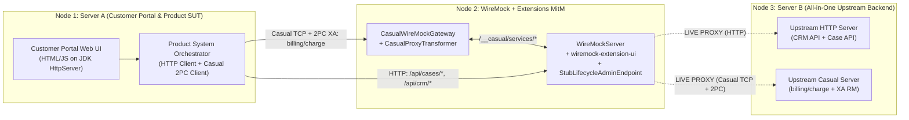

# End-to-End Multi-Protocol Progressive Simulation Plan (HTTP + Casual 2PC)

This document specifies the architecture and implementation plan for a self-contained **3-node integration test and Playwright demo recording** demonstrating the core `wiremock-extensions` mission: **transitioning a multi-protocol enterprise system (HTTP REST + Casual XATMI/2PC) from Fully Integrated (`LIVE PROXY`) to Fully Simulated (`STUBS MODE`) with zero code changes to the System Under Test.**

---

## 1. System Topology (3-Node In-Process Harness)

### Components
1. **Node 1 — Server A (`ProductPortalServer`)**:
   - Hosts an embedded **Customer Portal Web UI** (`/portal`) where a customer can apply for a banking product (`"Platinum Credit Line"`) and approve the resulting purchase offer.
   - Hosts the **Product System Backend API** (`/portal/api/apply`, `/portal/api/approve`) which orchestrates downstream calls:
     - **Case Management (HTTP via WireMock)**:
       - `POST /api/cases` — Creates application case (`CASE-1001`).
       - `POST /api/cases/CASE-1001/offer` — Records calculated offer on the case.
       - `POST /api/cases/CASE-1001/complete` — Marks case as `PURCHASED`.
     - **CRM System (HTTP via WireMock)**:
       - `GET /api/crm/customers/CUST-42/kyc` — Checks KYC status (`VERIFIED`).
       - `GET /api/crm/customers/CUST-42/eligibility` — Checks do-not-sell list & purchase eligibility (`doNotSell: false, eligible: true`).
       - `POST /api/crm/customers/CUST-42/sales` — Updates CRM with final sales order info.
     - **Billing Platform (Casual XATMI + 2PC/XA via `CasualWireMockGateway`)**:
       - Executes `tpcall("billing/charge", ...)` inside a global XA transaction (`Xid`), followed by 2PC Phase 1 (`prepare` -> `XA_OK`) and Phase 2 (`commit` -> `XA_OK`).
2. **Node 2 — WireMock MitM (`WireMockServer` + `CasualWireMockGateway`)**:
   - Runs `WireMockServer` with `UiExtensionFactory` (`/__admin/ui/` + `StubLifecycleAdminEndpoint`) and `CasualProxyTransformer`.
   - Configured with 3 project-grouped **Proxy Stubs** (initially in `LIVE PROXY` mode):
     - `case-service`: `ANY /api/cases/.*` -> `proxyBaseUrl` to Server B HTTP
     - `crm-service`: `ANY /api/crm/.*` -> `proxyBaseUrl` to Server B HTTP
     - `billing-service`: `/__casual/services/.*` (`metadata.mode = "proxy"`, `transformers = ["casual-proxy-transformer"]`) -> forwards via `CasualWireMockGateway` over Casual TCP to Server B
3. **Node 3 — Server B (`UpstreamBackendServer`)**:
   - Hosts both the **Upstream HTTP Backend** (serving live CRM and Case Management endpoints and counting hits) and the **Upstream Casual Server** (serving `billing/charge` and maintaining the live XA Resource Manager ledger of prepared/committed `Xid`s).
   - Can be **completely shut down** (`stopUpstreamServer()`) between Run 1 and Run 2 to prove 100% backend decoupling.

---

## 2. Protocol-Aware Unified Journal & In-Process Casual Proxy

### A. In-Process Casual Proxy Stub (`CasualProxyTransformer`)
Instead of opening an extra HTTP port or recording out-of-band on a 404 miss:
- A lightweight WireMock `ResponseDefinitionTransformerV2` (`casual-proxy-transformer`, non-global) in `wiremock-extension-casual` delegates active Casual proxy stubs (`metadata.mode = "proxy"`) directly to `CasualWireMockGateway`'s upstream TCP client.
- **Run 1 (`LIVE PROXY` Mode)**:
  1. Product System sends Casual TCP `tpcall("billing/charge", payload, xid)` to `CasualWireMockGateway`.
  2. `CasualWireMockGateway` dispatches `/__casual/services/billing/charge` to `WireMockServer`.
  3. `WireMockServer` matches the `billing-service` proxy stub (`metadata.mode = "proxy"`) and invokes `casual-proxy-transformer`.
  4. The transformer forwards the binary `SERVICE_CALL_REQUEST` over TCP to Server B, enlists `xid` in `upstreamEnlistedXids` (so 2PC `prepare` and `commit` are also forwarded to Server B), and returns the upstream reply (`X-Casual-Error-State: OK`, `X-Casual-Transaction-State: TX_ACTIVE`, JSON payload) to `WireMockServer`.
- **Run 2 (`STUBS MODE`, Server B Offline)**:
  1. Clicking **Snapshot (`📸`)** and flipping **`LIVE PROXY` -> `STUBS MODE`** in the UI disables the Casual proxy stub and enables the recorded static stub.
  2. `WireMockServer` serves the recorded stub directly without invoking `casual-proxy-transformer`.
  3. `CasualWireMockGateway` sees the local stub match (`localMatchedXids`) and synthesizes the 2PC `XA_OK` `prepare` and `commit` votes locally.

### B. Protocol-Agnostic Resolution Badges & Casual-Native Terms in the UI
Because the Request Journal and Stubs list are unified across HTTP and Casual XATMI:
- **Resolution Badge** is strictly protocol-agnostic: **`🌐 PROXIED`**, **`📌 STUB`**, **`🧠 STATEFUL`**, or **`⚠️ UNMATCHED`**.
- **Protocol / Method & Status Display**: When a request or stub targets `/__casual/services/...` (or carries `X-Casual-Service`):
  - **Method/Protocol Badge**: Renders **`CASUAL`** instead of the internal HTTP bridge verb (`POST`).
  - **Status Column / Pill**: Renders the Casual `ErrorState` (**`OK`**, **`TPESVCFAIL`**, **`TPENOENT`**, **`TPETIME`**) from `X-Casual-Error-State` instead of HTTP status codes (`200`, `500`, `404`).

---

## 3. End-to-End Business Scenario & Playwright Walkthrough Flow

| Phase | Browser Tab | Action | Verification |
| :--- | :--- | :--- | :--- |
| **1. Integrated Run (`LIVE PROXY`)** | **Tab 1: Customer Portal UI** | 1. Customer (`CUST-42`) selects **"Platinum Credit Line"** and clicks **"Submit Application"**. 2. Product System creates Case (`POST /api/cases`), checks KYC (`GET /api/crm/.../kyc`), checks Eligibility (`GET /api/crm/.../eligibility`), calculates offer (`$299/yr`), and updates Case (`POST /api/cases/.../offer`). 3. Customer reviews offer and clicks **"Approve & Purchase"**. 4. Product System bills customer via **Casual 2PC** (`tpcall("billing/charge")` + `prepare` + `commit`), marks Case complete (`POST /api/cases/.../complete`), and updates CRM (`POST /api/crm/.../sales`). | Portal UI shows **"Purchase Confirmed"** with Invoice ID, Case ID, and 2PC `XA_OK` status. Server B counters confirm live HTTP + Casual 2PC execution. |
| **2. Inspect Journal (`🌐 PROXIED`)** | **Tab 2: WireMock Console UI (`/__admin/ui/`)** | Switch to Request Journal tab (`#nav-tab-journal`). Inspect the 6 calls across Case Management, CRM, and Billing (`/__casual/services/billing/charge`). | All 6 rows display the **`🌐 PROXIED`** resolution badge. HTTP rows show `GET`/`POST` + `200`; the Casual Billing row shows **`CASUAL`** + **`OK`**, and expanding it reveals the JSON invoice payload and `X-Casual-*` headers. |
| **3. Harvest & Flip to `STUBS MODE`** | **Tab 2: WireMock Console UI (`/__admin/ui/`)** | Switch to Stubs tab (`#nav-tab-stubs`). In each Project Group header (`case-service`, `crm-service`, `billing-service`), click **Snapshot (`📸`)** to harvest proxied HTTP & Casual calls into stubs, then click the mode pill to flip from **`LIVE PROXY`** to **`STUBS MODE`**. Clear the Request Journal for a clean Run 2 comparison. | Project badges switch to **`📌 STUBS MODE`**. Recorded stubs for `/api/cases/*`, `/api/crm/*`, and `/__casual/services/billing/charge` are active; proxy stubs are disabled. |
| **4. Stop Server B & Replay (`📌 STUB`)** | **Tab 1 -> Tab 2** | **Shut down Server B completely** (`stopUpstreamServer()`). In Tab 1 (Customer Portal UI), run the application & purchase approval flow again. Switch back to Tab 2 (WireMock Console UI Request Journal). | Portal UI succeeds identically (**"Purchase Confirmed"**). Server B hit counts remain unchanged (`0` new hits). Every entry in the Request Journal now displays **`📌 STUB`**. |

---

## 4. Phased Delivery Plan

1. **Commit 1 — `wiremock-extension-casual` In-Process Proxy Transformer & UI Casual Protocol Formatting**:
   - Add `CasualProxyTransformer` (`ResponseDefinitionTransformerV2`) to `CasualWireMockGateway` so a `metadata.mode = "proxy"` stub in WireMock forwards Casual calls over TCP to Server B and logs them as `🌐 PROXIED` in the WireMock Journal.
   - Update `wiremock-extension-ui` (`journal.js` & `stubs.js`) so `/__casual/services/*` entries display **`CASUAL`** and Casual `ErrorState` (**`OK`**, **`TPESVCFAIL`**, etc.) instead of HTTP `POST` / `200`.
   - Include `:wiremock-extension-casual` in `wiremock-extension-bundle`.
2. **Commit 2 — `wiremock-examples` 3-Node Banking Topology & Headless JUnit Verification**:
   - Implement `UpstreamBackendServer` (Node 3: HTTP CRM + Case API + Casual Billing 2PC server) and `ProductPortalServer` (Node 1: Customer Portal UI + Product System orchestrator).
   - Verify the complete Run 1 (`LIVE PROXY`) -> Snapshot & Mode Switch -> Stop Server B -> Run 2 (`STUBS MODE`) lifecycle via a fast headless JUnit test.
3. **Commit 3 — Dual-Tab Playwright E2E Test & Visual Snapshots**:
   - Layer `BankingProgressiveSimulationPlaywrightTest` on top of the verified 3-node harness, driving Tab 1 (Customer Portal UI) and Tab 2 (WireMock Console UI) end-to-end.
