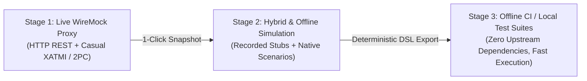

# Product Review & Scope Reflection: WireMock Extensions Suite

**Date**: October 2026
**Status**: Strategic Architectural Assessment & Scope Calibration
**Target Branch**: `product-review`

---

## 1. Executive Summary

As the `wiremock-extensions` suite has evolved through successive feature iterations (UI console, Casual protocol support, Toxiproxy L4 network emulation, OpenTelemetry observability, and progressive simulation harnesses), this review takes a step back to evaluate project scope, architectural complexity, and cognitive overhead.

The core question: **Are we creating bloat, aiming too high, and over-engineering features that developers will not use or maintain?**

The verdict:
* **The Core Value Proposition is Rock Solid**: Enabling integration tests to progress from **live proxying** $\to$ **1-click snapshot recording** $\to$ **100% offline stub playback** across heterogeneous enterprise protocols (HTTP REST + Casual XATMI/2PC) with zero test code changes provides massive real-world leverage.
* **The Stateful AST Engine is Bloat / Over-Engineering**: Building an in-memory JSON AST evaluator and attempting to automatically infer or deduce state machines from captured network traffic is high-effort, low-adoption, and drifts into reinventing a transactional database inside a mock engine.
* **Cross-Extension Collaboration is Valid and Desirable**: Extensions depending on each other (e.g. OTel reporting Casual and NetEm dimensions) creates a coherent enterprise platform rather than disjointed plugins, provided coupling remains loose at runtime.

---

## 2. Core Mission & Value Proposition Validation



The primary problem space for enterprise integration testing is **dependency management**:
* Upstream environments (billing systems, ERPs, CRM platforms, legacy mainframes) are flaky, slow, rate-limited, or unavailable during local development and CI runs.
* WireMock's greatest strength is sitting between the System Under Test (SUT) and these backends.

The validated 3-stage lifecycle demonstrated in `BankingProgressiveSimulationTest` works seamlessly:
1. **Run 1 (Live Proxy)**: Run the integration suite against live backends through WireMock.
2. **Snapshot**: Capture request/response interactions into WireMock stubs with a single API call or UI button click.
3. **Run 2 (Offline Stubs)**: Shut down backends completely; the exact same test passes unmodified against local stubs.

This workflow requires **no complex AST**, **no custom expression engine**, and **no magic state deduction**. It is simple, deterministic, and effective.

---

## 3. What Feels Right vs. What Feels Wrong

| Domain / Feature | Status | Evaluation | Rationale |
| :--- | :--- | :--- | :--- |
| **`wiremock-extension-ui`** | Implemented | **Feels Right** | Solves primary developer friction: inspecting unmatched 404s, turning a recorded request into a stub with one click, replaying requests in the tester, and copying Java `stubFor()` DSL. Zero NPM dependencies keeps it maintenance-free. |
| **`wiremock-extension-casual`** | Implemented | **Feels Right** | Massive enterprise differentiator. Tuxedo/Casual XATMI protocol simulation normally requires heavy application servers (WildFly, WebLogic) or C toolchains. In-process Netty translation to WireMock stubs provides unique value for banking and telecom stacks. |
| **`wiremock-extension-tcp-netem`** | Implemented | **Feels Right** | L4 network chaos (latency, jitter, connection drops) in pure Java 21 virtual threads. Eliminates the need for external Toxiproxy Docker containers, root networking privileges, or Go binaries during automated testing. |
| **`wiremock-extension-otel` & JSON Logging** | Implemented | **Feels Right** | W3C `traceparent` context extraction, MDC header correlation (`x-correlation-id`), and Prometheus scraping (`/__admin/metrics/prometheus`) meet standard enterprise observability requirements. |
| **`wiremock-extension-stateful` (AST Engine)** | Implemented | ⚠️ **Feels Wrong / Bloat** | Re-invents an in-memory database with custom JSON AST expressions, guards, and mutations. High complexity for marginal benefit over native WireMock scenarios and standard Java response transformers. |
| **Automated State Machine Extraction** | Roadmap / Spec | ❌ **Feels Wrong / Sci-Fi** | Network traffic only captures input/output pairs. Deducing internal business rules, invariants, and hidden system state from HTTP/RPC logs is mathematically indeterminate and produces brittle, hallucinated mocks. |
| **"Dynamic Snowball Harvesting" (Item 12)** | Roadmap / Spec | ⚠️ **Over-Engineered** | Dynamically parsing response payloads with regexes to discover IDs and mutating active session match criteria in real time creates non-deterministic tracing behavior. Explicit correlation IDs (`X-Correlation-Id`) are standard and reliable. |
| **In-Memory Pub/Sub & Mock OIDC (Items 6.2, 7)** | Roadmap / Spec | ❌ **Scope Creep** | Implementing an in-process Kafka broker, WebSocket event bus, and RSA-signing OAuth2 token issuer dilutes WireMock into an unmaintainable all-in-one cloud simulator. |

---

## 4. Deep Dive: Why the Stateful AST & State Deduction Miss the Mark

### 4.1. The "Reinventing the Database" Trap
The AST engine attempts to allow users to express state transitions and invariant rules in JSON:
```json
{
  "condition": {
    "op": "allMatch",
    "field": "tasks",
    "sub": { "op": "!=", "field": "status", "val": "PENDING" }
  },
  "mutation": {
    "op": "set",
    "field": "caseStatus",
    "val": "APPROVED"
  }
}
```
* **Developer Experience**: No developer wants to write, maintain, or debug business logic encoded in JSON AST strings. There is no IDE autocompletion, no type safety, no compiler verification, and stack traces point to generic AST evaluation classes.
* **Maintenance Burden**: Supporting complex domain logic eventually requires re-implementing arithmetic, string operations, collections manipulation, null-safety, and concurrent isolation.

### 4.2. WireMock Native Scenarios Already Handle Sequential State
Vanilla WireMock includes a built-in Finite State Machine (`Scenario`):
* `whenScenarioStateIs("Started")` $\to$ `willSetStateTo("OFFER_GENERATED")`
* `whenScenarioStateIs("OFFER_GENERATED")` $\to$ `willSetStateTo("SETTLED")`

Native scenarios are:
1. Declarative and standard across the entire WireMock ecosystem.
2. Fully supported by existing tooling, mapping files, and Admin APIs.
3. Clearly rendered in our UI DAG visualizer.
4. Sufficient for 95% of stateful stubbing requirements (e.g. step 1 returns pending, step 2 returns ready).

### 4.3. The Idiomatic Alternative: Standard Java Code
When a simulation genuinely requires complex dynamic logic (such as calculating credit limits or updating multi-table relational state), the idiomatic solution in Java testing is **code**:
* A standard WireMock `ResponseTransformerV2` implementation.
* A plain Java helper or mock repository in the test project.
* A Testcontainers-managed lightweight database.

Developers prefer 10 lines of debuggable, refactorable Java code over 50 lines of opaque JSON AST definitions.

### 4.4. The Fallacy of Inferring State Machines from Recorded Traffic
Traffic recording captures *effects*, not *causes*. From a series of requests:
1. `POST /applications` $\to$ `200 OK`
2. `POST /purchases` $\to$ `409 Conflict`

An automated engine cannot know whether the 409 occurred because:
* A duplicate purchase was detected,
* The user's balance was insufficient,
* A fraud check timed out, or
* A business rule rejected that specific product code.

Attempting to infer state machines from recordings results in brittle, overfitted heuristics that break as soon as test data or business logic slightly alters.

---

## 5. Architectural Assessment: Cross-Extension Dependencies

### Is It Acceptable for Extensions to Depend on Each Other?
**Yes, provided coupling remains loose at packaging and runtime.**

* **The Unified Platform Experience**: When users adopt `wiremock-extension-bundle`, they expect a cohesive system. If a request arrives via Casual XATMI, the OpenTelemetry listener should label it `protocol="casual"` and record its RPC status, rather than treating it as an unknown HTTP request.
* **Clean Implementation Pattern**:
  1. **HTTP Model as the Common Bus**: WireMock’s `Request` and `Response` objects serve as the lingua franca. Casual metadata is conveyed via standard headers (`X-Casual-Service`, `X-Casual-Error-State`). The OTel module reads these headers without needing a direct compile dependency on the Casual module.
  2. **Optional Runtime Integrations**: For NetEm metrics in OTel, `compileOnly` dependencies with runtime existence checks (`try { TcpNetEmRegistry... } catch (NoClassDefFoundError e)`) ensure `wiremock-extension-otel` can still function independently if NetEm is excluded.

---

## 6. Strategic Course Correction: The Four Grounded Pillars

To eliminate bloat, minimize maintenance risk, and focus engineering effort on high-leverage capabilities, the project will anchor on **Four Core Pillars**:

```
┌────────────────────────────────────────────────────────────────────────┐
│                       Four Core Value Pillars                          │
├────────────────────┬────────────────────┬──────────────────────────────┤
│ 1. Multi-Protocol  │ 2. In-Process      │ 3. Progressive Simulation    │
│    Ingress         │    Resilience      │    Lifecycle                 │
│ - WireMock HTTP    │ - Java 21 NetEm L4 │ - Transparent Live Proxying  │
│ - Casual XATMI/2PC │ - Casual L7 / XA   │ - 1-Click Snapshot Stubs     │
│ - gRPC / Protobuf  │   Fault Injection  │ - 100% Offline CI Execution  │
├────────────────────┴────────────────────┴──────────────────────────────┤
│ 4. Zero-Friction Developer Console (Web UI)                            │
│ - Visual 404 Unmatched Request Triage & Diffing                        │
│ - 1-Click Stub Creation & Java DSL stubFor() Generation                │
│ - Scenario State Machine Visualizer (DAG)                              │
│ - Interactive HTTP / RPC Request Tester                                │
└────────────────────────────────────────────────────────────────────────┘
```

### Pillar 1: Multi-Protocol Ingress
* In-process translation of non-HTTP protocols (Casual XATMI RPC, 2PC distributed transactions) into synthetic WireMock HTTP mappings.
* Standardized matching, templating, and journal tracking across all protocols.

### Pillar 2: In-Process Chaos & Resilience Testing
* Virtual-thread Layer 4 TCP network emulation (`wiremock-extension-tcp-netem`): latency, jitter, bandwidth throttling, connection slicing, and drops.
* Multi-tier Layer 7 fault injection: HTTP 5xx faults, Casual error states (`TPETIME`, `TPESVCERR`), and XA heuristic overrides (`XA_RBROLLBACK`, `XA_HEURHAZ`).

### Pillar 3: Progressive Simulation Lifecycle
* The core journey: **Live Proxy** $\to$ **1-Click Snapshot** $\to$ **Offline Stubs**.
* Service-scoped mode toggles (`LIVE PROXY` vs `STUBS MODE`) per project/upstream dependency.
* Portable export of recorded stubs for air-gapped CI test runs.

### Pillar 4: Zero-Friction Developer Console (Web UI)
* Pure Vanilla ES6 Web UI with zero NPM dependencies.
* Instant visual diagnosis of unmatched traffic (`?unmatched=true`).
* Rapid stub authoring (`Create Stub from Request`, Handlebars token helpers, Java `stubFor()` DSL export).
* Native WireMock Scenario state visualization.

---

## 7. Roadmap Adjustments

### What to Freeze / Deprecate
1. **`wiremock-extension-stateful` AST Engine**:
   - Freeze the AST expression evaluator.
   - Deprecate plans for complex query languages, JSON mutations, and dynamic invariant models.
   - Retain lightweight session-scoped state only where strictly necessary, pointing users toward standard WireMock Scenarios and Java response transformers for complex stateful needs.

### What to Remove from Roadmap / Backlog
1. **Automated State Machine Inference**: Remove speculative backlog items related to deducing FSM transitions from recorded journal logs.
2. **"Snowball Harvesting" Entity Mining**: Replace with deterministic session capture based on explicit headers (`X-Correlation-Id`, `X-Session-Id`) and URL prefix patterns.
3. **In-Memory Pub/Sub & Broker Mocks (AsyncAPI / WebSocket Broker)**: Drop standalone message broker simulation. Focus WireMock on request-reply and gateway boundaries.
4. **Mock OAuth2 / OIDC Provider**: WireMock stubs with static JWKS endpoints (`/.well-known/jwks.json`) and Handlebars-templated JWTs are sufficient; an embedded authentication server is out of scope.

### What to Accelerate
1. **Robust Packaging & Publishing**: Maven Central publication, Docker standalone container (`ghcr.io`), and standalone runnable bundle JAR.
2. **Air-Gapped Self-Containment**: Formal verification that Web UI assets and console operations function 100% offline in isolated environments.
3. **Java DSL / Codegen Ergonomics**: Refine the UI's `Copy Java stubFor()` export to make converting journal traffic into checked-in test code effortless.
4. **Documentation & GitHub Pages Demo**: Maintain high-quality documentation and the static interactive sandbox demonstrating the core four pillars.
