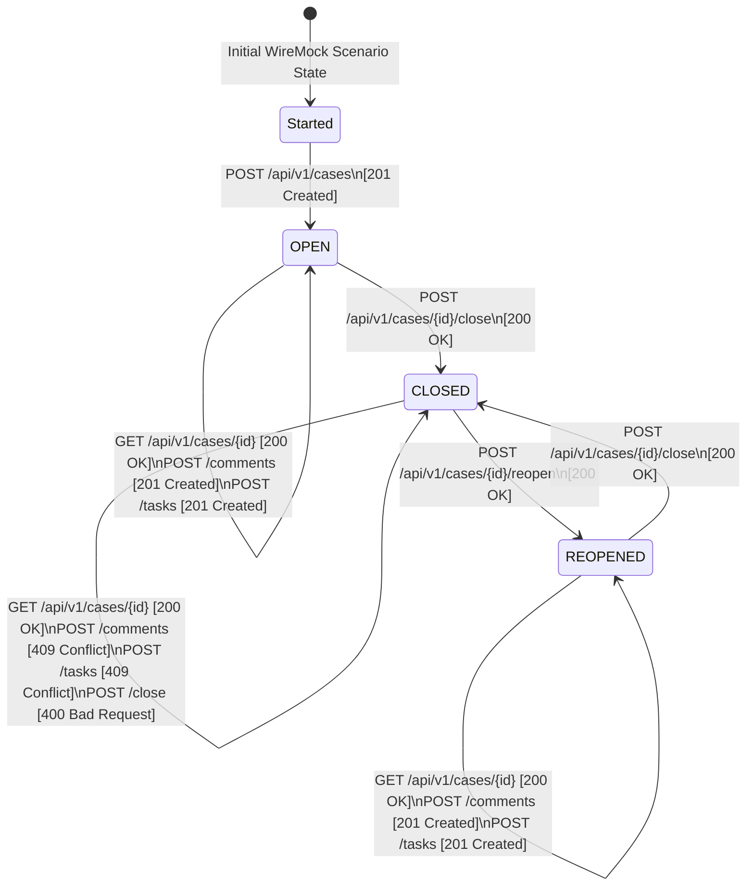

# WireMock Examples: Case Management System

A production-grade reference implementation demonstrating how to model, test, and debug stateful services using WireMock Scenarios, the Scenario DAG Visualizer, and Playwright.

## Domain Overview: Case Management System

The example models a stateful case lifecycle:
- **`Started`**: Entry state before a case is created.
- **`OPEN`**: Case is active. Allows reading case details, creating comments, and assigning tasks.
- **`CLOSED`**: Case has been resolved or closed. Rejects new comments and tasks with `409 Conflict`. Rejects repeated close requests with `400 Bad Request`.
- **`REOPENED`**: Case has been reopened. Allows comments and tasks again; can transition back to `CLOSED`.



## Key Components

1. **[`CaseClient`](src/main/java/com/github/mattiasgreen/wiremock/examples/casemanagement/CaseClient.java)**:
   - Typed Java 21 HTTP client built on `java.net.http.HttpClient` and Jackson.
   - Methods: `createCase()`, `getCase()`, `addComment()`, `addTask()`, `closeCase()`, `reopenCase()`.
   - Automatically raises typed `CaseConflictException` on 409 Conflict or 400 Bad Request.

2. **[`CaseLifecycleStubs`](src/main/java/com/github/mattiasgreen/wiremock/examples/casemanagement/CaseLifecycleStubs.java)**:
   - Configures WireMock stubs for the state machine.
   - Provides both a **Shared Scenario** setup (to expose out-of-the-box limitations) and an **Isolated Scenario** setup (best practice).

3. **[`CaseSystemIntegrationTest`](src/test/java/com/github/mattiasgreen/wiremock/examples/CaseSystemIntegrationTest.java)**:
   - **Single Case Happy Path & Invariants**: Tests the full state lifecycle, checking that comments and tasks are allowed in `OPEN`/`REOPENED` and strictly rejected in `CLOSED`.
   - **Parallel Cases Conundrum**: Demonstrates the global state collision pitfall where closing Case A inadvertently causes operations on concurrent Case B to fail with `409 Conflict`.
   - **Parallel Cases Solution**: Demonstrates best practice parameterization (`"CaseLifecycle-" + caseId`) ensuring complete test isolation without cross-test leakage.
   - **Request Journal Verification**: Uses `wireMockServer.verify(...)` to assert HTTP requests against the journal.
   - **Playwright DAG Visualizer**: Opens `/__admin/ui/#scenarios`, validates the interactive DAG visualizer, checks pipeline steps, and verifies real-time state synchronization when cases transition.

## Multi-Protocol Progressive Simulation: Banking Reference Architecture

The `wiremock-examples` module includes an end-to-end 3-node banking reference harness demonstrating how to transition a distributed system (HTTP REST CRM & Case Management + binary Casual XATMI 2PC billing) from live proxying to 100% offline simulation:

- **Node 1: Customer Portal & Product System SUT** (`ProductPortalServer`): Embedded web portal and orchestrator submitting applications and executing XA transactions.
- **Node 2: WireMock Gateway** (`WireMockServer` + `CasualWireMockGateway`): Layer 7 HTTP & L4 Casual reverse proxy recording traffic and managing stub lifecycles.
- **Node 3: Upstream Backend** (`UpstreamBackendServer`): Serves live Case API, CRM, and Casual billing with 2PC XA Resource Manager. Can be terminated between test runs to prove complete offline decoupling.

### 🎥 Progressive Simulation Video Tour

▶️ **[Download / Watch Banking Progressive Simulation Tour (WebM)](https://github.com/mattiasgreen/wiremock-extensions/releases/latest/download/banking-progressive-simulation-tour.webm)** *(Hosted on GitHub Releases, zero git bloat)*

#### Walkthrough Scenario:
1. **Live Proxy Recording**: SUT submits application and confirms purchase with live backend servers. WireMock captures all HTTP calls and binary `CASUAL` `OK` frames into the unified request journal.
2. **1-Click Harvest & Flip**: With one click in the Web UI, captured sessions are harvested into deterministic stubs, and project routes instantly switch from `LIVE PROXY` to `STUBS MODE`.
3. **100% Offline Replay**: The upstream backend server is terminated completely. Replaying the identical application and purchase journey succeeds 100% from local stubs with local 2PC transaction synthesis.

## Running the Examples

```bash
# Run the integration test suite
./gradlew :wiremock-examples:test
```

## Example Stubs Bundle

A standalone copy-pasteable WireMock stubs bundle is provided in [`example-stubs.json`](example-stubs.json). It defines clean baseline sample stubs (`GET /api/v1/users`, `POST /api/v1/orders`, `GET /api/v1/slow`, and `GET /api/v1/error`) without pre-populating servers by default.

### Importing Example Stubs

#### Option A: Via cURL (WireMock Admin API)
```bash
curl -X POST http://localhost:8080/__admin/mappings/import \
  -H "Content-Type: application/json" \
  -d @wiremock-examples/example-stubs.json
```

#### Option B: Via WireMock Console Web UI
1. Navigate to the Web UI at [http://localhost:8080/__admin/ui/](http://localhost:8080/__admin/ui/).
2. Click **Import Spec / Bundle** in the top navigation bar.
3. Switch to the **WireMock Bundle** tab.
4. Paste the JSON bundle contents below and click **Import Bundle**.

### Copy-Pasteable Bundle JSON

```json
{
  "mappings": [
    {
      "id": "10000000-0000-0000-0000-000000000001",
      "name": "List Users",
      "request": {
        "method": "GET",
        "url": "/api/v1/users"
      },
      "response": {
        "status": 200,
        "headers": {
          "Content-Type": "application/json"
        },
        "body": "[{\"id\":1,\"name\":\"Alice\"},{\"id\":2,\"name\":\"Bob\"}]"
      }
    },
    {
      "id": "10000000-0000-0000-0000-000000000002",
      "name": "Create Order",
      "request": {
        "method": "POST",
        "url": "/api/v1/orders",
        "bodyPatterns": [
          {
            "matchesJsonPath": "$.item"
          }
        ]
      },
      "response": {
        "status": 201,
        "headers": {
          "Content-Type": "application/json"
        },
        "body": "{\"orderId\":\"ord-9921\",\"status\":\"CREATED\"}"
      },
      "metadata": {
        "exampleRequest": {
          "path": "/api/v1/orders",
          "headers": {
            "Content-Type": "application/json"
          },
          "body": "{\n  \"item\": \"Wireless Noise-Canceling Headphones\",\n  \"quantity\": 1,\n  \"price\": 199.99,\n  \"customer\": \"alex@example.com\"\n}"
        }
      }
    },
    {
      "id": "10000000-0000-0000-0000-000000000003",
      "name": "Slow Latency Simulation",
      "request": {
        "method": "GET",
        "url": "/api/v1/slow"
      },
      "response": {
        "status": 200,
        "fixedDelayMilliseconds": 150,
        "headers": {
          "Content-Type": "application/json"
        },
        "body": "{\"latency\":\"delayed\"}"
      }
    },
    {
      "id": "10000000-0000-0000-0000-000000000004",
      "name": "Internal Server Error Mock",
      "request": {
        "method": "GET",
        "url": "/api/v1/error"
      },
      "response": {
        "status": 500,
        "headers": {
          "Content-Type": "application/json"
        },
        "body": "{\"error\":\"Internal Server Error\",\"code\":500}"
      }
    }
  ],
  "importOptions": {
    "duplicatePolicy": "OVERWRITE",
    "deleteAllNotInImport": false
  }
}
```
