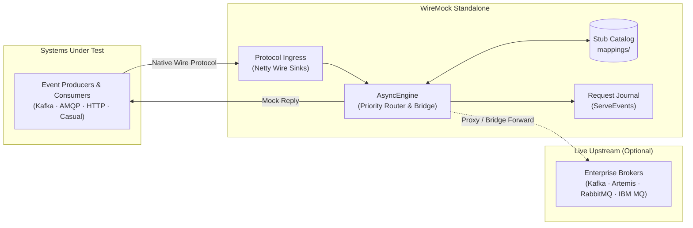
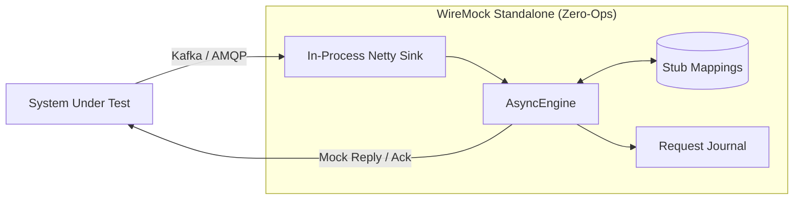
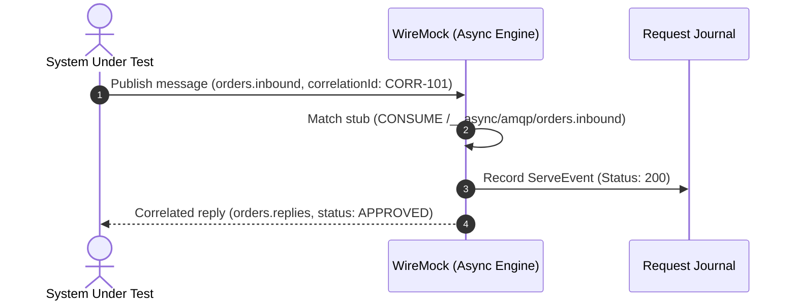
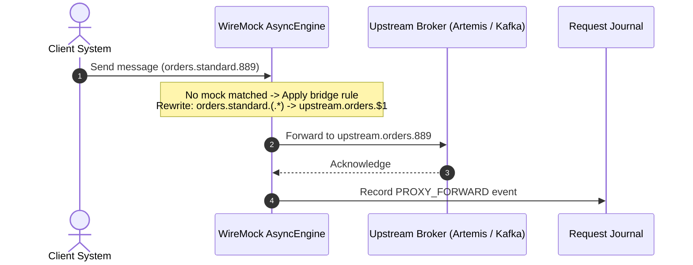
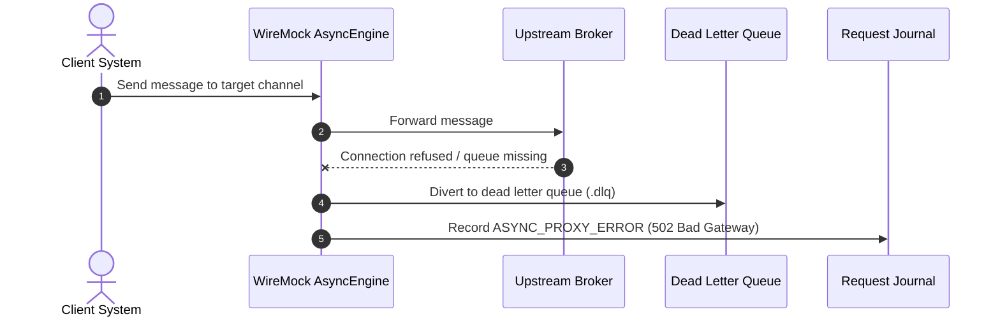
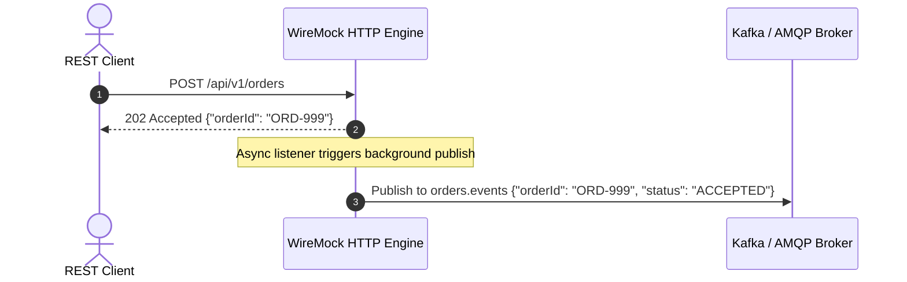
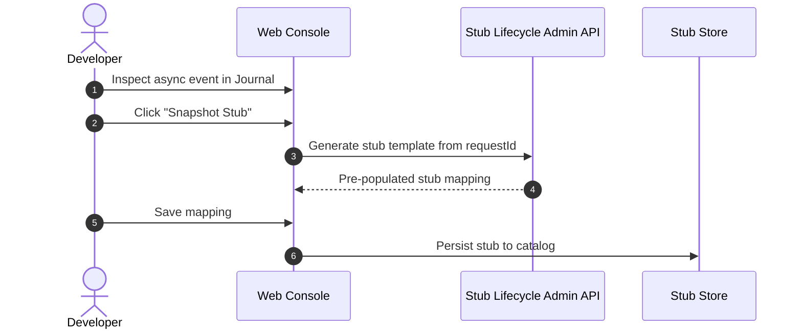

# WireMock Asynchronous Messaging & Queue Mocking Extension (`wiremock-extension-async`)

> [!IMPORTANT]
> **Beta Functionality**: Asynchronous messaging, queue bridging, and protocol simulation in WireMock are currently in active **Beta**. The stub schemas under `metadata.async`, in-process Netty Kafka wire sinks, AMQP 1.0 frame brokers, HTTP callback trigger listeners, and virtual-thread priority bridges are fully implemented and verified. Public SPI interfaces and metadata DSL properties may undergo minor refinement based on enterprise feedback.

---

## 1. Overview & Core Philosophy

`wiremock-extension-async` brings WireMock's core capabilities—flexible stub matching, templated response synthesis, fault injection, the Request Journal, and the Vanilla ES6 Web Console UI—to event-driven enterprise messaging:

- **Zero Standalone JVM Bloat**: WireMock never embeds heavyweight external broker daemons (ZooKeeper, KRaft, RabbitMQ, Artemis). It operates strictly as an ultra-lightweight in-memory Netty wire sink (< 2 MB memory overhead) or virtual-thread client bridge.
- **Zero Production Code Changes**: Systems Under Test (SUTs) interact with their standard queue and topic names over native protocols. WireMock achieves isolation and hybrid integration via transparent connection routing and priority bridging.
- **Unified Stub & Journal Surfaces**: Async stubs live as first-class WireMock stubs in `mappings/` alongside HTTP and Casual definitions. Inbound and reply messages mediate directly into WireMock's core `ServeEvent` journal pipeline (`CONSUME /__async/<protocol>/<channel>`).
- **Virtual-Thread Native**: Socket I/O, message dispatching, and templating execute on Java 21 virtual threads (`Thread.ofVirtual()`), preventing carrier-thread starvation and enabling thousands of concurrent simulated connections.
- **Multi-Protocol & Polyglot Ready**: Natively supports Apache Kafka wire framing, AMQP 1.0 (ActiveMQ Artemis, RabbitMQ, Azure Service Bus, IBM MQ 9.3+), Casual XATMI Queues, and complex polyglot payloads (escaped XML/SOAP strings nested inside JSON fields).

---

## 2. Subsystem Architecture



---

## 3. Supported Topologies

### 3.1. Topology 1: In-Process Zero-Ops Simulation (Hermetic Test & Docker)

When running unit tests or standalone WireMock in Docker containers, WireMock operates as a self-contained in-memory sink and broker. Downstream clients connect to ports 9092 (Kafka) or 5672 (AMQP) with zero external containers:



### 3.2. Topology 2: Dual-Broker Priority Bridge with Regex Rewriting

Solves the competing-consumer problem across Kafka, ActiveMQ, RabbitMQ, and IBM MQ without requiring test-specific headers or application modifications. WireMock intercepts high-priority test stubs locally, while transparently rewriting and forwarding unhandled traffic to upstream brokers:

```mermaid
flowchart LR
    SUT["System Under Test"] -->|orders.standard.456| TestBroker["Test Broker"]
    TestBroker --> WM["WireMock AsyncEngine"]

    WM -->|Priority 1: Mock Match| SUT
    WM -->|Priority 100: Rewrite ($1)| LiveBroker["Live Upstream Broker<br/>(upstream.orders.456)"]
    LiveBroker --> Backend["Downstream Services"]
```

---

## 4. Interaction Sequence Diagrams

### 4.1. Inbound Request-Reply Message Consumption



### 4.2. Priority Bridge with Upstream Forwarding & Regex Rewriting



### 4.3. Upstream Failure, 502 Bad Gateway & DLQ Diversion



### 4.4. Synchronous HTTP REST Call Triggering Asynchronous Kafka Event



### 4.5. 1-Click Snapshot Stubbing from Web Console Request Journal



---

## 5. Production Stub Examples by Use Case

### 5.1. In-Process Kafka Fire-and-Forget Sink

Consumes order event batches from Kafka producers. WireMock validates JSONPath schema constraints, acknowledges receipt (`204 No Content`), and records the message in the Request Journal:

```json
{
  "name": "Kafka Inbound Order Events Sink",
  "request": {
    "method": "CONSUME",
    "urlPath": "/__async/kafka/orders.events",
    "headers": {
      "content-type": {
        "equalTo": "application/json"
      }
    },
    "bodyPatterns": [
      {
        "matchesJsonPath": "$.orderId"
      },
      {
        "matchesJsonPath": "$.items[?(@.price > 0)]"
      }
    ]
  },
  "response": {
    "status": 204,
    "headers": {
      "X-Async-Ack": "ack",
      "X-Async-Partition": "0"
    }
  },
  "metadata": {
    "async": {
      "protocol": "kafka",
      "channel": "orders.events",
      "ackPolicy": "ack"
    }
  }
}
```

---

### 5.2. AMQP 1.0 / ActiveMQ Artemis Request-Reply with Dynamic Templating

Consumes payment authorization requests from an AMQP queue, matches currency and threshold headers, and synthesizes a correlated approval response delivered to the sender's `replyTo` destination with a simulated delay:

```json
{
  "name": "AMQP Payments Authorization Request-Reply",
  "request": {
    "method": "CONSUME",
    "urlPath": "/__async/amqp/payments.requests",
    "headers": {
      "x-currency": {
        "equalTo": "EUR"
      }
    },
    "bodyPatterns": [
      {
        "matchesJsonPath": "$.payment.amount"
      }
    ]
  },
  "response": {
    "status": 200,
    "headers": {
      "Content-Type": "application/json",
      "X-Async-Correlation-Id": "{{request.headers.X-Async-Correlation-Id}}",
      "X-Async-Reply-Channel": "{{request.headers.X-Async-Reply-To}}",
      "X-Processed-By": "wiremock-async-engine"
    },
    "jsonBody": {
      "transactionId": "{{randomValue type='UUID'}}",
      "status": "APPROVED",
      "amount": "{{jsonPath request.body '$.payment.amount'}}",
      "currency": "EUR",
      "processedAt": "{{now format='yyyy-MM-ddTHH:mm:ssZ'}}"
    },
    "fixedDelayMilliseconds": 85,
    "transformers": ["response-template"]
  },
  "metadata": {
    "async": {
      "protocol": "amqp",
      "broker": "amqp://127.0.0.1:5672",
      "channel": "payments.requests",
      "ackPolicy": "ack"
    }
  }
}
```

---

### 5.3. Synchronous HTTP REST Call Triggering Asynchronous Kafka Broadcast

Exposes a REST endpoint for submitting orders. Upon returning `202 Accepted`, WireMock's `AsyncMessagePublishingListener` automatically formats and publishes an asynchronous Kafka event to `notifications.broadcast`:

```json
{
  "name": "Submit Order with Asynchronous Kafka Event",
  "request": {
    "method": "POST",
    "urlPath": "/api/v1/orders"
  },
  "response": {
    "status": 202,
    "headers": {
      "Content-Type": "application/json"
    },
    "jsonBody": {
      "orderId": "{{randomValue type='UUID'}}",
      "status": "ACCEPTED",
      "submittedAt": "{{now format='epoch'}}"
    },
    "transformers": ["response-template"]
  },
  "metadata": {
    "async": {
      "produce": [
        {
          "protocol": "kafka",
          "destination": "notifications.broadcast",
          "key": "{{jsonPath response.body '$.orderId'}}",
          "headers": {
            "x-event-type": "OrderPlaced",
            "x-source-system": "wiremock-checkout"
          },
          "payload": "{\"orderId\":\"{{jsonPath response.body '$.orderId'}}\",\"event\":\"ORDER_PLACED\",\"status\":\"PENDING_PAYMENT\"}",
          "delayMs": 40
        }
      ]
    }
  }
}
```

---

### 5.4. Polyglot Payload Matching & Templating (Nested XML/SOAP inside JSON)

Handles enterprise integration pipelines where XML SOAP envelopes or legacy payloads are nested inside JSON transport structures (`escaped string literals`). WireMock inspects the nested payload without corruption, auto-unnests in the Web Console UI, and synthesizes templated responses:

```json
{
  "name": "Polyglot SOAP Envelope inside JSON Kafka Event",
  "request": {
    "method": "CONSUME",
    "urlPath": "/__async/kafka/trades.inbound",
    "bodyPatterns": [
      {
        "matchesJsonPath": "$.protocol",
        "equalTo": "FIX_XML"
      },
      {
        "matchesJsonPath": "$.xmlPayload"
      }
    ]
  },
  "response": {
    "status": 200,
    "headers": {
      "Content-Type": "application/json",
      "X-Async-Reply-Channel": "trades.settled"
    },
    "jsonBody": {
      "tradeId": "{{jsonPath request.body '$.tradeId'}}",
      "status": "SETTLED",
      "auditReceipt": "<receipt><status>CONFIRMED</status><clearedTimestamp>{{now format='epoch'}}</clearedTimestamp></receipt>"
    },
    "transformers": ["response-template"]
  },
  "metadata": {
    "async": {
      "protocol": "kafka",
      "channel": "trades.inbound",
      "ackPolicy": "ack"
    }
  }
}
```

---

### 5.5. Priority Bridge Rule with Regex Capture Group Rewriting (`$1`)

Defines a dynamic queue bridging rule. Inbound traffic matching `orders.standard.(.*)` is rewritten to `upstream.orders.$1` and forwarded to the live ActiveMQ Artemis broker:

```json
{
  "name": "Priority Bridge Rule - Standard Orders Rewriting",
  "priority": 100,
  "request": {
    "method": "CONSUME",
    "urlPattern": "/__async/amqp/orders\\.standard\\.(.*)"
  },
  "response": {
    "status": 200,
    "headers": {
      "X-Async-Target-Channel": "upstream.orders.$1",
      "X-Async-Proxy-Mode": "bridge"
    }
  },
  "metadata": {
    "async": {
      "mode": "bridge",
      "priority": 100,
      "sourcePattern": "orders\\.standard\\.(.*)",
      "targetDestination": "upstream.orders.$1"
    }
  }
}
```

---

### 5.6. Simulated Upstream 502 Bad Gateway & Error Injection

Injects an explicit connection drop, broker queue exhaustion, or missing queue error state, triggering the 4-pillar 502 Bad Gateway audit trail and DLQ routing:

```json
{
  "name": "Simulate Remote Broker Destination Queue Missing",
  "request": {
    "method": "CONSUME",
    "urlPath": "/__async/amqp/orders.faulty"
  },
  "response": {
    "status": 502,
    "headers": {
      "Content-Type": "application/json",
      "X-Async-Error": "Destination queue [orders.faulty] missing on remote broker",
      "X-Async-DLQ-Target": "orders.faulty.error"
    },
    "jsonBody": {
      "error": "ASYNC_PROXY_ERROR",
      "status": 502,
      "reason": "QueueNotFoundException",
      "details": "Remote broker rejected link attachment: queue not defined"
    }
  },
  "metadata": {
    "async": {
      "protocol": "amqp",
      "channel": "orders.faulty",
      "simulateError": "BAD_GATEWAY"
    }
  }
}
```

---

### 5.7. IBM MQ 9.3+ LTS Native AMQP Integration

Connects directly to modern IBM MQ Queue Managers over standard AMQP channels with zero proprietary IBM JAR dependencies or platform licensing restrictions:

```json
{
  "name": "IBM MQ Inbound Claims Queue Processing",
  "request": {
    "method": "CONSUME",
    "urlPath": "/__async/amqp/DEV.QUEUE.1",
    "headers": {
      "x-ibm-format": {
        "equalTo": "MQSTR"
      }
    },
    "bodyPatterns": [
      {
        "matchesJsonPath": "$.claimId"
      }
    ]
  },
  "response": {
    "status": 200,
    "headers": {
      "Content-Type": "application/json",
      "X-Async-Reply-Channel": "DEV.QUEUE.2",
      "X-IBM-Feedback": "0"
    },
    "jsonBody": {
      "claimId": "{{jsonPath request.body '$.claimId'}}",
      "adjudication": "APPROVED",
      "approvedAmount": 450.00
    },
    "transformers": ["response-template"]
  },
  "metadata": {
    "async": {
      "protocol": "amqp",
      "broker": "amqp://mq-host.enterprise.com:5672",
      "channel": "DEV.QUEUE.1",
      "ackPolicy": "ack"
    }
  }
}
```

---

## 6. Admin API Endpoints

The extension exposes management routes under `/__admin/async/` for health monitoring and dynamic test orchestration:

| Method | Endpoint | Description |
| :--- | :--- | :--- |
| `GET` | `/__admin/async/status` | Returns active sinks, connection lease counters, and consumed/produced metrics. |
| `GET` | `/__admin/async/journal` | Returns recent in-process async journal events (`CONSUME`, `PUBLISH`, `PROXY_FORWARD`, `ASYNC_PROXY_ERROR`). |
| `GET` | `/__admin/async/harvested` | Returns transient wire messages harvested by the live proxy bridge before being snapshotted into stubs. *(Note: All registered async stubs are standard WireMock stubs queried via `GET /__admin/mappings`)*. |
| `POST` | `/__admin/async/publish` | Injects a synthetic outbound message into a destination queue or topic for test harness coordination. |
| `POST` | `/__admin/async/sinks/kafka` | Dynamically starts or reconfigures the in-process Netty Kafka wire sink. |

### Example: Publish Synthetic Message via Admin API

```bash
curl -X POST http://localhost:8080/__admin/async/publish \
  -H "Content-Type: application/json" \
  -d '{
    "protocol": "amqp",
    "destination": "orders.inbound",
    "correlationId": "test-corr-456",
    "payload": "{\"orderId\":\"ORD-456\",\"amount\":120.50}",
    "headers": {
      "x-tenant": "acme-corp",
      "x-env": "test"
    }
  }'
```

---

## 7. Observability & Web Console Integration

- **Vanilla ES6 Request Journal (`/__admin/ui/#journal`)**:
  - Automatically identifies async traffic and applies high-visibility protocol badges: `.badge-KAFKA`, `.badge-CONSUME`, `.badge-ENQUEUE`, `.badge-DEQUEUE`.
  - Amber verdict pills (`.pill-proxy-error`) highlight 502 Bad Gateway proxy errors and remote queue attachment failures.
  - 1-Click **`📸 Snapshot Stub`** action converts any recorded async event directly into a WireMock stub definition inside the Stub Editor modal.
- **Unified Payload Lens**:
  - Pretty-prints and auto-unnesets multi-layered JSON, XML, Base64, and CDATA payloads.
  - Full-fidelity inspection with zero vertical scrollbars or layout voids.
- **OpenTelemetry & Prometheus Scrape Route (`/__admin/metrics/prometheus`)**:
  - `wiremock_requests_total{rpc_system="kafka", rpc_service="orders.events"}`
  - `wiremock_async_messages_consumed_total{protocol="amqp", channel="payments.requests"}`
  - `wiremock_async_messages_produced_total{protocol="kafka", destination="notifications.broadcast"}`

---

## 8. Native IBM MQ Support (Optional Runtime / Two-Task Packaging)

In addition to AMQP 1.0 channels on IBM MQ 9.3+, `wiremock-extension-async` provides native IBM MQ (`SVRCONN` / port `1414`) connectivity via `com.ibm.mq:com.ibm.mq.allclient` using JMS 2.0 (`QueueBrowser`, `JMSContext`) and **PCF** (`MQCMD_INQUIRE_Q`, `MQCMD_CLEAR_Q`).

- **Optional Zero-Bloat Library**: `com.ibm.mq.allclient` is declared `compileOnly` in `wiremock-extension-async`. `AsyncDestinationService` auto-registers `IbmMqDestinationProvider` (`protocol = "ibmmq"`) via reflection when `com.ibm.mq.jms.MQConnectionFactory` is present on the classpath.
- **Two Standalone Fat-JAR Tasks** (`wiremock-extension-bundle`):
  - **Lean (default)**: `./gradlew fatJar` builds `-standalone.jar` without IBM MQ libraries.
  - **With IBM MQ**: `./gradlew fatJarIbmMq` builds `-standalone-ibmmq.jar` bundling `com.ibm.mq.allclient` for standalone execution.
- **Integration Verification (Testcontainers)**:
  ```bash
  ./gradlew :wiremock-extension-async:ibmMqIntegrationTest
  ```
  Boots `icr.io/ibm-messaging/mq:latest` (`QM1`) to verify live PCF queue discovery, non-destructive `QueueBrowser` peek, header normalization (`x-tenant-id` → `x_tenant_id`), selective deletion, and queue purging.
