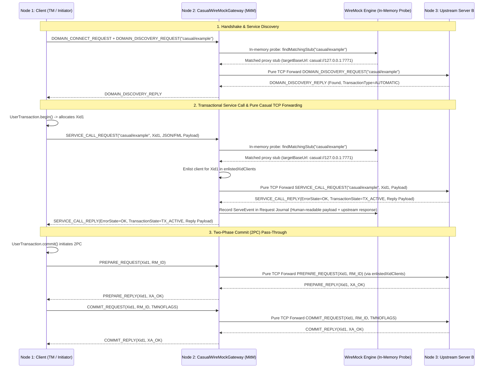
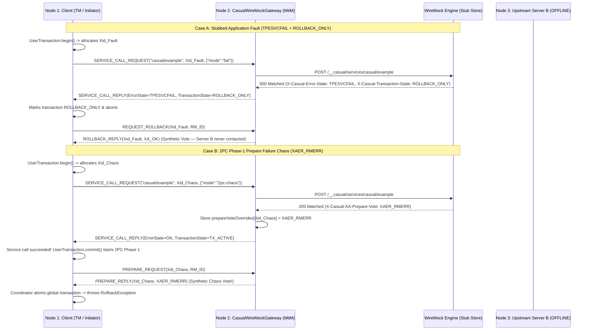

# `wiremock-extension-casual`

In-process **Casual (XATMI / Tuxedo) Domain Gateway & Protocol Simulation Extension** for WireMock Standalone (JDK 21).

Enables WireMock to act as an in-process Casual Domain Gateway listening on a raw TCP port. Clients communicating via Casual wire protocol (`tpcall`, `tpacall`, domain discovery) have their requests intercepted and matched against WireMock stubs—allowing realistic simulation of legacy enterprise, banking, and distributed transaction architectures without requiring a full C++ Casual domain broker, Oracle Tuxedo licenses, or heavy Jakarta EE / Quarkus application servers.

---

## 1. Key Capabilities

* **Pure Java SE 21 + Netty Engine**: High-performance, lightweight in-process server and client utilizing upstream `se.laz.casual:casual-network`, `casual-network-protocol`, and `casual-api`. Fully dynamic protocol negotiation across versions 1.0 to 1.5 (`1000`–`1005`). Zero Jakarta EE, JCA, WildFly, or Quarkus runtime dependencies required.
* **Transparent Domain Discovery Aggregation**: When an upstream domain is configured, dynamic service discovery queries both upstream services and local WireMock stubs (`/__casual/services/*`), merging them into a unified catalog. Empty discovery probes (`serviceNames = []`) discover the full upstream domain catalog.
* **Fail-Fast Protocol Mechanics & Low Timeouts**: Default 4-second upstream timeouts prevent client hangs. Socket errors or unsupported message types close TCP connections immediately rather than silently hanging or dropping frames. Timeouts produce actionable error messages citing the exact configuration flag.
* **Non-JSON Binary Buffer Support (`.FIELDED`, `CFIELD/`, `X_OCTET`)**: Binary and fielded buffers pass through transparently to upstream domains, and record/replay to WireMock stubs via Base64 serialization with `X-Casual-Buffer-Type` headers. Offline unmatched binary requests fail fast with `ErrorState.TPEITYPE`.
* **WireMock Stub Engine Integration**: Translates Casual service calls (`tpcall`) to internal WireMock request structures (`POST /__casual/services/{serviceName}`), unlocking WireMock’s full matching engine, JSON body patterns, scenario state machines, response templating, and request journal.
* **Stub Match Discrimination**: Accurately distinguishes matched stubs (flagged with `Matched-Stub-Id`) from unmatched services, preventing accidental short-circuits.
* **Transparent L7 Proxy Forwarding**: Seamlessly forwards unmatched service requests over TCP to an upstream real or secondary Casual domain.
* **Automatic Record-and-Replay**: Automatically captures forwarded upstream calls into persistent WireMock stubs (`recordStubs`), allowing test suites to be recorded once and replayed completely offline.
* **Full XATMI Failure Mode & Transaction Simulation**: Comprehensive simulation of all 18 XATMI error states, custom user return codes (`urcode`), and distributed transaction rollback states.
* **Hierarchical Observability**: Multi-tier SLF4J logging (`DEBUG` for inbound/outbound frame correlation and stub matches, `TRACE` for packet size inspection and canonical 128-byte hex dumps).

---

## 2. Architecture & Request Lifecycle

```
┌────────────────────────────────────────────────────────────────────────┐
│                        Casual Client (Java / C++)                      │
│                [tpcall("createOrder", "{...}")]                        │
└───────────────────────────────────┬────────────────────────────────────┘
                                    │ TCP (XATMI Protocol)
                                    ▼
┌────────────────────────────────────────────────────────────────────────┐
│          CasualWireMockGateway (In-Process Netty Server)               │
│                                                                        │
│  1. Decode Frame (CasualNWMessageDecoder / Protocol 1.0 - 1.5)        │
│  2. Dispatch to WireMock (POST /__casual/services/createOrder)         │
└───────────────────┬────────────────────────────────┬───────────────────┘
                    │                                │
      [Stub Matched in WireMock]           [Unmatched Request]
                    │                                │
                    ▼                                ▼
     ┌────────────────────────────┐    ┌───────────────────────────┐
     │ WireMock HTTP Stub Engine  │    │ Upstream Casual Domain    │
     │  - Evaluates body/headers  │    │  (Transparent Forwarding) │
     │  - Returns status/headers  │    └─────────────┬─────────────┘
     └──────────────┬─────────────┘                  │
                    │                                │ [Optional Record]
                    │                                ▼
                    │                  ┌───────────────────────────┐
                    │                  │ Record to WireMock Stubs  │
                    │                  │ (POST /__admin/mappings)  │
                    │                  └─────────────┬─────────────┘
                    │                                │
                    ▼                                ▼
┌────────────────────────────────────────────────────────────────────────┐
│        Synthesize CasualServiceCallReplyMessage & Return TCP Frame     │
│   (Status / X-Casual-Error-State / X-Casual-Transaction-State / urcode) │
└────────────────────────────────────────────────────────────────────────┘
```

---

## 3. Bidirectional L7 Protocol Normalization & Heterogeneous Interoperability

In enterprise topologies, clients and upstream domains often run disparate versions of the Casual protocol:
* **Legacy Clients (e.g. WildFly 3.3.x / JBoss EAP)**: Only support Protocols `1.0` through `1.2` (`[1000, 1001, 1002]`). They require transactional `XID` fields in `SERVICE_CALL_REPLY` (`3101`) and crash with `Unknown message type: 3103` if sent Protocol 1.3+ replies.
* **Modern Upstream Domains / Tuxedo Gateways**: Run Protocol `1.3` or `1.4` (`[1000..1004]`). They omit `XID` from `SERVICE_CALL_REPLY_V_1_3` (`3103`), require mandatory `parentSpan` in `SERVICE_CALL_REQUEST_V_1_3` (`3102`), and reject legacy `3100` frames with `Message type 3100 is not supported by protocol version VERSION_1_4`.

### Architectural Choice: L7 Gateway Normalization (Decoupled Legs)

Rather than forcing 1:1 protocol pass-through—which would break upstream connection pooling across heterogeneous clients and fail when upstream and downstream versions diverge—WireMock acts as a **true Layer 7 protocol-normalizing gateway**:

1. **Downstream Leg (Client -> Gateway)**: The client negotiates its preferred protocol version (`connVersion`) with `CasualServer`. All outbound service replies sent by `CasualServer` are strictly normalized to match `connVersion`:
   - If `connVersion < VERSION_1_3`: Replies are formatted as `CasualNWMessageType.SERVICE_CALL_REPLY` (`3101`), recovering the client's `XID` from the in-flight request.
   - If `connVersion >= VERSION_1_3`: Replies are formatted as `CasualNWMessageType.SERVICE_CALL_REPLY_V_1_3` (`3103`).
2. **Upstream Leg (Gateway -> Upstream Domain)**: The pooled `CasualTcpClient` negotiates the highest mutually supported protocol version with the upstream server (`upstreamVersion`). All forwarded requests are normalized to match `upstreamVersion`:
   - If `upstreamVersion >= VERSION_1_3`: Legacy requests are upgraded to `CasualNWMessageType.SERVICE_CALL_REQUEST_V_1_3` (`3102`), populating `parentSpan` with `SpanId.of()` when not present.
   - If `upstreamVersion < VERSION_1_3`: Requests are formatted as legacy `3100` frames.

This ensures zero framing desynchronization, maintains clean connection pooling, and allows legacy and modern enterprise components to interoperate transparently.

---

## 4. Fast Timeouts & Fail-Fast Mechanics

Enterprise internal networks expect fast resolution within 3–5 seconds. The extension defaults to a **4-second upstream timeout** and strict fail-fast error reporting:

### A. Configurable Upstream Timeout
Configure the timeout via system property or the gateway builder:
* **System Property**: `-Dwiremock.casual.upstream.timeout.seconds=<seconds>` (e.g. `-Dwiremock.casual.upstream.timeout.seconds=3`)
* **Builder API**: `CasualWireMockGateway.builder().upstreamTimeoutSeconds(5)`

When an upstream call times out, the client receives `ErrorState.TPESVCERR` and the log explicitly provides diagnostic hints:
```
[CASUAL-CLIENT-TIMEOUT] Upstream Casual call [SERVICE_CALL_REQUEST] to [server.internal:7771] timed out after 4s (correlationId=...). If your network or upstream service is slower, increase the timeout using system property -Dwiremock.casual.upstream.timeout.seconds=<seconds> or builder.upstreamTimeoutSeconds(int).
```

### B. Fail-Fast Socket Closure
To ensure client applications never hang or block indefinitely waiting for orphaned replies:
1. **Unsupported Message Types**: Inbound frames not recognized by the gateway immediately log an error and close the TCP channel (`ctx.close()`), triggering instant connection reset at the client.
2. **Channel Exceptions**: Any uncaught Netty decode or network exception immediately closes the socket.
3. **Offline Binary Payloads**: When unmatched binary buffers (`.FIELDED`, `CFIELD/`, `X_OCTET`) arrive while offline (no upstream configured), the gateway returns `ErrorState.TPEITYPE` immediately rather than attempting invalid JSON string coercion.

---

## 5. Binary, Fielded & Text Buffers (`JSON`, `CSTRING/`, `CFIELD/`, `X_OCTET`)

Casual applications use a variety of buffer formats. `CasualWireMockGateway` normalizes all payloads to **human-readable representations** in the WireMock Request Journal and stub definitions:

* **`JSON` (`.json/`, `JSON`)**: Ingested and stored directly as standard UTF-8 JSON text strings with `Content-Type: application/json`.
* **`CSTRING/`**: Null-terminated ASCII/UTF-8 C-strings are automatically stripped of trailing `\0` upon extraction and recorded as human-readable text with `Content-Type: text/plain; charset=UTF-8`. When returned to downstream clients, the null terminator is transparently restored.
* **`CFIELD/` / `.FIELDED`**: Fielded Buffers (FML) are automatically translated to/from structured JSON objects using `FieldedTypeBuffer` and `CasualFieldedLookup`. Downstream clients receive binary FML while WireMock journals and stubs display human-readable JSON properties (with graceful Base64 fallback if a field buffer is unmapped or binary).
* **`X_OCTET/` (Binary)**: Pure raw binary buffers fallback to standard Base64 encoding with `Content-Type: application/octet-stream`.
* **Live Upstream Proxying**: When forwarding to upstream Casual domains, buffers are proxied natively over TCP socket-to-socket without redundant conversion or lossy transcoding.
  ```json
  {
    "request": {
      "method": "POST",
      "url": "/__casual/services/fieldedService",
      "headers": {
        "X-Casual-Buffer-Type": { "equalTo": ".FIELDED" }
      },
      "bodyPatterns": [ { "equalTo": "AQIDBAU=" } ]
    },
    "response": {
      "status": 200,
      "headers": {
        "Content-Type": "application/octet-stream",
        "X-Casual-Buffer-Type": ".FIELDED"
      },
      "body": "BgcICQoL"
    }
  }
  ```
* **Offline Replay**: When replaying, the gateway decodes the Base64 response body back to raw bytes and constructs a native `ServiceBuffer` matching the declared buffer type.

---

## 6. Observability & Debug Logging Guide

The Casual extension uses standard **SLF4J** logging. For inbound requests, outbound responses, and stub checks, structured log messages provide complete visibility into connection states, correlation IDs, and transaction XIDs.

### Log Levels
* **`DEBUG`**: Logs connection events, inbound frame headers (service name, buffer type, payload size, XID, execution UUID), WireMock stub match/unmatch status, upstream proxy forwarding, and stub recordings.
* **`TRACE`**: Guarded payload logging including canonical 128-byte hex dumps (`CasualBufferUtils.toHexDump(...)`) for diagnosing byte-level protocol mismatches.

### How to Enable Debug Logging

#### 1. In `StandaloneDevServer` (Gradle)
Pass the SLF4J simple logger system property when running the bundle:
```bash
./gradlew :wiremock-extension-bundle:runStandalone -Dorg.slf4j.simpleLogger.defaultLogLevel=debug
```
Or target only the Casual extension:
```bash
./gradlew :wiremock-extension-bundle:runStandalone \
  -Dorg.slf4j.simpleLogger.log.se.laz.casual=debug \
  -Dorg.slf4j.simpleLogger.log.com.github.mattiasgreen.wiremock.casual=debug
```

#### 2. In WireMock Standalone JAR
Pass the logging configuration on the command line:
```bash
java -Dorg.slf4j.simpleLogger.defaultLogLevel=debug \
     -cp "wiremock-standalone-3.x.jar:wiremock-extension-casual.jar" \
     com.github.tomakehurst.wiremock.standalone.WireMockServerRunner
```

#### 3. In Docker Containers
Pass JVM flags via `JAVA_OPTS`:
```bash
docker run -it -p 8080:8080 -p 7001:7001 \
  -e JAVA_OPTS="-Dorg.slf4j.simpleLogger.defaultLogLevel=debug -Dwiremock.casual.upstream.timeout.seconds=5" \
  wiremock-custom:latest
```

---

## 7. XATMI Failure Modes, Error States & Transaction Simulation

The gateway faithfully reproduces Tuxedo / XATMI protocol behavior and distributed transaction semantics:

### A. All 18 Casual / XATMI Error States Supported
The gateway inspects the response header `X-Casual-Error-State` (case-insensitive) to set the exact `se.laz.casual.api.flags.ErrorState`:

| ErrorState | Code | Description | Typical HTTP Mapping |
| :--- | :--- | :--- | :--- |
| **`OK`** | 0 | Service call succeeded | `200` |
| **`TPEBADDESC`** | 2 | Invalid descriptor | `400` |
| **`TPEBLOCK`** | 3 | Blocking condition encountered | `429` |
| **`TPEINVAL`** | 4 | Invalid arguments | `400` |
| **`TPELIMIT`** | 5 | Resource limit exceeded | `429` |
| **`TPENOENT`** | 6 | Service does not exist in domain | `404` |
| **`TPEOS`** | 7 | Operating system error | `500` |
| **`TPEPROTO`** | 9 | Protocol violation | `500` |
| **`TPESVCERR`** | 10 | Service error / infrastructure crash | `502` / `503` |
| **`TPESVCFAIL`** | 11 | Application business logic failure with payload | `500` |
| **`TPESYSTEM`** | 12 | System failure | `500` |
| **`TPETIME`** | 13 | Timeout reached | `408` / `504` |
| **`TPETRAN`** | 14 | Transaction error | `500` |
| **`TPGOTSIG`** | 15 | Signal received | `500` |
| **`TPEITYPE`** | 17 | Invalid input buffer type | `415` |
| **`TPEOTYPE`** | 18 | Invalid output buffer type | `406` |
| **`TPEEVENT`** | 22 | Event occurred | `200` |
| **`TPEMATCH`** | 24 | Match error | `500` |

### B. Automatic HTTP Status Fallback
When `X-Casual-Error-State` is omitted from a stub, the gateway infers the appropriate XATMI error code from standard HTTP status conventions:
* **`2xx`** $\rightarrow$ `ErrorState.OK`
* **`400`** $\rightarrow$ `ErrorState.TPEINVAL` (Invalid argument)
* **`404`** $\rightarrow$ `ErrorState.TPENOENT` (Service not found)
* **`408`** / **`504`** $\rightarrow$ `ErrorState.TPETIME` (Timeout)
* **`429`** $\rightarrow$ `ErrorState.TPELIMIT` (Limit exceeded)
* **`502`** / **`503`** $\rightarrow$ `ErrorState.TPESVCERR` (Infrastructure error)
* **`500`** $\rightarrow$ `ErrorState.TPESVCFAIL` (Application failure)

### C. User-Defined Error Codes (`urcode`)
In XATMI, services return custom application codes via `tpreturn(int rval, long rcode, ...)`. Simulate this via:
* **`X-Casual-User-Supplied-Error: <long>`** (or `X-Casual-User-Code` / `X-Casual-User-Defined-Code`)

### D. Transaction State (`TransactionState`)
Simulate distributed transaction status (e.g. marking a transaction rollback-only upon error):
* **`X-Casual-Transaction-State`**:
  * `TX_ACTIVE` (default)
  * `ROLLBACK_ONLY`
  * `TIMEOUT_ROLLBACK_ONLY`
  * `ERROR`

---

## 8. Stub-Driven Dynamic Proxying & Multi-Upstream 2PC Stickiness

Rather than requiring out-of-band global upstream host/port configuration or separate proxy transformers, `wiremock-extension-casual` implements **stub-driven dynamic proxying**:

### A. Dynamic Proxy Routing via WireMock Stubs
Upstream Casual destinations are declared natively in standard WireMock stubs where `targetBaseUrl` starts with `casual://`:

```java
wireMock.stubFor(post(urlMatching("/__casual/services/.*"))
        .withName("Billing Service Proxy")
        .atPriority(10)
        .withMetadata(Map.of(
                "mode", "proxy",
                "targetBaseUrl", "casual://billing-upstream.internal:7771"))
        .willReturn(aResponse().withStatus(200)));
```

* **Microsecond In-Memory Probing**: For every inbound Casual frame, the gateway evaluates WireMock's stub store in-memory. Zero Jetty or HTTP loopback overhead.
* **Priority Matching**: Priority ordering is strictly respected. High-priority mock stubs (e.g., Priority 1) override broad proxy routes (e.g., Priority 10) without modifying proxy rules.
* **Zero Superfluous Protocol Conversion**: When a stub matches with `casual://...`, the gateway establishes a pooled TCP connection directly to the target upstream domain, forwarding the native Casual frame socket-to-socket. No ping-pong through HTTP.

### B. Multi-Upstream 2PC / XA Transaction Stickiness
In Tuxedo and Casual, Two-Phase Commit frames (`PREPARE_REQUEST`, `COMMIT_REQUEST`, `ROLLBACK_REQUEST`) only transmit the transaction identifier (`Xid`), **not** the `serviceName`. Therefore, distributed transactions cannot resolve upstream destinations by URL path at commit time.

`CasualWireMockGateway` tracks dynamic enlistment stickiness (`enlistedXidClients`):
* Any upstream connection utilized during an active transaction (`Xid`) is tracked in memory.
* When 2PC frames arrive for that `Xid`, the gateway forwards the prepare/commit/rollback requests to all enlisted upstream domains.
* Supports **multi-upstream transactions** spanning different remote domains under a single global XA coordinator.

### C. Standard Snapshot Recording & Offline Replay
Because proxying records standard `ServeEvent`s into the WireMock Request Journal, you can capture stubs using WireMock's built-in Snapshot API:

```java
// Snapshot recorded live proxy interactions into offline stubs
wireMock.snapshotRecord(recordSpec()
        .makeStubsPersistent(false)
        .extractTextBodiesOver(Long.MAX_VALUE)
        .extractBinaryBodiesOver(Long.MAX_VALUE));
```

Once snapshot, upstream servers can be shut down entirely. WireMock serves recorded stubs offline while the gateway acts as a **Synthetic XA Resource Manager**, voting `XA_OK` to complete client 2PC commit loops.

### D. Ready-Made JSON Proxy Stub for `StandaloneDevServer` & CLI

When running `StandaloneDevServer` locally:
```bash
./gradlew :wiremock-extension-bundle:runStandalone
```
WireMock runs on HTTP port `8080`, and the Casual TCP Gateway listens on `casual://127.0.0.1:7772`.

You can immediately configure Casual proxying by importing the ready-made stub mapping [`wiremock-examples/casual-proxy-stub.json`](../wiremock-examples/casual-proxy-stub.json):

```json
{
  "id": "10000000-0000-0000-0000-000000000005",
  "name": "Casual Upstream Dynamic Proxy",
  "priority": 10,
  "request": {
    "method": "POST",
    "urlPattern": "/__casual/services/.*"
  },
  "response": {
    "status": 200
  },
  "metadata": {
    "project": "Billing Platform",
    "mode": "proxy",
    "protocol": "casual",
    "targetBaseUrl": "casual://127.0.0.1:7771"
  }
}
```

#### Key Properties:
* **`urlPattern: "/__casual/services/.*"`**: Matches any inbound Casual `tpcall` or `tpacall` arriving at the TCP gateway.
* **`priority: 10`**: Functions as a low-priority proxy fallback. Any specific mocks configured with higher priority (e.g. Priority 1–5) will intercept their service calls locally, while unmocked services forward to upstream.
* **`metadata.targetBaseUrl: "casual://<upstream-host>:<port>"`**: Instructs `CasualWireMockGateway` to proxy directly over native TCP to the designated Casual domain.
* **`metadata.mode: "proxy"`**: Flags the stub in the WireMock Console UI (`http://localhost:8080/__admin/ui`) as a live proxy route with the **LIVE PROXY** badge and enables the 1-click **Harvest & Flip to Stubs** workflow.

#### Loading into StandaloneDevServer:
```bash
# Option 1: Load individual Casual proxy stub via WireMock Admin API
curl -X POST http://localhost:8080/__admin/mappings \
  -H "Content-Type: application/json" \
  -d @wiremock-examples/casual-proxy-stub.json

# Option 2: Import complete examples bundle (HTTP mocks + Casual dynamic proxy)
curl -X POST http://localhost:8080/__admin/mappings/import \
  -H "Content-Type: application/json" \
  -d @wiremock-examples/example-stubs.json

# Option 3: Import via WireMock Console UI
# Open http://localhost:8080/__admin/ui, click 'Import Spec / Bundle', and paste the JSON
```

### E. End-to-End Live Recording & Offline Replay Recipe

Here is the complete inner loop for proxying live Casual interactions, recording them into persistent JSON stubs, and transitioning to 100% offline simulation:

1. **Start `StandaloneDevServer`**:
   ```bash
   ./gradlew :wiremock-extension-bundle:runStandalone
   ```
   WireMock is listening on `http://localhost:8080` and the Casual TCP Gateway is on port `7772`.

2. **Register the Proxy Stub**:
   Post [`wiremock-examples/casual-proxy-stub.json`](../wiremock-examples/casual-proxy-stub.json) to `http://localhost:8080/__admin/mappings`. Update `targetBaseUrl` to point to your live upstream Casual server (e.g. `casual://127.0.0.1:7771` or `casual://billing-upstream.internal:7771`).

3. **Execute Client Traffic**:
   Configure your Casual client / application (e.g. `casual-java`, WildFly, Tuxedo gateway, C++ client, Quarkus app) to connect to WireMock's Casual Gateway at `127.0.0.1:7772`.
   When the client issues `tpcall("billing.charge", ...)`, WireMock:
   - Evaluates in-memory stubs and matches the proxy mapping.
   - Forwards the raw XATMI frame socket-to-socket over TCP to `127.0.0.1:7771`.
   - Returns the upstream reply to the client.
   - Logs the full request/response exchange into the WireMock Request Journal.

4. **Snapshot Record to Generate Persistent Stubs**:
   Capture all recorded live proxy calls from the journal into permanent offline stubs via the Admin API:
   ```bash
   curl -X POST http://localhost:8080/__admin/recordings/snapshot \
     -H "Content-Type: application/json" \
     -d '{
       "outputFormat": "FULL",
       "persist": true,
       "extractBodyCriteria": {
         "textSizeThreshold": "0",
         "binarySizeThreshold": "0"
       }
     }'
   ```
   *UI Alternative*: In the WireMock Console Web UI at [http://localhost:8080/__admin/ui](http://localhost:8080/__admin/ui), open the **Request Journal** tab and click **Snapshot / Harvest**, or click the project mode pill to switch from **LIVE PROXY** to **STUBS**.

5. **Verify Recorded Offline Stubs**:
   WireMock automatically synthesizes offline stubs:
   - JSON payloads are recorded as human-readable JSON strings with `Content-Type: application/json`.
   - Fielded buffers (`.FIELDED` / `CFIELD/`) are mapped to structured JSON or Base64 with `X-Casual-Buffer-Type`.
   - Null-terminated C-strings (`CSTRING/`) are recorded as clean UTF-8 text.

6. **100% Offline Decoupling & Synthetic XA Execution**:
   Stop or disconnect the upstream server (`127.0.0.1:7771`).
   Subsequent client calls to the recorded services succeed 100% offline:
   - WireMock serves responses directly from the recorded stubs.
   - If the client executes a Two-Phase Commit transaction (JTA / Narayana), `CasualWireMockGateway` acts as a **Synthetic XA Resource Manager**, automatically replying `XA_OK` to `PREPARE_REQUEST` and `COMMIT_REQUEST`.

---

## 9. Configuration & Admin API Control Plane

The Casual extension supports lightweight configuration via environment properties or dynamic REST API queries. Extending WireMock Standalone (where the main HTTP port is configured via `--port`), extension ports and settings are configured strictly via environment properties:

### A. Environment Properties

| Setting | Environment Property | Default | Description |
| :--- | :--- | :--- | :--- |
| **Gateway Port** | `WIREMOCK_CASUAL_PORT` | `7772` | TCP port where the Casual server listens. |
| **Casual Enabled** | `WIREMOCK_CASUAL_ENABLED` | `true` | Enables or disables the Casual TCP gateway. |
| **Upstream Timeout** | `WIREMOCK_CASUAL_UPSTREAM_TIMEOUT` | `4` | Upstream timeout in seconds before failing fast. |

### B. Admin API REST Control Plane (`/__admin/casual/config`)

Inspect the Casual gateway state at runtime:
```bash
curl http://localhost:8080/__admin/casual/config
```
Returns `200 OK`:
```json
{
  "enabled": true,
  "port": 7772,
  "running": true
}
```

---

## 10. Usage & Stubbing Examples

### A. Starting the Gateway in Tests
```java
// 1. Start WireMock
WireMockServer wireMock = new WireMockServer(wireMockConfig().dynamicPort());
wireMock.start();

// 2. Start Casual Gateway
CasualWireMockGateway gateway = CasualWireMockGateway.builder()
        .port(0) // dynamic TCP port
        .wireMockBaseUrl(wireMock.baseUrl())
        .build();
gateway.start();

int tcpPort = gateway.getPort();
```

### B. Successful Service Stub with JSON Payload
```java
wireMock.stubFor(post(urlEqualTo("/__casual/services/createOrder"))
        .withRequestBody(equalToJson("{\"amount\": 150.0, \"currency\": \"SEK\"}"))
        .willReturn(aResponse()
                .withStatus(200)
                .withHeader("Content-Type", "application/json")
                .withBody("{\"orderId\": \"ORD-9988\", \"status\": \"CONFIRMED\"}")));
```

### C. Simulating Business Failure with User Code and Rollback
```java
wireMock.stubFor(post(urlEqualTo("/__casual/services/transferFunds"))
        .willReturn(aResponse()
                .withStatus(500)
                .withHeader("Content-Type", "application/json")
                .withHeader("X-Casual-Error-State", "TPESVCFAIL")
                .withHeader("X-Casual-User-Supplied-Error", "4001") // Custom business code
                .withHeader("X-Casual-Transaction-State", "ROLLBACK_ONLY")
                .withBody("{\"error\": \"Insufficient funds\", \"balance\": 4.50}")));
```

### D. Configuring Dynamic Stub-Driven Casual Proxy (Java)
```java
// Routes all /__casual/services/* calls to an upstream Casual server
wireMock.stubFor(post(urlMatching("/__casual/services/.*"))
        .withName("Casual Proxy to Billing")
        .atPriority(10)
        .withMetadata(Map.of(
                "mode", "proxy",
                "targetBaseUrl", "casual://upstream.billing.internal:7771"))
        .willReturn(aResponse().withStatus(200)));
```

### E. Ready-Made JSON-Based Stub Definitions (cURL & Admin API)

#### 1. Dynamic Proxy Stub (`casual-proxy-stub.json`)
```json
{
  "name": "Casual Proxy Route (Billing Platform)",
  "priority": 10,
  "request": {
    "method": "POST",
    "urlPattern": "/__casual/services/.*"
  },
  "response": {
    "status": 200
  },
  "metadata": {
    "project": "Billing Platform",
    "mode": "proxy",
    "protocol": "casual",
    "targetBaseUrl": "casual://127.0.0.1:7771"
  }
}
```
Register via cURL:
```bash
curl -X POST http://localhost:8080/__admin/mappings \
  -H "Content-Type: application/json" \
  -d @wiremock-examples/casual-proxy-stub.json
```

#### 2. Specific Local Mock Stub (Overrides Proxy Fallback)
```json
{
  "name": "Billing Charge Mock (Local Override)",
  "priority": 5,
  "request": {
    "method": "POST",
    "url": "/__casual/services/billing.charge"
  },
  "response": {
    "status": 200,
    "headers": {
      "Content-Type": "application/json",
      "X-Casual-Error-State": "OK"
    },
    "body": "{\"txId\":\"tx-9012\",\"amount\":99.0,\"status\":\"COMMITTED\"}"
  },
  "metadata": {
    "project": "Billing Platform",
    "protocol": "casual"
  }
}
```
Register via cURL:
```bash
curl -X POST http://localhost:8080/__admin/mappings \
  -H "Content-Type: application/json" \
  -d '{
    "name": "Billing Charge Mock (Local Override)",
    "priority": 5,
    "request": {
      "method": "POST",
      "url": "/__casual/services/billing.charge"
    },
    "response": {
      "status": 200,
      "headers": {
        "Content-Type": "application/json",
        "X-Casual-Error-State": "OK"
      },
      "body": "{\"txId\":\"tx-9012\",\"amount\":99.0,\"status\":\"COMMITTED\"}"
    },
    "metadata": {
      "project": "Billing Platform",
      "protocol": "casual"
    }
  }'
```

#### 3. Trigger Snapshot Recording
Snapshot all proxied requests into offline stubs:
```bash
curl -X POST http://localhost:8080/__admin/recordings/snapshot \
  -H "Content-Type: application/json" \
  -d '{
    "outputFormat": "FULL",
    "persist": true,
    "extractBodyCriteria": {
      "textSizeThreshold": "0",
      "binarySizeThreshold": "0"
    }
  }'
```

---

## 11. Test Suite & Verification Matrix

The test suite covers comprehensive unit, integration, and E2E scenarios across multiple test sets:

* **Unit & Fail-Fast Tests**:
  * [`CasualBufferUtilsTest`](src/test/java/se/laz/casual/api/buffer/CasualBufferUtilsTest.java): JSON detection (`.json/`, `JSON`), Base64 wrapping/unwrapping, and hex dump formatting.
  * [`CasualServerFailFastTest`](src/test/java/se/laz/casual/server/CasualServerFailFastTest.java): Netty `EmbeddedChannel` tests verifying immediate channel closure on unhandled frames or pipeline exceptions.
  * [`CasualConfigurationTest`](src/test/java/com/github/mattiasgreen/wiremock/casual/CasualConfigurationTest.java): Environment variable, system property precedence, and upstream auto-enablement.
  * [`CasualAdminEndpointTest`](src/test/java/com/github/mattiasgreen/wiremock/casual/CasualAdminEndpointTest.java): Admin API REST control plane (`/__admin/casual/config` and `/reset`) runtime updates.
* **Gateway Suite (26 Scenarios)** in [`CasualWireMockGatewayTest`](src/test/java/com/github/mattiasgreen/wiremock/casual/CasualWireMockGatewayTest.java):
  * Service discovery aggregation (upstream + local WireMock stubs).
  * Standard JSON stubbing, payload matching, and discrimination of matched 404 stubs.
  * Transparent proxying of service calls and 2PC XA prepare/commit/rollback messages.
  * Base64 `.FIELDED` non-JSON proxying, recording, and replay.
  * Fail-fast `TPEITYPE` on unmatched binary buffers when offline.
  * Fast timeout handling with actionable property hints (`-Dwiremock.casual.upstream.timeout.seconds`).
* **Quarkus 2PC E2E Integration Suite (6 Scenarios)** in [`CasualEndToEndIntegrationTest`](src/quarkusTest/java/com/github/mattiasgreen/wiremock/casual/integration/CasualEndToEndIntegrationTest.java):
  * 3-node distributed transaction topology (Quarkus REST Client + WireMock Casual Gateway + Upstream Quarkus Server).
  * JTA / Narayana two-phase commit pass-through and application-level rollbacks.
  * 2PC Phase-1 prepare failure chaos (`XAER_RMERR`).
  * Multi-node discovery aggregation and `.FIELDED` binary buffer 2PC pass-through.

---

## 12. Multi-Node Integration Test Architecture & Scenario Flyovers

To validate end-to-end distributed transactions (JTA/Narayana 2PC) and transparent Man-in-the-Middle (MitM) behavior without slowing down the inner unit-test loop, `wiremock-extension-casual` provides an isolated integration test suite (`quarkusIntegrationTest`) modeling a 3-node Casual topology:

```
┌─────────────────────────────────────────────────────────────────────────────────────────────────┐
│                         3-Node Casual / WireMock MitM Test Topology                             │
├─────────────────────────────────────────────────────────────────────────────────────────────────┤
│                                                                                                 │
│  ┌─────────────────────────┐       ┌─────────────────────────────────┐       ┌───────────────┐  │
│  │  Node 1: Client Server  │       │   Node 2: WireMock Casual MitM  │       │ Node 3: Real  │  │
│  │   (casual-quarkus A)    │       │     (CasualWireMockGateway)     │       │ Casual Server │  │
│  │                         │       │                                 │       │  (Server B)   │  │
│  │  • REST Endpoint        │       │  • Netty Casual Inbound (:7772) │       │               │  │
│  │  • Narayana JTA TM      │       │  • CasualTransactionHandler     │       │ • Inbound     │  │
│  │  • Outbound Pool ───────┼──────►│  • WireMock HTTP Engine (:8089) │       │   (:7771)     │  │
│  │    (target -> :7772)    │  TCP  │  • Upstream Netty Client ───────┼──────►│ • @CasualSvc  │  │
│  │                         │ Framing│    (upstream -> :7771)         │  TCP  │ • Local XA RM │  │
│  └─────────────────────────┘       └─────────────────────────────────┘       └───────────────┘  │
│                                                                                                 │
└─────────────────────────────────────────────────────────────────────────────────────────────────┘
```

### Scenario Flyover 1: Stub-Driven Proxying & Journal Recording (With 2PC Pass-Through)
When `CasualWireMockGateway` sits between **Node 1 (Client Initiator)** and **Node 3 (Upstream Server B)** with a WireMock proxy stub (`targetBaseUrl = "casual://127.0.0.1:7771"`):



* **Key Takeaway**: Because `Xid1` was routed to **Node 3**, the gateway records the upstream client connection in `enlistedXidClients` and transparently forwards both `PREPARE_REQUEST` and `COMMIT_REQUEST` socket-to-socket over TCP. The interaction is recorded as a standard `ServeEvent` in WireMock's Request Journal and can be snapshotted into offline stubs at any time via `wireMock.snapshotRecord(...)`.

---

### Scenario Flyover 2: Offline Stubbing, Application Faults & 2PC Chaos Simulation
Once stubs are defined (or recorded from Scenario 1), **Node 3 (Upstream Server B)** can be shut down completely. **Node 2 (`CasualWireMockGateway`)** now acts as both the service endpoint and a **Synthetic XA Resource Manager**:



* **Key Takeaway**: Without running a real upstream Casual server or JEE Transaction Manager inside WireMock, tests can deterministically verify both **application-level rollbacks** (`TPESVCFAIL` + `ROLLBACK_ONLY` during the service call) and **infrastructure-level 2PC commit/prepare hazards** (`XAER_RMERR`, `XA_RBROLLBACK`, `XA_HEURRB` during `UserTransaction.commit()`).

---

## 13. Future Roadmap & Native Matching Engine

See [`TODO.md`](TODO.md) for detailed architectural evaluations, including:
* **In-Process WireMock `Request` Adapter**: Bypassing HTTP loopback sockets to evaluate directly against WireMock’s in-memory `StubMappings` for sub-millisecond ($\sim 50\mu\text{s}$) latency.
* **Native Custom Matchers**: Adding a `RequestMatcherExtension` (`CasualFieldedMatcher`) to unpack and match on `.FIELDED` / FML binary buffers without requiring string conversions.
* **Upstream Contributions**: Upstreaming standalone Java SE Netty client and server components to `casualcore/casual-java`.

---

## 14. Direct Upstream Git Sources (`casualcore/casual-java` & `casualcore/casual-quarkus`)

The extension builds upon upstream `se.laz.casual` libraries (`casual-api`, `casual-network`, `casual-network-protocol`). Rather than relying on decompilation or downloading source JARs manually, developers and coding agents should work directly with the actual upstream Git repositories cloned under `.upstream/`:

```bash
# Clone or update upstream repositories locally:
powershell -ExecutionPolicy Bypass -File .agents/scripts/sync-upstream-casual.ps1
```

- **Commit History & Blame**: Use `git log -S <symbol>` to track when specific message decoders, validators, or protocol versions were introduced.
- **Tag Inspection**: Checkout specific release tags (e.g. `git checkout 3.4.0`) to compare behaviors against the version specified in `gradle/libs.versions.toml`.
- **Zero Decompilation**: Original Java source files with author comments, tests, and commit discussions are always accessible.
