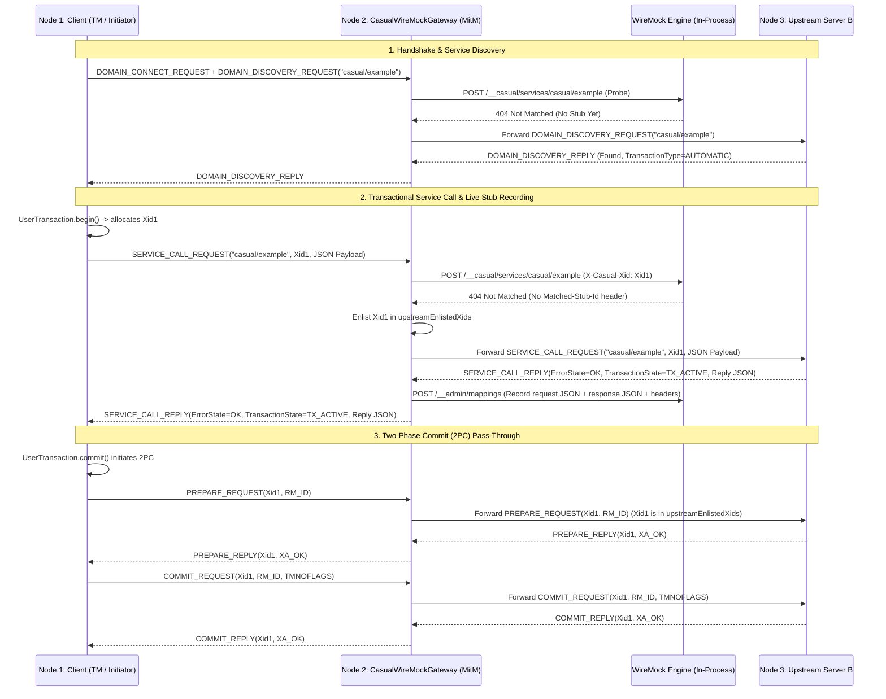
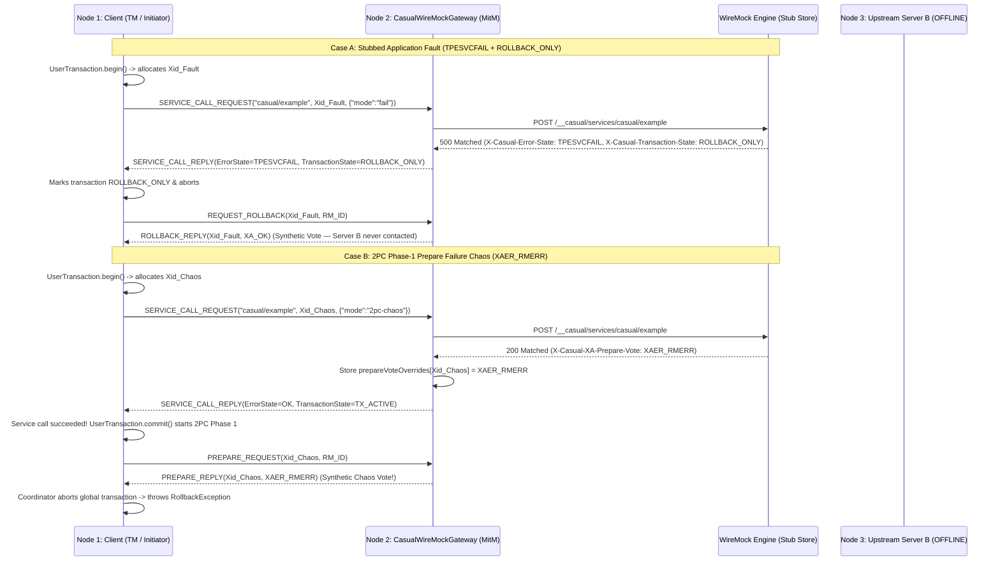

# `wiremock-extension-casual`

In-process **Casual (XATMI / Tuxedo) Domain Gateway & Protocol Simulation Extension** for WireMock Standalone (JDK 21).

Enables WireMock to act as an in-process Casual Domain Gateway listening on a raw TCP port. Clients communicating via Casual wire protocol (`tpcall`, `tpacall`, domain discovery) have their requests intercepted and matched against WireMock stubs—allowing realistic simulation of legacy enterprise, banking, and distributed transaction architectures without requiring a full C++ Casual domain broker, Oracle Tuxedo licenses, or heavy Jakarta EE / Quarkus application servers.

---

## 1. Key Capabilities

* **Pure Java SE 21 + Netty Engine**: High-performance, lightweight in-process server and client utilizing upstream `se.laz.casual:casual-network`, `casual-network-protocol`, and `casual-api`. Fully dynamic protocol negotiation across versions 1.0 to 1.5 (`1000`–`1005`). Zero Jakarta EE, JCA, WildFly, or Quarkus runtime dependencies required.
* **Transparent Domain Discovery Aggregation**: When an upstream domain is configured, dynamic service discovery queries both upstream services and local WireMock stubs (`/__casual/services/*`), merging them into a unified catalog. Empty discovery probes (`serviceNames = []`) discover the full upstream domain catalog.
* **Fail-Fast Protocol Mechanics & Low Timeouts**: Default 4-second upstream timeouts prevent client hangs. Socket errors or unsupported message types close TCP connections immediately rather than silently hanging or dropping frames. Timeouts produce actionable error messages citing the exact configuration flag.
* **Non-JSON Binary Buffer Support (`.FIELDED`, `CFIELD/`, `X_OCTET`)**: Binary and fielded buffers pass through transparently to upstream domains, and record/replay to WireMock stubs via Base64 serialization with `X-Casual-Buffer-Type` headers. Offline unmatched binary requests fail fast with `ErrorState.TPEITYPE`.
* **WireMock Stub Engine Integration**: Translates Casual service calls (`tpcall`) to internal WireMock request structures (`POST /__casual/services/{serviceName}`), unlocking WireMock’s full matching engine, JSON body patterns, scenario state machines, response templating, and request journal.
* **Stub Match Discrimination**: Accurately distinguishes matched stubs (flagged with `Matched-Stub-Id`) from unmatched services, preventing accidental short-circuits.
* **Transparent L7 Proxy Forwarding**: Seamlessly forwards unmatched service requests over TCP to an upstream real or secondary Casual domain.
* **Automatic Record-and-Replay**: Automatically captures forwarded upstream calls into persistent WireMock stubs (`recordStubs`), allowing test suites to be recorded once and replayed completely offline.
* **Full XATMI Failure Mode & Transaction Simulation**: Comprehensive simulation of all 18 XATMI error states, custom user return codes (`urcode`), and distributed transaction rollback states.
* **Hierarchical Observability**: Multi-tier SLF4J logging (`DEBUG` for inbound/outbound frame correlation and stub matches, `TRACE` for packet size inspection and canonical 128-byte hex dumps).

---

## 2. Architecture & Request Lifecycle

```
┌────────────────────────────────────────────────────────────────────────┐
│                        Casual Client (Java / C++)                      │
│                [tpcall("createOrder", "{...}")]                        │
└───────────────────────────────────┬────────────────────────────────────┘
                                    │ TCP (XATMI Protocol)
                                    ▼
┌────────────────────────────────────────────────────────────────────────┐
│          CasualWireMockGateway (In-Process Netty Server)               │
│                                                                        │
│  1. Decode Frame (CasualNWMessageDecoder / Protocol 1.0 - 1.5)        │
│  2. Dispatch to WireMock (POST /__casual/services/createOrder)         │
└───────────────────┬────────────────────────────────┬───────────────────┘
                    │                                │
      [Stub Matched in WireMock]           [Unmatched Request]
                    │                                │
                    ▼                                ▼
     ┌────────────────────────────┐    ┌───────────────────────────┐
     │ WireMock HTTP Stub Engine  │    │ Upstream Casual Domain    │
     │  - Evaluates body/headers  │    │  (Transparent Forwarding) │
     │  - Returns status/headers  │    └─────────────┬─────────────┘
     └──────────────┬─────────────┘                  │
                    │                                │ [Optional Record]
                    │                                ▼
                    │                  ┌───────────────────────────┐
                    │                  │ Record to WireMock Stubs  │
                    │                  │ (POST /__admin/mappings)  │
                    │                  └─────────────┬─────────────┘
                    │                                │
                    ▼                                ▼
┌────────────────────────────────────────────────────────────────────────┐
│        Synthesize CasualServiceCallReplyMessage & Return TCP Frame     │
│   (Status / X-Casual-Error-State / X-Casual-Transaction-State / urcode) │
└────────────────────────────────────────────────────────────────────────┘
```

---

## 3. Fast Timeouts & Fail-Fast Mechanics

Enterprise internal networks expect fast resolution within 3–5 seconds. The extension defaults to a **4-second upstream timeout** and strict fail-fast error reporting:

### A. Configurable Upstream Timeout
Configure the timeout via system property or the gateway builder:
* **System Property**: `-Dwiremock.casual.upstream.timeout.seconds=<seconds>` (e.g. `-Dwiremock.casual.upstream.timeout.seconds=3`)
* **Builder API**: `CasualWireMockGateway.builder().upstreamTimeoutSeconds(5)`

When an upstream call times out, the client receives `ErrorState.TPESVCERR` and the log explicitly provides diagnostic hints:
```
[CASUAL-CLIENT-TIMEOUT] Upstream Casual call [SERVICE_CALL_REQUEST] to [server.internal:7771] timed out after 4s (correlationId=...). If your network or upstream service is slower, increase the timeout using system property -Dwiremock.casual.upstream.timeout.seconds=<seconds> or builder.upstreamTimeoutSeconds(int).
```

### B. Fail-Fast Socket Closure
To ensure client applications never hang or block indefinitely waiting for orphaned replies:
1. **Unsupported Message Types**: Inbound frames not recognized by the gateway immediately log an error and close the TCP channel (`ctx.close()`), triggering instant connection reset at the client.
2. **Channel Exceptions**: Any uncaught Netty decode or network exception immediately closes the socket.
3. **Offline Binary Payloads**: When unmatched binary buffers (`.FIELDED`, `CFIELD/`, `X_OCTET`) arrive while offline (no upstream configured), the gateway returns `ErrorState.TPEITYPE` immediately rather than attempting invalid JSON string coercion.

---

## 4. Binary & Fielded Buffers (`.FIELDED`, `CFIELD/`, `X_OCTET`)

While JSON buffers (`.json/`, `JSON`) are stored as plain text strings, Casual applications frequently transmit binary fielded buffers (`.FIELDED`, `CFIELD/`, `X_OCTET`):
* **Live Upstream Proxying**: Raw byte arrays pass through untouched to the upstream domain.
* **WireMock Recording**: When `recordStubs(true)` is active, binary payloads are encoded to **Standard Base64** in WireMock stub definitions:
  ```json
  {
    "request": {
      "method": "POST",
      "url": "/__casual/services/fieldedService",
      "headers": {
        "X-Casual-Buffer-Type": { "equalTo": ".FIELDED" }
      },
      "bodyPatterns": [ { "equalTo": "AQIDBAU=" } ]
    },
    "response": {
      "status": 200,
      "headers": {
        "Content-Type": "application/octet-stream",
        "X-Casual-Buffer-Type": ".FIELDED"
      },
      "body": "BgcICQoL"
    }
  }
  ```
* **Offline Replay**: When replaying, the gateway decodes the Base64 response body back to raw bytes and constructs a native `ServiceBuffer` matching the declared buffer type.

---

## 5. Observability & Debug Logging Guide

The Casual extension uses standard **SLF4J** logging. For inbound requests, outbound responses, and stub checks, structured log messages provide complete visibility into connection states, correlation IDs, and transaction XIDs.

### Log Levels
* **`DEBUG`**: Logs connection events, inbound frame headers (service name, buffer type, payload size, XID, execution UUID), WireMock stub match/unmatch status, upstream proxy forwarding, and stub recordings.
* **`TRACE`**: Guarded payload logging including canonical 128-byte hex dumps (`CasualBufferUtils.toHexDump(...)`) for diagnosing byte-level protocol mismatches.

### How to Enable Debug Logging

#### 1. In `StandaloneDevServer` (Gradle)
Pass the SLF4J simple logger system property when running the bundle:
```bash
./gradlew :wiremock-extension-bundle:runStandalone -Dorg.slf4j.simpleLogger.defaultLogLevel=debug
```
Or target only the Casual extension:
```bash
./gradlew :wiremock-extension-bundle:runStandalone \
  -Dorg.slf4j.simpleLogger.log.se.laz.casual=debug \
  -Dorg.slf4j.simpleLogger.log.com.github.mattiasgreen.wiremock.casual=debug
```

#### 2. In WireMock Standalone JAR
Pass the logging configuration on the command line:
```bash
java -Dorg.slf4j.simpleLogger.defaultLogLevel=debug \
     -cp "wiremock-standalone-3.x.jar:wiremock-extension-casual.jar" \
     com.github.tomakehurst.wiremock.standalone.WireMockServerRunner
```

#### 3. In Docker Containers
Pass JVM flags via `JAVA_OPTS`:
```bash
docker run -it -p 8080:8080 -p 7001:7001 \
  -e JAVA_OPTS="-Dorg.slf4j.simpleLogger.defaultLogLevel=debug -Dwiremock.casual.upstream.timeout.seconds=5" \
  wiremock-custom:latest
```

---

## 6. XATMI Failure Modes, Error States & Transaction Simulation

The gateway faithfully reproduces Tuxedo / XATMI protocol behavior and distributed transaction semantics:

### A. All 18 Casual / XATMI Error States Supported
The gateway inspects the response header `X-Casual-Error-State` (case-insensitive) to set the exact `se.laz.casual.api.flags.ErrorState`:

| ErrorState | Code | Description | Typical HTTP Mapping |
| :--- | :--- | :--- | :--- |
| **`OK`** | 0 | Service call succeeded | `200` |
| **`TPEBADDESC`** | 2 | Invalid descriptor | `400` |
| **`TPEBLOCK`** | 3 | Blocking condition encountered | `429` |
| **`TPEINVAL`** | 4 | Invalid arguments | `400` |
| **`TPELIMIT`** | 5 | Resource limit exceeded | `429` |
| **`TPENOENT`** | 6 | Service does not exist in domain | `404` |
| **`TPEOS`** | 7 | Operating system error | `500` |
| **`TPEPROTO`** | 9 | Protocol violation | `500` |
| **`TPESVCERR`** | 10 | Service error / infrastructure crash | `502` / `503` |
| **`TPESVCFAIL`** | 11 | Application business logic failure with payload | `500` |
| **`TPESYSTEM`** | 12 | System failure | `500` |
| **`TPETIME`** | 13 | Timeout reached | `408` / `504` |
| **`TPETRAN`** | 14 | Transaction error | `500` |
| **`TPGOTSIG`** | 15 | Signal received | `500` |
| **`TPEITYPE`** | 17 | Invalid input buffer type | `415` |
| **`TPEOTYPE`** | 18 | Invalid output buffer type | `406` |
| **`TPEEVENT`** | 22 | Event occurred | `200` |
| **`TPEMATCH`** | 24 | Match error | `500` |

### B. Automatic HTTP Status Fallback
When `X-Casual-Error-State` is omitted from a stub, the gateway infers the appropriate XATMI error code from standard HTTP status conventions:
* **`2xx`** $\rightarrow$ `ErrorState.OK`
* **`400`** $\rightarrow$ `ErrorState.TPEINVAL` (Invalid argument)
* **`404`** $\rightarrow$ `ErrorState.TPENOENT` (Service not found)
* **`408`** / **`504`** $\rightarrow$ `ErrorState.TPETIME` (Timeout)
* **`429`** $\rightarrow$ `ErrorState.TPELIMIT` (Limit exceeded)
* **`502`** / **`503`** $\rightarrow$ `ErrorState.TPESVCERR` (Infrastructure error)
* **`500`** $\rightarrow$ `ErrorState.TPESVCFAIL` (Application failure)

### C. User-Defined Error Codes (`urcode`)
In XATMI, services return custom application codes via `tpreturn(int rval, long rcode, ...)`. Simulate this via:
* **`X-Casual-User-Supplied-Error: <long>`** (or `X-Casual-User-Code` / `X-Casual-User-Defined-Code`)

### D. Transaction State (`TransactionState`)
Simulate distributed transaction status (e.g. marking a transaction rollback-only upon error):
* **`X-Casual-Transaction-State`**:
  * `TX_ACTIVE` (default)
  * `ROLLBACK_ONLY`
  * `TIMEOUT_ROLLBACK_ONLY`
  * `ERROR`

---

## 7. Recording Considerations & Sensible Defaults

When enabling transparent proxy recording (`recordStubs: true`), the gateway enforces battle-tested recording defaults:

| Upstream Result | Nature | Default Recording Behavior | Rationale |
| :--- | :--- | :--- | :--- |
| **`ErrorState.OK`** | Normal success | **Recorded** | Captures golden responses for offline playback. |
| **`ErrorState.TPESVCFAIL`** | Business failure with payload | **Recorded** (if `recordFaults = true`) | Real business validation errors (e.g., account locked) should be preserved in stubs. |
| **`ErrorState.TPENOENT`** | Service not found | **NOT recorded by default** | **Prevents the "Poisoned Missing Stub" problem**: If an upstream service is temporarily undeployed or has a typo during recording, recording a 404 stub permanently blocks future requests from reaching upstream even after the service is restored. |
| **`ErrorState.TPESVCERR`** | Infrastructure failure | **NOT recorded** | Transient upstream network drops/crashes should not be frozen into permanent stubs. |

> 💡 **Opt-in for Negative Test Recording**: If your test suite explicitly tests how client applications react to permanently missing services, enable `.recordNotFound(true)` on the builder.

---

## 8. Configuration & Admin API Control Plane

The Casual extension supports flexible configuration via JVM system properties (highest precedence), environment variables (for Docker / containerized environments), or dynamic REST API updates at runtime.

### A. Environment Variables & System Properties

| Setting | Environment Variable | System Property | Default | Description |
| :--- | :--- | :--- | :--- | :--- |
| **Casual Enabled** | `WIREMOCK_CASUAL_ENABLED` | `wiremock.casual.enabled` | `true` | Enables or disables the Casual TCP gateway. |
| **Gateway Port** | `WIREMOCK_CASUAL_PORT` | `wiremock.casual.port` | `7772` | TCP port where the Casual server listens. |
| **Upstream Host** | `WIREMOCK_CASUAL_UPSTREAM_HOST` | `wiremock.casual.upstream.host` | `null` | Upstream Casual domain hostname/IP for proxying. |
| **Upstream Port** | `WIREMOCK_CASUAL_UPSTREAM_PORT` | `wiremock.casual.upstream.port` | `0` | Upstream Casual domain port for proxying. |
| **Upstream Enabled** | `WIREMOCK_CASUAL_UPSTREAM_ENABLED` | `wiremock.casual.upstream.enabled` | Auto `true` | Automatically enabled when host & port are set. |
| **Upstream Timeout** | `WIREMOCK_CASUAL_UPSTREAM_TIMEOUT` | `wiremock.casual.upstream.timeout.seconds` | `4` | Upstream timeout in seconds before failing fast. |
| **Record Stubs** | `WIREMOCK_CASUAL_RECORD_STUBS` | `wiremock.casual.record.stubs` | `false` | Automatically records proxied calls as WireMock stubs. |

### B. Admin API REST Control Plane (`/__admin/casual/config`)

WireMock Standalone exposes dedicated REST endpoints (auto-discovered via `CasualExtensionFactory` SPI) to inspect and reconfigure Casual gateway behavior at runtime without restarting the server:

* **Inspect Configuration**:
  ```bash
  curl http://localhost:8080/__admin/casual/config
  ```
  Returns `200 OK`:
  ```json
  {
    "enabled": true,
    "port": 7772,
    "upstreamHost": "upstream.casual.local",
    "upstreamPort": 7771,
    "upstreamEnabled": true,
    "hasUpstreamConfigured": true,
    "recordStubs": false,
    "recordFaults": true,
    "recordNotFound": false,
    "running": true
  }
  ```

* **Update Upstream & Recording at Runtime**:
  ```bash
  curl -X POST http://localhost:8080/__admin/casual/config \
    -H "Content-Type: application/json" \
    -d '{
      "upstreamHost": "10.0.1.50",
      "upstreamPort": 7771,
      "recordStubs": true
    }'
  ```

* **Reset to Defaults**:
  ```bash
  curl -X POST http://localhost:8080/__admin/casual/reset
  ```

---

## 9. Usage & Stubbing Examples

### A. Starting the Gateway in Tests
```java
// 1. Start WireMock
WireMockServer wireMock = new WireMockServer(wireMockConfig().dynamicPort());
wireMock.start();

// 2. Start Casual Gateway
CasualWireMockGateway gateway = CasualWireMockGateway.builder()
        .port(0) // dynamic TCP port
        .wireMockBaseUrl(wireMock.baseUrl())
        .build();
gateway.start();

int tcpPort = gateway.getPort();
```

### B. Successful Service Stub with JSON Payload
```java
wireMock.stubFor(post(urlEqualTo("/__casual/services/createOrder"))
        .withRequestBody(equalToJson("{\"amount\": 150.0, \"currency\": \"SEK\"}"))
        .willReturn(aResponse()
                .withStatus(200)
                .withHeader("Content-Type", "application/json")
                .withBody("{\"orderId\": \"ORD-9988\", \"status\": \"CONFIRMED\"}")));
```

### C. Simulating Business Failure with User Code and Rollback
```java
wireMock.stubFor(post(urlEqualTo("/__casual/services/transferFunds"))
        .willReturn(aResponse()
                .withStatus(500)
                .withHeader("Content-Type", "application/json")
                .withHeader("X-Casual-Error-State", "TPESVCFAIL")
                .withHeader("X-Casual-User-Supplied-Error", "4001") // Custom business code
                .withHeader("X-Casual-Transaction-State", "ROLLBACK_ONLY")
                .withBody("{\"error\": \"Insufficient funds\", \"balance\": 4.50}")));
```

### D. Configuring Transparent Upstream Proxy with Recording
```java
CasualWireMockGateway proxyGateway = CasualWireMockGateway.builder()
        .port(7001)
        .wireMockBaseUrl(wireMock.baseUrl())
        .upstream("real-casual-domain.internal", 7000)
        .upstreamTimeoutSeconds(4) // 4 second fast-fail timeout
        .recordStubs(true)         // Record unmatched upstream responses
        .recordFaults(true)        // Record TPESVCFAIL business errors
        .recordNotFound(false)     // Do NOT freeze TPENOENT (keeps missing services open)
        .build();
proxyGateway.start();
```

---

## 10. Test Suite & Verification Matrix

The test suite covers comprehensive unit, integration, and E2E scenarios across multiple test sets:

* **Unit & Fail-Fast Tests**:
  * [`CasualBufferUtilsTest`](src/test/java/se/laz/casual/api/buffer/CasualBufferUtilsTest.java): JSON detection (`.json/`, `JSON`), Base64 wrapping/unwrapping, and hex dump formatting.
  * [`CasualServerFailFastTest`](src/test/java/se/laz/casual/server/CasualServerFailFastTest.java): Netty `EmbeddedChannel` tests verifying immediate channel closure on unhandled frames or pipeline exceptions.
  * [`CasualConfigurationTest`](src/test/java/com/github/mattiasgreen/wiremock/casual/CasualConfigurationTest.java): Environment variable, system property precedence, and upstream auto-enablement.
  * [`CasualAdminEndpointTest`](src/test/java/com/github/mattiasgreen/wiremock/casual/CasualAdminEndpointTest.java): Admin API REST control plane (`/__admin/casual/config` and `/reset`) runtime updates.
* **Gateway Suite (26 Scenarios)** in [`CasualWireMockGatewayTest`](src/test/java/com/github/mattiasgreen/wiremock/casual/CasualWireMockGatewayTest.java):
  * Service discovery aggregation (upstream + local WireMock stubs).
  * Standard JSON stubbing, payload matching, and discrimination of matched 404 stubs.
  * Transparent proxying of service calls and 2PC XA prepare/commit/rollback messages.
  * Base64 `.FIELDED` non-JSON proxying, recording, and replay.
  * Fail-fast `TPEITYPE` on unmatched binary buffers when offline.
  * Fast timeout handling with actionable property hints (`-Dwiremock.casual.upstream.timeout.seconds`).
* **Quarkus 2PC E2E Integration Suite (6 Scenarios)** in [`CasualEndToEndIntegrationTest`](src/quarkusTest/java/com/github/mattiasgreen/wiremock/casual/integration/CasualEndToEndIntegrationTest.java):
  * 3-node distributed transaction topology (Quarkus REST Client + WireMock Casual Gateway + Upstream Quarkus Server).
  * JTA / Narayana two-phase commit pass-through and application-level rollbacks.
  * 2PC Phase-1 prepare failure chaos (`XAER_RMERR`).
  * Multi-node discovery aggregation and `.FIELDED` binary buffer 2PC pass-through.

---

## 11. Multi-Node Integration Test Architecture & Scenario Flyovers

To validate end-to-end distributed transactions (JTA/Narayana 2PC) and transparent Man-in-the-Middle (MitM) behavior without slowing down the inner unit-test loop, `wiremock-extension-casual` provides an isolated integration test suite (`quarkusIntegrationTest`) modeling a 3-node Casual topology:

```
┌─────────────────────────────────────────────────────────────────────────────────────────────────┐
│                         3-Node Casual / WireMock MitM Test Topology                             │
├─────────────────────────────────────────────────────────────────────────────────────────────────┤
│                                                                                                 │
│  ┌─────────────────────────┐       ┌─────────────────────────────────┐       ┌───────────────┐  │
│  │  Node 1: Client Server  │       │   Node 2: WireMock Casual MitM  │       │ Node 3: Real  │  │
│  │   (casual-quarkus A)    │       │     (CasualWireMockGateway)     │       │ Casual Server │  │
│  │                         │       │                                 │       │  (Server B)   │  │
│  │  • REST Endpoint        │       │  • Netty Casual Inbound (:7772) │       │               │  │
│  │  • Narayana JTA TM      │       │  • CasualTransactionHandler     │       │ • Inbound     │  │
│  │  • Outbound Pool ───────┼──────►│  • WireMock HTTP Engine (:8089) │       │   (:7771)     │  │
│  │    (target -> :7772)    │  TCP  │  • Upstream Netty Client ───────┼──────►│ • @CasualSvc  │  │
│  │                         │ Framing│    (upstream -> :7771)         │  TCP  │ • Local XA RM │  │
│  └─────────────────────────┘       └─────────────────────────────────┘       └───────────────┘  │
│                                                                                                 │
└─────────────────────────────────────────────────────────────────────────────────────────────────┘
```

### Scenario Flyover 1: Transparent Proxying & Stub Recording (With 2PC Pass-Through)
When `CasualWireMockGateway` sits between **Node 1 (Client Initiator)** and **Node 3 (Upstream Server B)** with `recordStubs(true)` and an empty WireMock stub store:



* **Key Takeaway**: Because `Xid1` was routed to **Node 3**, the gateway records `Xid1` in `upstreamEnlistedXids` and transparently forwards both `PREPARE_REQUEST` and `COMMIT_REQUEST` to Node 3 so that Node 3's real database/queue resources commit atomically with Node 1's transaction manager. Meanwhile, the service call payload is captured as a reusable WireMock stub.

---

### Scenario Flyover 2: Offline Stubbing, Application Faults & 2PC Chaos Simulation
Once stubs are defined (or recorded from Scenario 1), **Node 3 (Upstream Server B)** can be shut down completely. **Node 2 (`CasualWireMockGateway`)** now acts as both the service endpoint and a **Synthetic XA Resource Manager**:



* **Key Takeaway**: Without running a real upstream Casual server or JEE Transaction Manager inside WireMock, tests can deterministically verify both **application-level rollbacks** (`TPESVCFAIL` + `ROLLBACK_ONLY` during the service call) and **infrastructure-level 2PC commit/prepare hazards** (`XAER_RMERR`, `XA_RBROLLBACK`, `XA_HEURRB` during `UserTransaction.commit()`).

---

## 12. Future Roadmap & Native Matching Engine

See [`TODO.md`](TODO.md) for detailed architectural evaluations, including:
* **In-Process WireMock `Request` Adapter**: Bypassing HTTP loopback sockets to evaluate directly against WireMock’s in-memory `StubMappings` for sub-millisecond ($\sim 50\mu\text{s}$) latency.
* **Native Custom Matchers**: Adding a `RequestMatcherExtension` (`CasualFieldedMatcher`) to unpack and match on `.FIELDED` / FML binary buffers without requiring string conversions.
* **Upstream Contributions**: Upstreaming standalone Java SE Netty client and server components to `casualcore/casual-java`.
