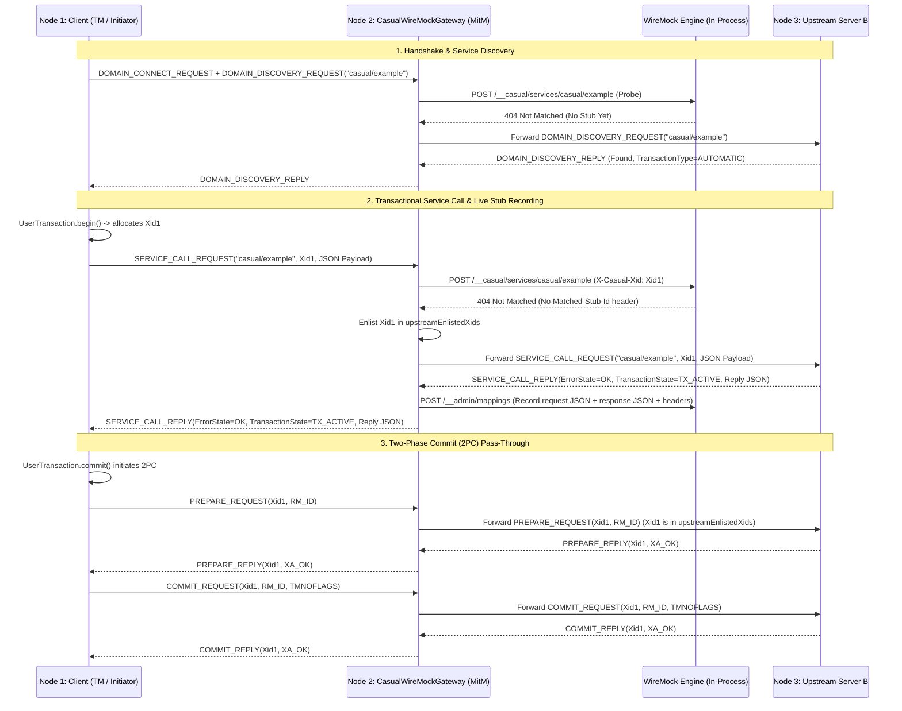
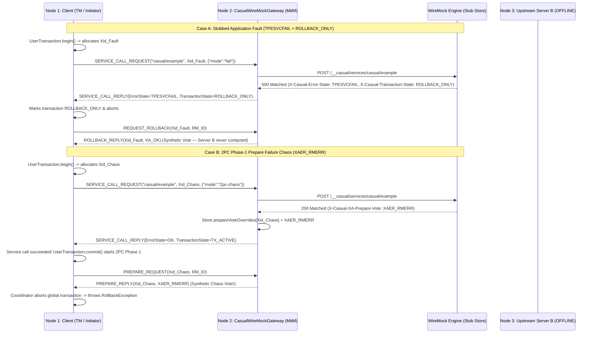

# `wiremock-extension-casual`

In-process **Casual (XATMI / Tuxedo) Domain Gateway & Protocol Simulation Extension** for WireMock Standalone (JDK 21).

Enables WireMock to act as an in-process Casual Domain Gateway listening on a raw TCP port. Clients communicating via Casual wire protocol (`tpcall`, `tpacall`, domain discovery) have their requests intercepted and matched against WireMock stubs—allowing realistic simulation of legacy enterprise, banking, and distributed transaction architectures without requiring a full C++ Casual domain broker, Oracle Tuxedo licenses, or heavy Jakarta EE / Quarkus application servers.

---

## 1. Key Capabilities

* **Pure Java SE 21 + Netty Engine**: High-performance, lightweight in-process server and client utilizing `se.laz.casual:casual-network-protocol` and `casual-api`. Zero Jakarta EE, JCA, WildFly, or Quarkus runtime dependencies.
* **XATMI Domain Handshake & Service Discovery**: Responds to Casual domain connect (`DOMAIN_CONNECT_REQUEST`) and dynamic service discovery (`DOMAIN_DISCOVERY_REQUEST`) handshakes over multiplexed TCP connections.
* **WireMock Stub Engine Integration**: Translates Casual service calls (`tpcall`) to internal WireMock request structures (`POST /__casual/services/{serviceName}`), unlocking WireMock’s full matching engine, JSON body patterns, scenario state machines, response templating, and request journal.
* **Stub Match Discrimination**: Accurately distinguishes matched stubs (flagged with `Matched-Stub-Id`) from unmatched services, preventing accidental short-circuits.
* **Transparent L7 Proxy Forwarding**: Seamlessly forwards unmatched service requests over TCP to an upstream real or secondary Casual domain.
* **Automatic Record-and-Replay**: Automatically captures forwarded upstream calls into persistent WireMock stubs (`recordStubs`), allowing test suites to be recorded once and replayed completely offline.
* **Full XATMI Failure Mode & Transaction Simulation**: Comprehensive simulation of all 18 XATMI error states, custom user return codes (`urcode`), and distributed transaction rollback states.

---

## 2. Architecture & Request Lifecycle

```
┌────────────────────────────────────────────────────────────────────────┐
│                        Casual Client (Java / C++)                      │
│                [tpcall("createOrder", "{...}")]                        │
└───────────────────────────────────┬────────────────────────────────────┘
                                    │ TCP (XATMI Protocol)
                                    ▼
┌────────────────────────────────────────────────────────────────────────┐
│          CasualWireMockGateway (In-Process Netty Server)               │
│                                                                        │
│  1. Decode Frame (CasualFrameDecoder)                                  │
│  2. Dispatch to WireMock (POST /__casual/services/createOrder)         │
└───────────────────┬────────────────────────────────┬───────────────────┘
                    │                                │
      [Stub Matched in WireMock]           [Unmatched Request]
                    │                                │
                    ▼                                ▼
     ┌────────────────────────────┐    ┌───────────────────────────┐
     │ WireMock HTTP Stub Engine  │    │ Upstream Casual Domain    │
     │  - Evaluates body/headers  │    │  (Transparent Forwarding) │
     │  - Returns status/headers  │    └─────────────┬─────────────┘
     └──────────────┬─────────────┘                  │
                    │                                │ [Optional Record]
                    │                                ▼
                    │                  ┌───────────────────────────┐
                    │                  │ Record to WireMock Stubs  │
                    │                  │ (POST /__admin/mappings)  │
                    │                  └─────────────┬─────────────┘
                    │                                │
                    ▼                                ▼
┌────────────────────────────────────────────────────────────────────────┐
│        Synthesize CasualServiceCallReplyMessage & Return TCP Frame     │
│   (Status / X-Casual-Error-State / X-Casual-Transaction-State / urcode) │
└────────────────────────────────────────────────────────────────────────┘
```

---

## 3. XATMI Failure Modes, Error States & Transaction Simulation

The extension faithfully reproduces Tuxedo / XATMI protocol behavior and distributed transaction semantics:

### A. All 18 Casual / XATMI Error States Supported
The gateway inspects the response header `X-Casual-Error-State` (case-insensitive) to set the exact `se.laz.casual.api.flags.ErrorState`:

| ErrorState | Code | Description | Typical HTTP Mapping |
| :--- | :--- | :--- | :--- |
| **`OK`** | 0 | Service call succeeded | `200` |
| **`TPEBADDESC`** | 2 | Invalid descriptor | `400` |
| **`TPEBLOCK`** | 3 | Blocking condition encountered | `429` |
| **`TPEINVAL`** | 4 | Invalid arguments | `400` |
| **`TPELIMIT`** | 5 | Resource limit exceeded | `429` |
| **`TPENOENT`** | 6 | Service does not exist in domain | `404` |
| **`TPEOS`** | 7 | Operating system error | `500` |
| **`TPEPROTO`** | 9 | Protocol violation | `500` |
| **`TPESVCERR`** | 10 | Service error / infrastructure crash | `502` / `503` |
| **`TPESVCFAIL`** | 11 | Application business logic failure with payload | `500` |
| **`TPESYSTEM`** | 12 | System failure | `500` |
| **`TPETIME`** | 13 | Timeout reached | `408` / `504` |
| **`TPETRAN`** | 14 | Transaction error | `500` |
| **`TPGOTSIG`** | 15 | Signal received | `500` |
| **`TPEITYPE`** | 17 | Invalid input buffer type | `415` |
| **`TPEOTYPE`** | 18 | Invalid output buffer type | `406` |
| **`TPEEVENT`** | 22 | Event occurred | `200` |
| **`TPEMATCH`** | 24 | Match error | `500` |

### B. Automatic HTTP Status Fallback
When `X-Casual-Error-State` is omitted from a stub, the gateway infers the appropriate XATMI error code from standard HTTP status conventions:
* **`2xx`** $\rightarrow$ `ErrorState.OK`
* **`400`** $\rightarrow$ `ErrorState.TPEINVAL` (Invalid argument)
* **`404`** $\rightarrow$ `ErrorState.TPENOENT` (Service not found)
* **`408`** / **`504`** $\rightarrow$ `ErrorState.TPETIME` (Timeout)
* **`429`** $\rightarrow$ `ErrorState.TPELIMIT` (Limit exceeded)
* **`502`** / **`503`** $\rightarrow$ `ErrorState.TPESVCERR` (Infrastructure error)
* **`500`** $\rightarrow$ `ErrorState.TPESVCFAIL` (Application failure)

### C. User-Defined Error Codes (`urcode`)
In XATMI, services return custom application codes via `tpreturn(int rval, long rcode, ...)`. Simulate this via:
* **`X-Casual-User-Supplied-Error: <long>`** (or `X-Casual-User-Code` / `X-Casual-User-Defined-Code`)

### D. Transaction State (`TransactionState`)
Simulate distributed transaction status (e.g. marking a transaction rollback-only upon error):
* **`X-Casual-Transaction-State`**:
  * `TX_ACTIVE` (default)
  * `ROLLBACK_ONLY`
  * `TIMEOUT_ROLLBACK_ONLY`
  * `ERROR`

---

## 4. Recording Considerations & Sensible Defaults

When enabling transparent proxy recording (`recordStubs: true`), the gateway enforces battle-tested recording defaults:

| Upstream Result | Nature | Default Recording Behavior | Rationale |
| :--- | :--- | :--- | :--- |
| **`ErrorState.OK`** | Normal success | **Recorded** | Captures golden responses for offline playback. |
| **`ErrorState.TPESVCFAIL`** | Business failure with payload | **Recorded** (if `recordFaults = true`) | Real business validation errors (e.g., account locked) should be preserved in stubs. |
| **`ErrorState.TPENOENT`** | Service not found | **NOT recorded by default** | **Prevents the "Poisoned Missing Stub" problem**: If an upstream service is temporarily undeployed or has a typo during recording, recording a 404 stub permanently blocks future requests from reaching upstream even after the service is restored. |
| **`ErrorState.TPESVCERR`** | Infrastructure failure | **NOT recorded** | Transient upstream network drops/crashes should not be frozen into permanent stubs. |

> 💡 **Opt-in for Negative Test Recording**: If your test suite explicitly tests how client applications react to permanently missing services, enable `.recordNotFound(true)` on the builder.

---

## 5. Usage & Stubbing Examples

### A. Starting the Gateway in Tests
```java
// 1. Start WireMock
WireMockServer wireMock = new WireMockServer(wireMockConfig().dynamicPort());
wireMock.start();

// 2. Start Casual Gateway
CasualWireMockGateway gateway = CasualWireMockGateway.builder()
        .port(0) // dynamic TCP port
        .wireMockBaseUrl(wireMock.baseUrl())
        .build();
gateway.start();

int tcpPort = gateway.getPort();
```

### B. Successful Service Stub with JSON Payload
```java
wireMock.stubFor(post(urlEqualTo("/__casual/services/createOrder"))
        .withRequestBody(equalToJson("{\"amount\": 150.0, \"currency\": \"SEK\"}"))
        .willReturn(aResponse()
                .withStatus(200)
                .withHeader("Content-Type", "application/json")
                .withBody("{\"orderId\": \"ORD-9988\", \"status\": \"CONFIRMED\"}")));
```

### C. Simulating Business Failure with User Code and Rollback
```java
wireMock.stubFor(post(urlEqualTo("/__casual/services/transferFunds"))
        .willReturn(aResponse()
                .withStatus(500)
                .withHeader("Content-Type", "application/json")
                .withHeader("X-Casual-Error-State", "TPESVCFAIL")
                .withHeader("X-Casual-User-Supplied-Error", "4001") // Custom business code
                .withHeader("X-Casual-Transaction-State", "ROLLBACK_ONLY")
                .withBody("{\"error\": \"Insufficient funds\", \"balance\": 4.50}")));
```

### D. Configuring Transparent Upstream Proxy with Recording
```java
CasualWireMockGateway proxyGateway = CasualWireMockGateway.builder()
        .port(7001)
        .wireMockBaseUrl(wireMock.baseUrl())
        .upstream("real-casual-domain.internal", 7000)
        .recordStubs(true)    // Record unmatched upstream responses
        .recordFaults(true)   // Record TPESVCFAIL business errors
        .recordNotFound(false)// Do NOT freeze TPENOENT (keeps missing services open)
        .build();
proxyGateway.start();
```

---

## 6. Test Suite & Verification Matrix

The test suite in [`CasualWireMockGatewayTest`](src/test/java/com/github/mattiasgreen/wiremock/casual/CasualWireMockGatewayTest.java) covers 19 scenarios:

1. **Service Discovery**: Responds to domain connect and queries for registered service names (`shouldDiscoverServices`).
2. **Standard Stubbing**: Faithful serialization and deserialization of JSON payloads via WireMock (`shouldStubCasualServiceCallSuccessfully`).
3. **Unstubbed Fallback**: Returns `TPENOENT` when no stub matches and no upstream is configured (`shouldReturnTpenoentWhenServiceNotFound`).
4. **Matched-Stub-Id Discrimination**: Differentiates intentional 404 stubs from unmatched requests (`shouldDiscriminateMatched404StubFromUnmatchedRequest`).
5. **Payload-Specific Matching**: Dispatches requests based on JSON request body patterns (`shouldMatchSpecificStubBasedOnJsonRequestBody`).
6. **Transparent Proxying**: Forwards unmatched calls to an upstream Casual domain and returns its reply (`shouldForwardUnmatchedRequestToUpstreamCasualServer`).
7. **Transparent Upstream Failure**: Handles upstream communication drops gracefully with `TPESVCERR` (`shouldReturnTpesvcerrWhenUpstreamFails`).
8. **Upstream Stub Recording**: Captures successful upstream calls into WireMock stubs and serves second calls locally (`shouldRecordAndReplayUpstreamStubsWhenRecordStubsEnabled`).
9. **Upstream Fault Recording**: Captures `TPESVCFAIL` application faults with response payloads (`shouldRecordAndReplayUpstreamFaultsWhenRecordStubsEnabled`).
10. **Full XATMI Custom Faults**: Simulates custom `ErrorState` (e.g. `TPETRAN`), custom user codes, and `ROLLBACK_ONLY` (`shouldStubCasualFailureModeWithCustomErrorStateUserCodeAndTxState`).
11. **HTTP Status Code Mapping**: Tests automatic mapping of 400 $\rightarrow$ `TPEINVAL`, 504 $\rightarrow$ `TPETIME`, 429 $\rightarrow$ `TPELIMIT`, and 502 $\rightarrow$ `TPESVCERR` (`shouldMapStandardHttpStatusCodesToCasualErrorStates`).
12. **Safe Recording Defaults**: Verifies `TPENOENT` is not recorded by default and calls continue to fall through to upstream (`shouldNotRecordTpenoentByDefault`).
13. **Explicit NotFound Recording**: Verifies `TPENOENT` is recorded when `recordNotFound(true)` is explicitly configured (`shouldRecordTpenoentWhenRecordNotFoundExplicitlyEnabled`).
14–17. **All TransactionState Modes**: Parameterized test verifying all 4 `TransactionState` enum values (`TX_ACTIVE`, `ROLLBACK_ONLY`, `TIMEOUT_ROLLBACK_ONLY`, `ERROR`) (`shouldStubAllTransactionStatesCorrectly`).
18. **TransactionState Fallbacks**: Verifies fallback to `TX_ACTIVE` when header is missing or malformed (`shouldDefaultToTxActiveWhenTransactionStateHeaderIsMissingOrInvalid`).
19. **Upstream TransactionState Recording**: Verifies upstream transaction states (e.g. `TIMEOUT_ROLLBACK_ONLY`) are recorded into stubs and faithfully replayed (`shouldRecordAndReplayUpstreamTransactionState`).
20. **Synthetic 2PC/XA Voting (`XA_OK`)**: Verifies default `XA_OK` responses for `PREPARE_REQUEST`, `COMMIT_REQUEST`, and `REQUEST_ROLLBACK` on stubbed transactional calls (`shouldReturnXaOkByDefaultForStubbed2pcTransactions`).
21. **2PC Chaos Vote Overrides**: Verifies `X-Casual-XA-Prepare-Vote` (e.g. `XAER_RMERR`) overrides synthetic 2PC voting (`shouldHonorStubbedXaVoteHeadersFor2pcChaosSimulation`).
22. **Transparent 2PC Upstream Forwarding**: Verifies 2PC `PREPARE` and `COMMIT` messages are transparently forwarded to the upstream Casual server when a transactional call was proxied (`shouldTransparentlyForward2pcMessagesToUpstreamCasualServer`).

---

## 7. Multi-Node Integration Test Architecture & Scenario Flyovers

To validate end-to-end distributed transactions (JTA/Narayana 2PC) and transparent Man-in-the-Middle (MitM) behavior without slowing down the inner unit-test loop, `wiremock-extension-casual` provides an isolated integration test suite (`quarkusIntegrationTest`) modeling a 3-node Casual topology:

```
┌─────────────────────────────────────────────────────────────────────────────────────────────────┐
│                         3-Node Casual / WireMock MitM Test Topology                             │
├─────────────────────────────────────────────────────────────────────────────────────────────────┤
│                                                                                                 │
│  ┌─────────────────────────┐       ┌─────────────────────────────────┐       ┌───────────────┐  │
│  │  Node 1: Client Server  │       │   Node 2: WireMock Casual MitM  │       │ Node 3: Real  │  │
│  │   (casual-quarkus A)    │       │     (CasualWireMockGateway)     │       │ Casual Server │  │
│  │                         │       │                                 │       │  (Server B)   │  │
│  │  • REST Endpoint        │       │  • Netty Casual Inbound (:7772) │       │               │  │
│  │  • Narayana JTA TM      │       │  • CasualTransactionHandler     │       │ • Inbound     │  │
│  │  • Outbound Pool ───────┼──────►│  • WireMock HTTP Engine (:8089) │       │   (:7771)     │  │
│  │    (target -> :7772)    │  TCP  │  • Upstream Netty Client ───────┼──────►│ • @CasualSvc  │  │
│  │                         │ Framing│    (upstream -> :7771)         │  TCP  │ • Local XA RM │  │
│  └─────────────────────────┘       └─────────────────────────────────┘       └───────────────┘  │
│                                                                                                 │
└─────────────────────────────────────────────────────────────────────────────────────────────────┘
```

### Scenario Flyover 1: Transparent Proxying & Stub Recording (With 2PC Pass-Through)
When `CasualWireMockGateway` sits between **Node 1 (Client Initiator)** and **Node 3 (Upstream Server B)** with `recordStubs(true)` and an empty WireMock stub store:



* **Key Takeaway**: Because `Xid1` was routed to **Node 3**, the gateway records `Xid1` in `upstreamEnlistedXids` and transparently forwards both `PREPARE_REQUEST` and `COMMIT_REQUEST` to Node 3 so that Node 3's real database/queue resources commit atomically with Node 1's transaction manager. Meanwhile, the service call payload is captured as a reusable WireMock stub.

---

### Scenario Flyover 2: Offline Stubbing, Application Faults & 2PC Chaos Simulation
Once stubs are defined (or recorded from Scenario 1), **Node 3 (Upstream Server B)** can be shut down completely. **Node 2 (`CasualWireMockGateway`)** now acts as both the service endpoint and a **Synthetic XA Resource Manager**:



* **Key Takeaway**: Without running a real upstream Casual server or JEE Transaction Manager inside WireMock, tests can deterministically verify both **application-level rollbacks** (`TPESVCFAIL` + `ROLLBACK_ONLY` during the service call) and **infrastructure-level 2PC commit/prepare hazards** (`XAER_RMERR`, `XA_RBROLLBACK`, `XA_HEURRB` during `UserTransaction.commit()`).

---

## 8. Future Roadmap & Native Matching Engine

See [`TODO.md`](TODO.md) for detailed architectural evaluations, including:
* **In-Process WireMock `Request` Adapter**: Bypassing HTTP loopback sockets to evaluate directly against WireMock’s in-memory `StubMappings` for sub-millisecond ($\sim 50\mu\text{s}$) latency.
* **Native Custom Matchers**: Adding a `RequestMatcherExtension` (`CasualFieldedMatcher`) to unpack and match on `.FIELDED` / FML binary buffers without requiring string conversions.
* **Upstream Contributions**: Upstreaming standalone Java SE Netty client and server components to `casualcore/casual-java`.

