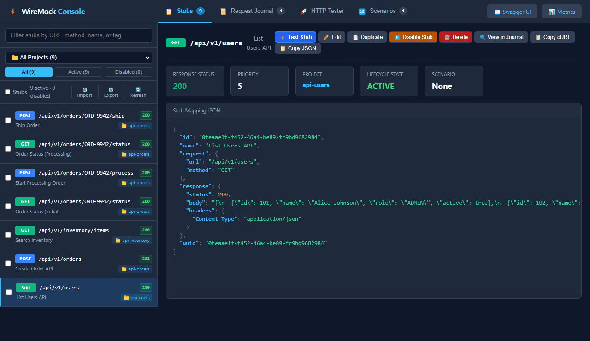
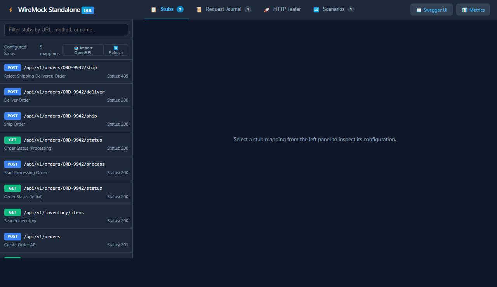
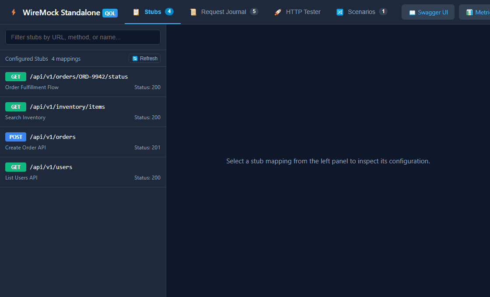
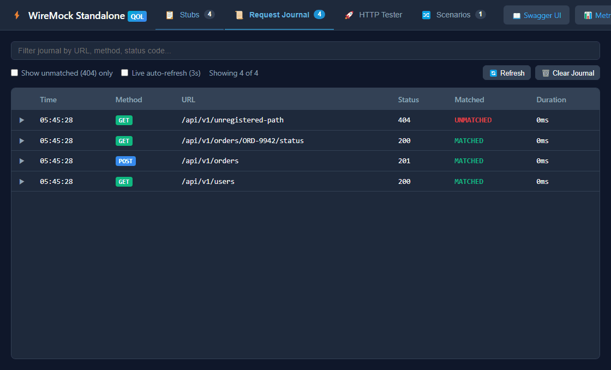
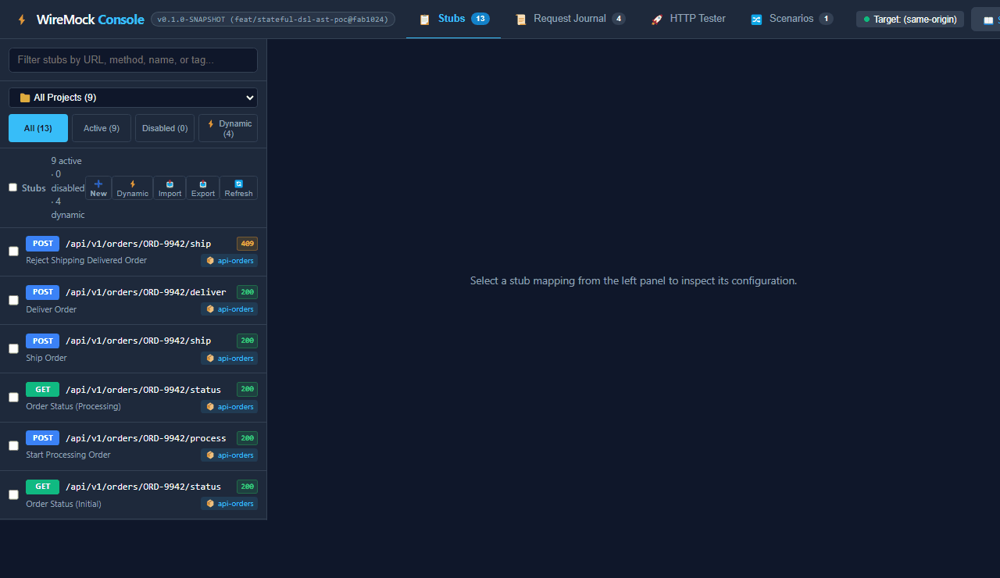
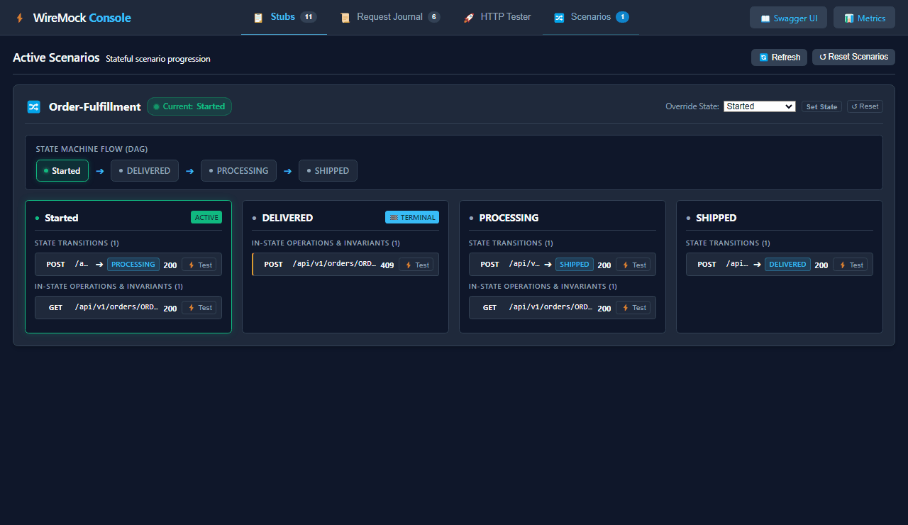

# WireMock Console (UI Extension)

A lightweight, self-contained web user interface for exploring stubs, inspecting the request journal, and testing HTTP endpoints directly from WireMock.

## Problem Statement

WireMock standalone exposes administration capabilities exclusively through raw JSON REST endpoints (`/__admin/mappings`, `/__admin/requests`). While scriptable, developers and QA engineers frequently need to:
- Visually browse, search, and inspect configured stubs and scenario states.
- Diagnose why an incoming request matched or failed to match a stub.
- Test and debug live HTTP requests against WireMock without switching to external tools like Postman or terminal curl commands.
- Share direct links to specific stubs, journal records, or test queries with teammates.

Most third-party UIs require external Node.js runtimes, Docker containers, or public CDN scripts that violate air-gapped security policies.

## How It Addresses the Problem

This extension embeds a pure vanilla ES6 Single-Page Application directly inside the JAR. It mounts seamlessly under WireMock's admin endpoint at `/__admin/ui/`.
- Zero external runtime or build dependencies (no npm, webpack, or CDNs required).
- Completely self-contained and safe for restricted/air-gapped networks.
- Full hash-based URL addressability so views, filters, stubs, and tester queries can be bookmarked and shared.



## Features

- **End-to-End OpenAPI Import & Testing Workflow**:
  - One-click import hub for OpenAPI 3.0 / 3.1 specifications (YAML or JSON) and WireMock bundles.
  - Choice between **Synthetic Stubs** (format-aware data generator) and **Live Transparent Proxy** (proxies requests to upstream live service with auto-discovered `servers:` block).
  - Direct handoff into the HTTP Tester with persistent Stubs Explorer on the left, request/response inspector, and collapsible vertical history sidebar.
  - Inspect live traffic matching and response verification in the Request Journal.

- **Live Proxy Recording & Project Lifecycle**:
  - Group stubs and proxies into distinct **Projects**.
  - **One-Click Snapshot Recording**: Record actual traffic forwarded to the upstream service directly from the request journal into captured stubs parked as `DISABLED` so they do not collide with active proxying.
  - **Project Mode Flip**: Toggle between **LIVE PROXY** mode and offline **STUBS MODE** in one click. Flipping to `STUBS MODE` disables the proxy stubs and activates the authentic recorded stubs, enabling 100% offline testing.



- **Stub Explorer, Dual-Mode Editor & Lifecycle**:
  - Filter stubs instantly by HTTP method, URL pattern, stub name, project, or lifecycle state.
  - Create brand new stubs from scratch via `➕ New` without needing an OpenAPI spec or bundle.
  - **Dual-Mode Stub Editor**: Seamlessly toggle between **Form Mode** and full-fidelity **Raw JSON Mode** (`#btn-editor-mode-json`) with live roundtrip synchronization, syntax error diagnostics, and formatted indentation.
  - Seamless lifecycle management: edit both active and disabled stubs safely with zero 404 errors.
  - View full JSON mapping definitions with syntax highlighting (keys, strings, numbers, booleans, null, punctuation).
  - One-click copy for JSON stubs and generated `curl` commands.
  - **⚡ Test Stub** button transitions directly into the HTTP Tester with pre-populated URL, method, headers, and body while keeping the stubs sidebar visible.

- **Interactive HTTP Request Tester**:
  - Send requests directly to WireMock with custom methods, headers, and request bodies.
  - Full-height dual pane: Request Builder on the left, Response Inspector on the right (Response, Sent Request, or Both).
  - Dedicated collapsible vertical execution history sidebar with timestamps, status badges, response sizes, and one-click restoration.
  - Persistent header presets (`+ JSON`, `+ Bearer`, `+ Accept`) and JSON body formatter.



- **Request Journal Viewer & Snapshot Recording**:
  - Search and filter recorded requests by method, URL, or matching status (`PROXIED`, `STUB`, `STATEFUL`, `UNMATCHED`).
  - Expandable inline inspector showing request headers/body and corresponding response definition.
  - **Inline Base64-Decoded JSON Inspection**: Automatically detects Base64-encoded JSON in request and response payloads, providing interactive `[Raw]` / `[Decoded]` view toggle pills.
  - **1-Click Exact-Match Snapshotting**: Save proxied requests as static offline stubs (`📸 Snapshot Stub`) with exact request body matching (`equalToJson`, `equalTo`, `binaryEqualTo`), preventing collision when multiple requests target the same endpoint.
  - Highlights matched vs. unmatched status with visual badges.
  - Dedicated localized toolbar actions to refresh or clear the journal log.



- **Scenario DAG State Machine Visualizer**:
  - Automatic extraction of state machines and transitions across all configured stubs.
  - Interactive pipeline flow showing all stages (Started, in-progress stages, terminal states).
  - Real-time active state glow indicator synchronized with live scenario progress.
  - State operations & rejection invariants inspector with one-click **⚡ Test** triggers.
  - Per-scenario targeted controls: override scenario state on the fly or reset individual scenarios to `Started`.

- **Dynamic Stateful API Simulation**:
  - Unified explorer listing both declarative stubs and `[⚡ DYNAMIC]` stateful simulation stubs with route scope indicators (e.g. `/api/v1/cases/*/close`).
  - Dedicated **Stateful Specification Inspector** detailing entity schemas, path parameter mappings, mutations (`set_field`, `append_to_list`, `increment`), and invariant guard conditions.
  - **Dynamic Stub Bootstrapper Modal**: Pre-packaged templates (*Case Management with tasks*, *Order Fulfillment with items*) with interactive JSON schema editing.
  - **Invariant Violation Diagnostics**: Direct transition to HTTP Tester and immediate visual tracing of invariant rejections (e.g., HTTP 409 responses) in the Request Journal with passed/violated badges.





- **URL Addressability & Deep Linking**:
  - All tabs, selected stubs, journal details, and tester inputs synchronize with the URL hash (e.g. `#stubs?stubId=...`, `#tester?method=POST&url=...`).
- **Swagger UI Integration**:
  - Relative neighbor link to `../swagger-ui/` for environments where Swagger UI is co-hosted.
- **Developer Hot-Reloading**:
  - During local development, the endpoint detects local resources on disk and reloads HTML/CSS/JS without restarting the server.

## Usage

### Dependency Coordinates

**Gradle**:
```groovy
implementation 'io.github.mattiasgreen:wiremock-extension-ui:1.6.0'
```

**Maven**:
```xml
<dependency>
    <groupId>io.github.mattiasgreen</groupId>
    <artifactId>wiremock-extension-ui</artifactId>
    <version>1.6.0</version>
</dependency>
```

### Standalone CLI

Add the JAR to the classpath:

```bash
java -cp "wiremock-extension-ui-1.6.0.jar:wiremock-standalone-3.12.1.jar" \
  com.github.tomakehurst.wiremock.standalone.WireMockServerRunner \
  --port 8080
```

Open `http://localhost:8080/__admin/ui/` in your browser.

### Embedded Java

```java
import com.github.mattiasgreen.wiremock.ui.UiAdminApiEndpoint;
import com.github.tomakehurst.wiremock.WireMockServer;
import com.github.tomakehurst.wiremock.core.WireMockConfiguration;

WireMockServer wm = new WireMockServer(WireMockConfiguration.options()
    .port(8080)
    .extensions(new UiAdminApiEndpoint()));
wm.start();
```

When the JAR is on the classpath, the extension registers automatically via Java SPI.

## WireMock Studio (Zero-Dependency Desktop Web Container & Reverse Proxy)

In addition to serving the web console embedded in WireMock at `/__admin/ui/`, a standalone desktop container is provided as a **single, zero-dependency Java file** ([`WireMockStudio.java`](file:///c:/dev/repos/wiremock-extensions/WireMockStudio.java)).

It combines an embedded JDK 21 `HttpServer` with a transparent, CORS-free reverse proxy:
* **100% Web UI Reuse**: Serves the identical Vanilla JS Web UI at `http://localhost:19840/__admin/ui/`, completely eliminating double implementation and keeping every feature in sync.
* **Zero CORS Restrictions**: All administrative and application routes are proxied directly to the upstream WireMock server over raw HTTP via JDK 21 `HttpClient`, enabling seamless connections to remote staging environments, Docker containers, or local instances without browser origin errors.
* **Native Desktop Window**: Automatically launches in app mode using local Chromium (`--app=http://localhost:19840/__admin/ui/`) with fallback to the default system browser and a minimalist desktop companion controller.

### Instant Run (No build or clone required)

* **Linux / macOS**:
  ```bash
  curl -sLO https://raw.githubusercontent.com/mattiasgreen/wiremock-extensions/main/WireMockStudio.java
  java WireMockStudio.java http://localhost:8080
  ```

* **Windows (PowerShell)**:
  ```powershell
  Invoke-WebRequest -Uri "https://raw.githubusercontent.com/mattiasgreen/wiremock-extensions/main/WireMockStudio.java" -OutFile "WireMockStudio.java"
  java WireMockStudio.java http://localhost:8080
  ```

* **From within this repository**:
  ```bash
  # Option 1: Direct JEP 330 script
  java WireMockStudio.java

  # Option 2: Gradle task
  ./gradlew :wiremock-extension-ui:runDesktop
  ```

### Automated Verification
* Web SPA: Playwright integration tests (`UiPlaywrightTest`)
* In-Browser Headless Unit Tests: Direct ES module verification (`UiModuleUnitTest`)
* Desktop Container & Reverse Proxy: In-memory WireMock tests (`WireMockStudioTest`)

```bash
./gradlew :wiremock-extension-ui:test
```

## Testing Strategy & Roadmap

### Test Pyramid Rebalancing (TODO)

To maintain high development velocity and fast feedback loops while honoring the **Zero NPM / Zero JS Bundlers** constraint, we are shifting verification toward the foundation of the test pyramid:

```
          /  E2E Playwright Tests  \         <-- High fidelity (DOM layout, visual regressions, full browser navigation)
         /   (UiPlaywrightTest.java) \
        /-----------------------------\
       /  In-Browser Headless Modules  \      <-- Blazing fast (<2s execution, pure logic & algorithms)
      /    (UiModuleUnitTest.java)      \
     /-----------------------------------\
```

#### Priority Feature Areas for Unit-Level Migration

1. **Query Parsing & Deep Filtering (`modules/filter.js`)**:
   - Complex nested boolean expressions (`AND`, `OR`, whitespace precedence).
   - Deep inspection across headers, query parameters, body patterns, JSON payloads, and custom `metadata` (e.g. correlation IDs, customer/tenant attributes).
2. **cURL Command Generator (`modules/stubs.js` -> `generateCurl`)**:
   - Escaping single/double quotes, newlines, binary bodies, query string formatting, and corporate header synthesis.
3. **Stateful Scenario & DAG State Transitions (`modules/scenarios.js`)**:
   - Extracting scenario definitions, topological DAG ordering, cycle detection, and terminal state resolution.
4. **Router & Deep-Link Hash Serialization (`modules/router.js`)**:
   - Encoding/decoding query parameters (`#tester?m=POST&p=...`), active tab switching, and state restoration on hash change.
5. **JSON Highlighter & Formatter (`modules/highlighter.js`)**:
   - Tokenization edge cases, HTML entity escaping, null/boolean coloring, and large payload truncation.
6. **Dynamic Stateful Model Normalizer (`modules/dynamic-stubs.js`)**:
   - Converting in-memory AST schemas, routes, and mutation specifications into virtual stub mappings.
