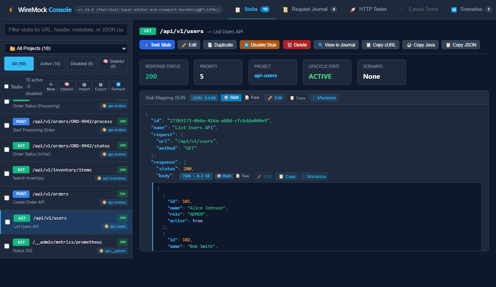
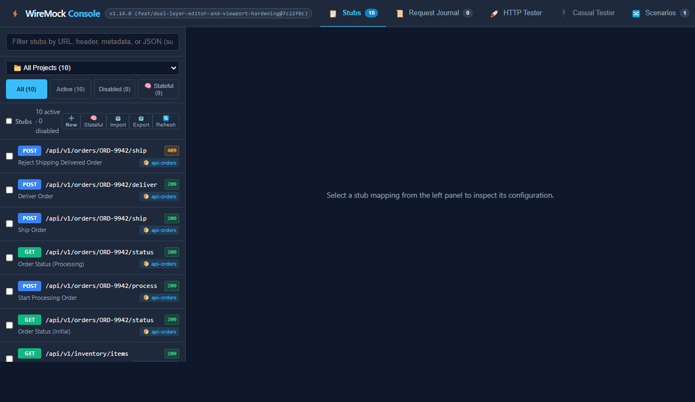
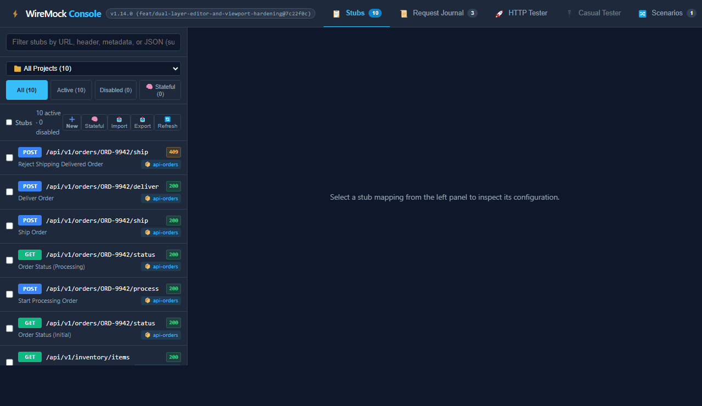
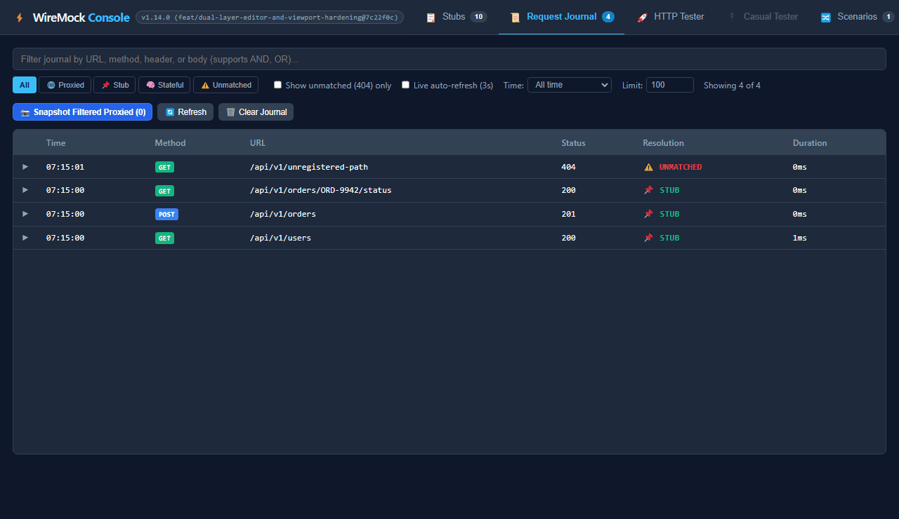
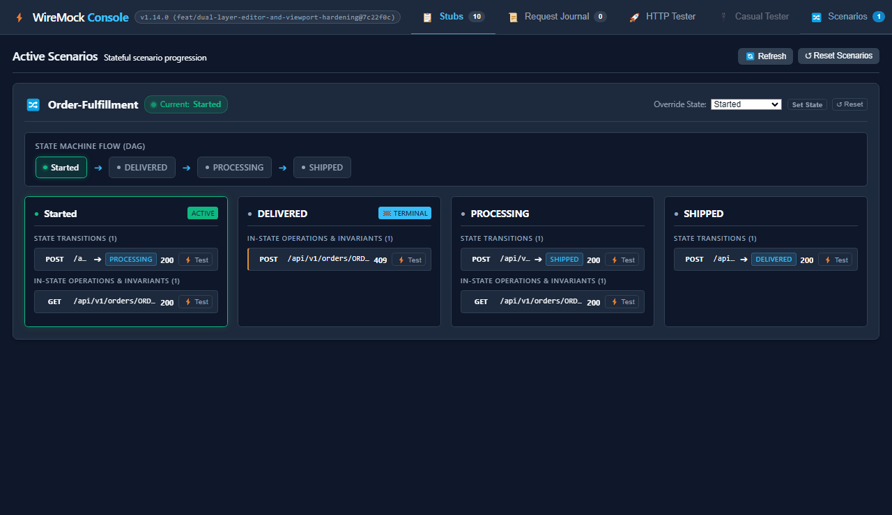

# WireMock Console (UI Extension)

A lightweight, self-contained web user interface for exploring stubs, inspecting the request journal, visualizing scenario state machines, and testing HTTP, Kafka, AMQP, and Casual XATMI endpoints directly from WireMock.

## Problem Statement

WireMock standalone exposes administration capabilities exclusively through raw JSON REST endpoints (`/__admin/mappings`, `/__admin/requests`). While scriptable, developers and QA engineers frequently need to:
- Visually browse, search, and inspect configured stubs and scenario states.
- Diagnose why an incoming request matched or failed to match a stub.
- Test and debug live HTTP requests against WireMock without switching to external tools like Postman or terminal curl commands.
- Share direct links to specific stubs, journal records, or test queries with teammates.

Most third-party UIs require external Node.js runtimes, Docker containers, or public CDN scripts that violate air-gapped security policies.

## How It Addresses the Problem

This extension embeds a pure vanilla ES6 Single-Page Application directly inside the JAR. It mounts seamlessly under WireMock's admin endpoint at `/__admin/ui/`.
- Zero external runtime or build dependencies (no npm, webpack, or CDNs required).
- Completely self-contained and safe for restricted/air-gapped networks.
- Full hash-based URL addressability so views, filters, stubs, and tester queries can be bookmarked and shared.



## Features

- **End-to-End OpenAPI & Bundle Import Hub**:
  - One-click import modal (`#openapi-modal`) for OpenAPI 3.0 / 3.1 specifications (YAML or JSON) and WireMock JSON bundles, with inline `PolyglotViewer` preview and `✏️ Paste / Edit in Workspace` (`#modal-document-workspace`).
  - Choice between **Synthetic Stubs** (format-aware data generator) and **Live Transparent Proxy** (proxies requests to upstream live service with auto-discovered `servers:` block).
  - Direct handoff into the full-width Multi-Protocol Tester, with request/response inspector and collapsible execution history sidebar.

- **Live Proxy Recording & Project Lifecycle**:
  - Group stubs and proxies into distinct **Projects**.
  - **One-Click Snapshot Recording**: Record actual traffic forwarded to the upstream service directly from the request journal into captured stubs parked at `priority >= 100` (`DISABLED`) so they do not collide with active proxying.
  - **Project Mode Flip**: Toggle between **LIVE PROXY** mode and offline **STUBS MODE** in one click via native priority tiers (`metadata.previousPriority` round-trip).



- **Stub Explorer, Unified Document Workspace & Polyglot Payload Engine**:
  - Filter stubs instantly by HTTP method, URL pattern, stub name, project, lifecycle state (`All` / `Active` / `Disabled`), and boolean expressions (`AND`, `OR`), with visibility-scoped bulk actions (`getVisibleSelectedStubIds`).
  - **Unified Document Workspace (`#modal-document-workspace`)**: `➕ New`, `✏️ Edit`, `📄 Duplicate`, and `⛶ Open in Workspace` open in the foldable **Polyglot Tree Viewer** (`polyglot-viewer.js`) first—auto-unnesting embedded JSON, XML (CDATA/entities), Java `Map.toString()` `{k=v}` KV (`pseudo-json.js`), and Base64 payloads with charset detection (`UTF-8`, `ISO-8859-1`, `WINDOWS-1252`, `KOI8-R`, `US-ASCII` via `charset-codec.js`).
  - **Focused Section Editor & Exact-Span Splicing**: Clicking `✏️ Edit Document` or `✏️ Edit Section` transitions into `code-editor.js` (defaulting in-memory to `<pre contenteditable="plaintext-only">` + `CSS.highlights`, with hot-swappable fallback to the dual-layer `<textarea>` engine). Clicking `✓ Apply Section` splices edits back using exact `[start, end]` character spans (`polyglot-ast.js`, preserving compact vs. multi-line wire style) before `💾 Save`.
  - Clean Stub Detail toolbar with grouped `📋 Copy ▾` (`Copy cURL`, `Copy Java`, `Copy JSON`) and `••• More ▾` (`Duplicate`, `Delete`) menus, Promise-based confirmation dialogs (`#modal-confirm`), and non-blocking toast notifications (`#toast-container`).
  - **⚡ Test Stub** button transitions directly into the full-width Multi-Protocol Tester with pre-populated URL, method, headers, and body.

- **Unified Multi-Protocol Request Tester (`PROTOCOL_ADAPTERS`)**:
  - Dispatch requests across **HTTP**, **Kafka**, **AMQP 1.0**, and **Casual XATMI** using one shared headers editor (with isolated per-protocol drafts), one adaptive Send button (`#btn-tester-send`), `PolyglotViewer` + Document Workspace payload editor, and on-click shareable links (`#btn-tester-share-link`).
  - Full-height dual pane: Request Builder on the left, Response / Sent Request Inspector on the right (Formatted, Raw, or Hex Dump for binary Casual replies).
  - Collapsible protocol-filterable execution history sidebar with timestamps, status badges, response sizes, and one-click restoration.
  - Protocol-specific header presets and browser-persistent corporate headers (for HTTP) with dynamic macros (`{{uuid}}`, `{{now}}`, `{{timestamp}}`).



- **Request Journal Viewer & Snapshot Recording**:
  - Search and filter recorded requests by method, URL, caller source (`src:` / `ip:` / `host:` with async reverse-DNS hostname resolution), protocol (`HTTP`, `Kafka`, `AMQP`, `Casual`), or verdict (`PROXIED`, `BRIDGED`, `STUB`, `STUB · TPL`, `UNMATCHED`, `PROXY_ERROR`).
  - Expandable inline inspector with `PolyglotViewer` trees, Document Workspace drill-down, and interactive Base64 `[Raw]` / `[Decoded]` toggle pills.
  - **1-Click Exact-Match Snapshotting**: Save proxied requests as static offline stubs (`📸 Snapshot Stub`) with configurable JSON path exclusions, preventing collision when multiple requests target the same endpoint.



- **Scenario DAG State Machine Visualizer**:
  - Automatic extraction of state machines and transitions across all configured stubs.
  - Interactive pipeline flow showing all stages (Started, in-progress stages, terminal states) with live active state indicator, per-state **⚡ Test** triggers, state override, and reset controls.



- **Unified Console Settings & Explicit Lazy Demo Mode**:
  - 4-tab Settings modal (`#modal-settings`) combining **Target Host** (plus the 7-extension Detected Server Capabilities matrix), **Persistent Headers**, **JSON Exclusions**, and clipboard **Import / Export** config sync.
  - Explicit **Demo Mode** (`?demo=true`, `file://`, `github.io`, or `✨ Demo Mode` button) dynamically loads `demo-backend.js` and `demo-snapshot.js` (generated from a live in-process `WireMockServer` via `:wiremock-extension-ui:generateDemoSnapshot`) with zero silent error failover.

- **Lifecycle Admin Endpoints (`/__admin/lifecycle/*`) & Journal API**:
  - `GET /__admin/lifecycle/status`: Capability health probe (`{"status":"UP"}`).
  - `POST /__admin/lifecycle/snapshots`: Unified traffic-to-stub snapshot endpoint supporting whole-project (`{"project":"..."}` or `_all`) and filtered request-ID captures (`{"requestIds":[...]}`).
  - `POST /__admin/lifecycle/snapshot-template`: Generates an editable `StubMapping` template from a single journal event.
  - `POST /__admin/lifecycle/projects/{project}/mode`: Switches a project (or `_all`) between `proxy` and `stubs` modes using priority-tier parking.
  - `GET /__admin/ui/api/requests`: Server-side journal search and caller source enrichment (`sourceIp`, `sourceHost`).

- **URL Addressability, Swagger UI & Developer Hot-Reloading (`UiAssetLoader`)**:
  - Tabs, selected stubs, and journal filters synchronize with the URL hash (`#stubs?stubId=...`, `#journal?q=...`), while Tester share links encode full request state on click (`#btn-tester-share-link`).
  - Relative neighbor link to `../swagger-ui/` (rewritten automatically when targeting a remote WireMock host).
  - `UiAdminApiEndpoint` resolves static HTML/CSS/ES6 modules and `/__admin/ui/version` through `UiAssetLoader`, checking local dev resource directories first with path-traversal protection before falling back to `UiAssetLoader.class.getResourceAsStream(...)`, while `WireMockConsoleProxy` remains self-contained for zero-compile JEP 330 execution.

## Usage

### Dependency Coordinates

**Gradle**:
```groovy
implementation 'io.github.mattiasgreen:wiremock-extension-ui:1.14.0'
```

**Maven**:
```xml
<dependency>
    <groupId>io.github.mattiasgreen</groupId>
    <artifactId>wiremock-extension-ui</artifactId>
    <version>1.14.0</version>
</dependency>
```

### Standalone CLI

Add the JAR to the classpath:

```bash
java -cp "wiremock-extension-ui-1.14.0.jar:wiremock-standalone-3.12.1.jar" \
  com.github.tomakehurst.wiremock.standalone.WireMockServerRunner \
  --port 8080
```

Open `http://localhost:8080/__admin/ui/` in your browser.

### Embedded Java

```java
import com.github.mattiasgreen.wiremock.ui.UiAdminApiEndpoint;
import com.github.tomakehurst.wiremock.WireMockServer;
import com.github.tomakehurst.wiremock.core.WireMockConfiguration;

WireMockServer wm = new WireMockServer(WireMockConfiguration.options()
    .port(8080)
    .extensions(new UiAdminApiEndpoint()));
wm.start();
```

When the JAR is on the classpath, the extension registers automatically via Java SPI.

## WireMock Console Proxy (Zero-Dependency Reverse Proxy & Standalone UI Server)

In addition to serving the web console embedded in WireMock at `/__admin/ui/`, a self-contained reverse proxy is provided as a **single, zero-dependency Java file** ([`WireMockConsoleProxy.java`](src/main/java/com/github/mattiasgreen/wiremock/ui/WireMockConsoleProxy.java)).

It combines an embedded JDK 21 `HttpServer` (backed by virtual threads) with a transparent, CORS-free reverse proxy:
* **100% Web UI Reuse**: Serves the identical Vanilla ES6 Web UI at `http://localhost:19840/__admin/ui/` against any local, Docker, or vanilla WireMock instance.
* **Zero CORS Restrictions**: Administrative and application routes are proxied upstream via JDK 21 `HttpClient` using `X-Forwarded-Host`, `X-Forwarded-Proto`, and `X-Forwarded-Prefix` routing headers.

### Launch Options

```bash
# Option 1: Direct JDK 21 JEP 330 launch (0s compile)
java wiremock-extension-ui/src/main/java/com/github/mattiasgreen/wiremock/ui/WireMockConsoleProxy.java http://localhost:8080

# Option 2: WireMock CLI wrapper
./wiremock-cli/bin/wm proxy http://localhost:8080

# Option 3: Gradle task
./gradlew :wiremock-extension-ui:runProxy -Pwiremock.url=http://localhost:8080
```

### Automated Verification & Demo Snapshot Generation

```bash
# Run static contracts, ES6 unit tests, and Playwright E2E suites
./gradlew :wiremock-extension-ui:test

# Regenerate demo-snapshot.js from a live in-process WireMockServer
./gradlew :wiremock-extension-ui:generateDemoSnapshot
```

## Verification Pyramid

While honoring the **Zero NPM / Zero JS Bundlers** constraint, verification spans three fast, layered tiers:

1. **Static Contracts & Snapshot Parity**:
   - `UiAssetAndContractTest`: Verifies relative ES6 imports, zero circular imports involving `stubs.js`, air-gapped asset constraints, and `index.html` <-> `dom.js` ID contracts.
   - `DemoSnapshotContractTest`: Validates `DemoSnapshotGenerator` and checked-in `modules/demo-snapshot.js` schema parity.
   - `WireMockConsoleProxyTest`: Verifies standalone reverse proxy forwarding, CORS headers, and static asset loading.
2. **In-Browser Headless ES6 Unit Tests (`UiModuleUnitTest`)**:
   - Directly imports and verifies ES6 modules inside headless Chromium: `filter.js` (including `src:` / `ip:` / `host:` and Java/JS parity), `charset-codec.js`, `pseudo-json.js`, `polyglot-ast.js`, `document-workspace.js`, `bulk-actions.js`, `settings.js`, `stub-catalog.js`, `request-journal.js`, `tester.js`, `queues.js`, and `demo-backend.js`.
3. **Domain Playwright E2E Suites (`AbstractUiPlaywrightTest` & Specialized Specs)**:
   - `UiStubsAndLifecyclePlaywrightTest`, `UiJournalAndTesterPlaywrightTest`, `UiOpenApiPlaywrightTest`, `UiPayloadEditorPlaywrightTest`, `UiDemoModePlaywrightTest`, `UiVanillaWireMockPlaywrightTest`, `UiScenariosAndStatefulPlaywrightTest`, `UiNetEmPlaywrightTest`, `UiQueuesAndTopicsPlaywrightTest`, and `UiCasualTesterPlaywrightTest`.
